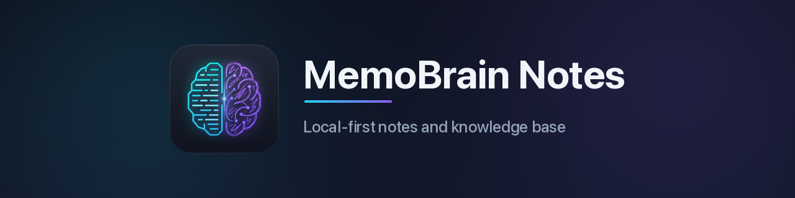

<p align="center">
  
</p>

**MemoBrain Notes** è un'app di knowledge management _local-first_. Le note sono file Markdown ordinari in una cartella (il _vault_), compatibile con i vault di Obsidian: l'app funziona completamente offline e il cloud è facoltativo.

- **Client desktop** (macOS, Windows, Linux) basato su Wails: editor CodeMirror con Live Preview, link e backlink, grafo, ricerca full-text, canvas (`.canvas`), disegni Excalidraw (`.excalidraw`), Bases (`.base`),
  template, note giornaliere, presentazioni e cronologia delle versioni.
- **Cloud Service** self-hosted (Go, PostgreSQL, storage S3-compatibile, autenticazione Keycloak/OIDC) per sincronizzare i vault tra dispositivi e condividerli con utenti e gruppi. Il merge avviene sempre sul
  client: il server ordina le modifiche e archivia i contenuti senza interpretarli.
- **Due tipi di vault cloud:** _privati_, cifrati end-to-end sul client (il server non vede né i nomi né il contenuto dei file), e _condivisi_, collaborativi con altri utenti.
- **Web UI** incorporata nel cloud: console utente e amministrazione, e la stessa interfaccia del desktop nel browser per aprire e modificare i vault.

## Installazione

### App desktop

Scaricare l'installer dalla pagina [Releases](https://github.com/E2BR/MemoBrain/releases) e verificarlo
con `SHA256SUMS` (`sha256sum -c SHA256SUMS`).

| Sistema | Pacchetto                                 | Requisiti                          |
| ------- | ----------------------------------------- | ---------------------------------- |
| macOS   | `.dmg` universale (Apple Silicon e Intel) | trascinare l'app in _Applicazioni_ |
| Windows | installer NSIS (amd64)                    | Windows 10/11 con WebView2 Runtime |
| Linux   | `.deb` o AppImage (amd64)                 | `webkit2gtk-4.1`                   |

Gli installer al momento **non sono firmati**: al primo avvio Gatekeeper (macOS) o SmartScreen (Windows)
chiedono conferma. Non c'è un installer per Windows arm64 (tolto nella 1.2.3) né per Linux arm64, e
l'aggiornamento automatico è disattivato in queste build: le nuove versioni si installano a mano. All'avvio si apre o si crea un vault: per la sincronizzazione inserire l'URL del server
in _Impostazioni → Cloud_. Dettagli nella [guida utente](docs/user-guide/installazione.md).

### Cloud Service

Il servizio è un unico binario (`memobrain-cloud --role=api|worker|all`) distribuito come immagine
container multi-arch su GHCR, con la Web UI inclusa. Richiede PostgreSQL 15+, uno storage S3-compatibile
(RustFS, MinIO, AWS S3) e un realm Keycloak.

- **Kubernetes:** chart Helm in [`deploy/helm/memobrain`](deploy/helm/memobrain)
  ```sh
  helm upgrade --install memobrain deploy/helm/memobrain -n memobrain --create-namespace -f my-values.yaml
  ```
- **Docker Compose** per installazioni piccole, con proxy TLS: [`deploy/compose`](deploy/compose).

Procedura completa, segreti, configurazione e verifica nella [guida di amministrazione](docs/admin-guide/installazione.md).

## Ambiente di sviluppo

### Prerequisiti

| Strumento | Versione       | Note                                                                                                                                       |
| --------- | -------------- | ------------------------------------------------------------------------------------------------------------------------------------------ |
| Go        | 1.27.x         | con `GOTOOLCHAIN=auto` (default) il toolchain viene scaricato se manca                                                                     |
| Wails CLI | v2.17.x        | `task wails-cli` (versione letta da `apps/desktop/go.mod`); `wails doctor` deve risultare "ready" (Xcode CLT, WebView2 o `webkit2gtk-4.1`) |
| Node      | 24 LTS         | vedi `.nvmrc`                                                                                                                              |
| Yarn      | 4.18.1         | `corepack enable` (versione bloccata da `packageManager`; npm e pnpm sono bloccati)                                                        |
| Docker    | con Compose v2 | solo per lo stack del cloud (PostgreSQL, RustFS, Keycloak)                                                                                 |
| Task      | v3.54.x        | `cd tools && GOWORK=off go install github.com/go-task/task/v3/cmd/task` (versione pinnata)                                                 |

### Preparazione

```sh
git clone git@github.com:E2BR/MemoBrain.git && cd MemoBrain
corepack enable
# Installa TASK da https://taskfile.dev/docs/installation
task tools   # tool Go pinnati (golangci-lint, buf, sqlc, oapi-codegen, …) + yarn install
task gen     # codice generato: OpenAPI → Go/TS, proto, sqlc, flag del Config Profile, binding Wails,
             # eventi, capability e FeatureId (elenco in CONTRIBUTING.md, «File generati»)
```

Il repository è un monorepo: `go.work` unisce i moduli Go (`shared/go`, `services/cloud`, `apps/desktop`),
i pacchetti TypeScript sono un workspace Yarn (`packages/*`, `web`).

### Avvio

```sh
task run-desktop        # app desktop standalone (senza cloud né Docker) con un vault demo
```

Con il cloud:

```sh
task stack-up           # PostgreSQL :5433, RustFS (S3) :9000, Keycloak :8080 (admin/admin)
task dev-cloud          # cloud su http://127.0.0.1:18081 (Web UI e API)
task dev-desktop        # app desktop con hot reload del frontend
```

In alternativa `task run-desktop-cloud` avvia stack, cloud e desktop insieme (`task run-desktop-2devices`
simula due dispositivi); `task dev-stop` ferma tutto. Utenti di prova: `admin`, `user1`, `user2`, password
`memobrain-dev-password`.

### Verifiche

```sh
task lint               # golangci-lint, eslint, prettier
task test               # go test -race, vitest, fixture di conformance Go/TS
task e2e                # Playwright (Chromium) su UI desktop e Web UI
task test-integration   # cloud con testcontainers (PostgreSQL, MinIO, Keycloak)
task ci                 # verifica completa: da eseguire prima di ogni merge e di ogni tag
task --list             # elenco completo dei task
```

Il progetto **non ha un servizio di CI** ([ADR-0036](docs/adr/0036-verifiche-locali-senza-ci.md)):
`task ci` è il controllo ufficiale e va eseguito, verde, prima di un merge su `main` e prima di creare un
tag di rilascio. Oltre a lint e test comprende typecheck, govulncheck, test del core in WebAssembly
(`task test-wasm`), i pannelli cloud sul core WebAssembly contro un cloud finto validato sull'OpenAPI
(`task test-core`), controllo di parità desktop/web e del codice generato. Le suite lente (integrazione,
sync a due dispositivi e contract test, e2e Playwright, client misti, cloud vero) sono elencate in [docs/dev-setup.md](docs/dev-setup.md#verifiche) e si eseguono quando si
tocca l'area relativa e prima di un rilascio. L'unico workflow GitHub, `release.yml`, parte da un tag e
costruisce e pubblica immagine, chart e installer senza eseguire controlli.

Altri dettagli (script di debug, test singoli, WebAssembly, parità) in [docs/dev-setup.md](docs/dev-setup.md);
piano di sviluppo in [docs/roadmap.md](docs/roadmap.md).

## Struttura del repository

| Percorso                          | Contenuto                                                                                                                                                                            |
| --------------------------------- | ------------------------------------------------------------------------------------------------------------------------------------------------------------------------------------ |
| `apps/desktop`                    | client desktop Wails v2: core Go (`internal/`: vault, indice, link, sync, crittografia, binding), entry del frontend ed e2e                                                          |
| `apps/desktop/cmd/memobrain-core` | lo stesso core Go compilato in WebAssembly per il workbench nel browser                                                                                                              |
| `services/cloud`                  | Cloud Service: binario `memobrain-cloud`, moduli in `internal/<modulo>`, migrazioni, test d'integrazione, Web UI incorporata                                                         |
| `web`                             | Web UI: console utente e amministrazione (`src/pages`) e host del workbench nel browser (`src/workbench`)                                                                            |
| `packages/workbench`              | `@memobrain/workbench`: l'interfaccia del vault (editor, pannelli, comandi), condivisa da desktop e Web UI                                                                           |
| `packages/cloud-features`         | `@memobrain/cloud-features`: gestione dei vault cloud scritta una volta per console, desktop e workbench (ADR-0037)                                                                  |
| `packages/ui`                     | `@memobrain/ui`: primitive UI e stili condivisi da console e workbench (ADR-0043)                                                                                                    |
| `packages/api-client`             | `@memobrain/api-client`: client TypeScript generato da `api/openapi.yaml`                                                                                                            |
| `packages/markdown`               | `@memobrain/markdown`: estrattore Markdown TypeScript, verificato con le stesse fixture del parser Go                                                                                |
| `packages/vaultcrypto-web`        | `@memobrain/vaultcrypto-web`: crittografia dei vault privati nel browser (stessi formati e vettori del Go)                                                                           |
| `packages/sqlite-bridge`          | `@memobrain/sqlite-bridge`: ponte sincrono tra il driver Go del core WASM e sqlite-wasm                                                                                              |
| `shared/go`                       | Go condiviso da client e server: `merge`, `vaultcrypto`, `syncproto`, `pathrules`, `hashing`, `apiclient` (client REST generato), `notifyv1`, `features`, `parity`, `updatemanifest` |
| `shared/conformance`              | fixture Markdown, merge e crittografia eseguite sia in Go sia in TypeScript                                                                                                          |
| `shared/parity`                   | registro delle funzioni (`features.yaml`) per la parità desktop/web/console, con le capability generate dal core                                                                     |
| `api`                             | contratti: `openapi.yaml` (fonte unica della REST), `proto/` (notifiche gRPC), schema dei Config Profile                                                                             |
| `deploy`                          | chart Helm, Docker Compose, stack di sviluppo, realm Keycloak, osservabilità                                                                                                         |
| `docs`                            | documentazione (in italiano), ADR, guide utente e di amministrazione                                                                                                                 |
| `scripts`                         | script di sviluppo, rilascio, parità e inventari                                                                                                                                     |
| `tools`                           | modulo Go con i tool pinnati (generatori, linter, Task), fuori da `go.work`                                                                                                          |

## Architettura in breve

- Il **client desktop** lavora offline su un vault che è una cartella di file ordinari; la UI (`@memobrain/workbench`) chiama il core Go attraverso i binding di Wails.
- Il **workbench web** è la stessa UI sullo stesso core Go, compilato in WebAssembly e avviato in un Web Worker, con i file in OPFS e gli indici in sqlite-wasm.
- Il **Cloud Service** è un modular monolith Go (`--role=api|worker|all`) con PostgreSQL, storage S3 e Keycloak come provider OIDC; notifica i client via gRPC o SSE.
- **Il merge è sempre sul client:** il server ordina le modifiche (changelog con `seq` monotono, revisioni immutabili, `base_rev`) e archivia blob content-addressed senza interpretarli. Dopo un ripristino del database cloud a un punto precedente i client ripubblicano ciò che il server ha perso invece di cancellarlo ([ADR-0046](docs/adr/0046-bootstrap-server-indietro.md)).
- **Vault privati** cifrati end-to-end e non condivisibili, **vault condivisi** in chiaro e collaborativi; ogni funzione resta dentro il proprio vault.
- **Parità per costruzione** ([ADR-0045](docs/adr/0045-parita-per-costruzione.md)): desktop, workbench web e console usano gli stessi componenti; le capability dell'host le dichiara il core Go, eventi, client dell'host e id delle funzioni sono generati, e il registro `shared/parity/features.yaml` elenca per ogni funzione lo stato e le prove su ciascuna superficie (un «sì» del workbench vuole un test sul core WebAssembly).
- `api/openapi.yaml` genera stub del server, client Go e client TypeScript; i binding di gestione cloud del core usano gli stessi tipi.

Dettagli in [docs/architecture.md](docs/architecture.md); vincoli e decisioni in [Specifications.md](Specifications.md).

## Documentazione

| Documento                                                        | Contenuto                                                                                                                                                |
| ---------------------------------------------------------------- | -------------------------------------------------------------------------------------------------------------------------------------------------------- |
| [docs/architecture.md](docs/architecture.md)                     | componenti, flusso di sync, vault privati e condivisi, contratti                                                                                         |
| [docs/desktop-web-sync.md](docs/desktop-web-sync.md)             | come desktop e workbench web restano allineati (guida sviluppatori): capability, eventi, `@memobrain/cloud-features`, una funzione nuova passo per passo |
| [docs/web-ui.md](docs/web-ui.md)                                 | Web UI: console, amministrazione e workbench                                                                                                             |
| [docs/web-workbench-parity.md](docs/web-workbench-parity.md)     | parità desktop/web: eccezioni, verifiche, tabelle generate                                                                                               |
| [docs/dev-setup.md](docs/dev-setup.md)                           | ambiente di sviluppo, comandi, suite di test, registro delle funzioni                                                                                    |
| [docs/adr/README.md](docs/adr/README.md)                         | indice delle decisioni architetturali (ADR)                                                                                                              |
| [docs/admin-guide/README.md](docs/admin-guide/README.md)         | installazione e gestione del Cloud Service                                                                                                               |
| [docs/runbook/backup-restore.md](docs/runbook/backup-restore.md) | backup e ripristino del cloud (PITR), provati con un ripristino reale                                                                                    |
| [docs/user-guide/README.md](docs/user-guide/README.md)           | guida utente                                                                                                                                             |
| [docs/perf/README.md](docs/perf/README.md)                       | obiettivi di prestazione, misure e come ripeterle                                                                                                        |
| [docs/security/](docs/security/)                                 | design crittografico, perimetro del pen test, conservazione dei dati                                                                                     |
| [docs/release/README.md](docs/release/README.md)                 | processo di rilascio                                                                                                                                     |
| [CHANGELOG.md](CHANGELOG.md)                                     | note di rilascio                                                                                                                                         |
| [docs/roadmap.md](docs/roadmap.md)                               | piano di sviluppo per milestone                                                                                                                          |

## Contribuire

Regole su lingua, messaggi di commit, ADR, file generati, moduli del cloud, sicurezza, parità desktop/web
e la checklist della pull request: [CONTRIBUTING.md](CONTRIBUTING.md).
