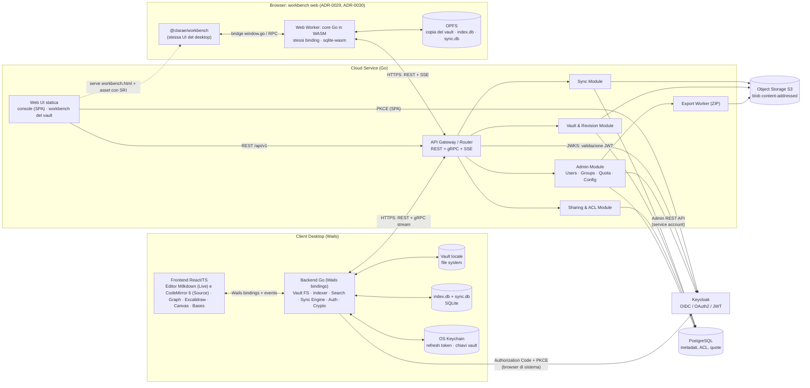
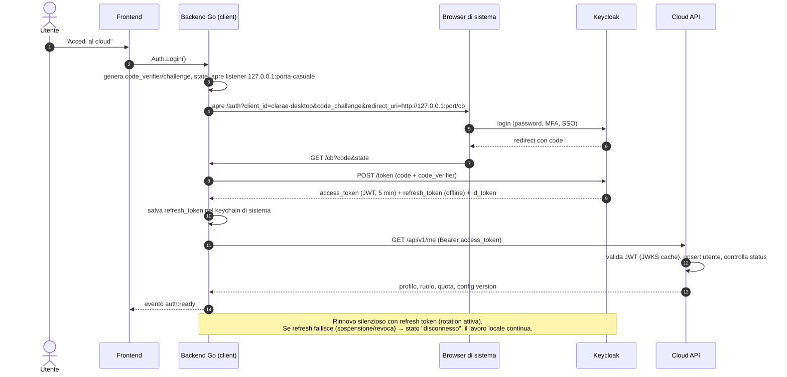
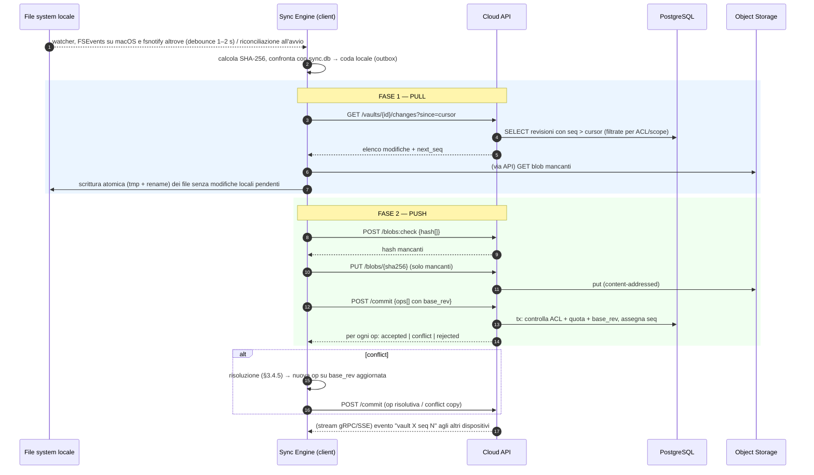
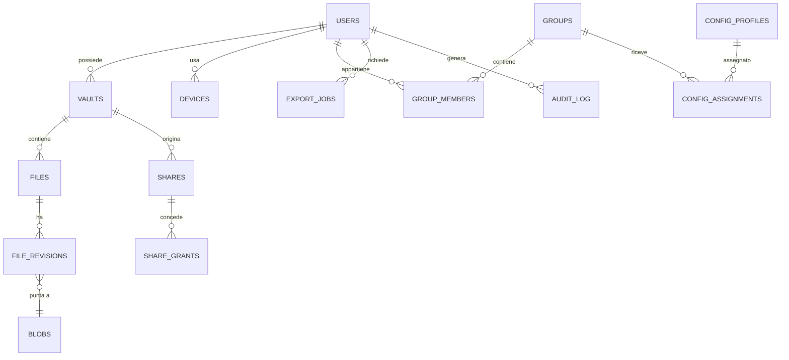
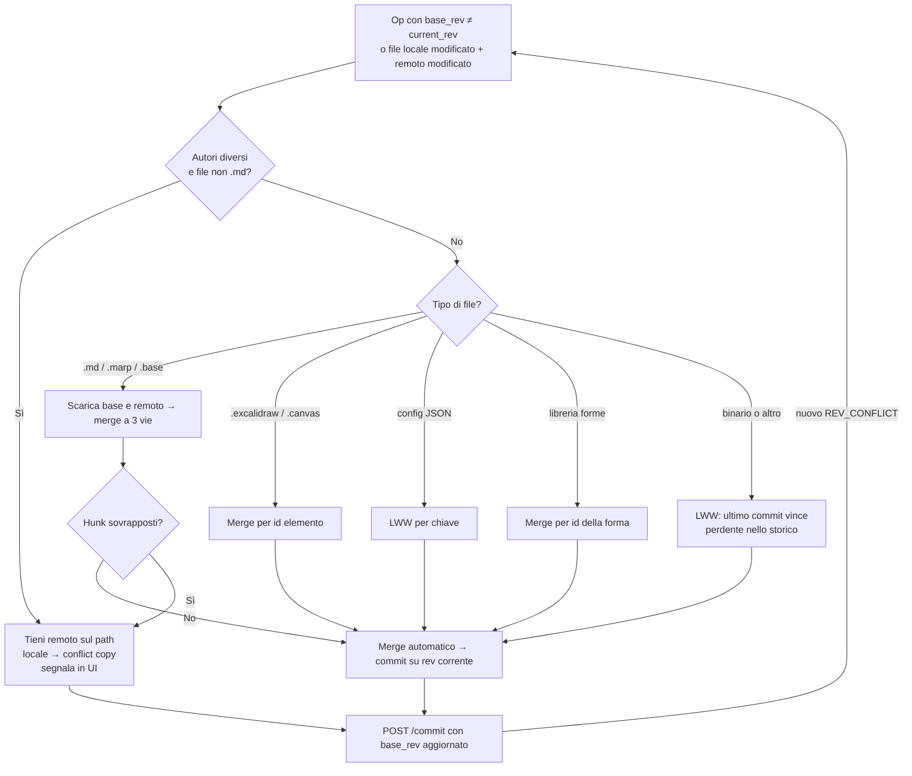

# Clarae notanda — Specifiche Tecniche e Funzionali

**Applicazione desktop e cloud nativa per note e knowledge base (ispirata agli editor di note locali su file Markdown)**

| | |
|---|---|
| **Versione documento** | 1.12 — Decisioni D-01…D-08 e ADR 0009–0024 e 0026–0068 recepiti (vedi Appendice C) |
| **Data** | 27 novembre 2026 |
| **Nome del prodotto** | *Clarae notanda* (identificatori `clarae`; già *MemoBrain Notes* e, come nome in codice, "Nodus") |
| **Stack** | Wails (Go + React/TypeScript) · Cloud Service in Go · Keycloak · PostgreSQL · Object Storage S3-compatibile |
| **Riferimento funzionale** | Le funzioni degli editor di note locali su file Markdown, elencate al §2.2 |

**Registro delle revisioni**

| Versione | Data | Modifiche |
|---|---|---|
| 1.12 | 27 novembre 2026 | Recepiti gli ADR accettati dall'owner il 27 novembre 2026 (Appendice C.4). **L'accettazione non cambia lo stato del codice: lo spec dice lo stato reale di ciascuno.** **ADR-0023** manifest di aggiornamento firmato (ed25519, anti-rollback), installer firmati e aggiornamento automatico: decisione accettata e codice presente (`shared/go/updatemanifest`, `apps/desktop/internal/updater`, `tools/release`), ma **non attiva**: non è mai stata eseguita su una release, l'updater è compilato fuori dalle build di rilascio dalla 1.2.2 (`DisabledByBuild`, ADR-0031), gli installer non sono firmati e mancano i certificati (Apple Developer ID, Authenticode), la chiave del manifest e il canale di pubblicazione; nessun client pubblicato si aggiorna da solo (§2.5, §4.5). **ADR-0045** parità per costruzione tra desktop, workbench web e console: capability con una sola fonte nel core Go, azioni dichiarative, `FeatureId` generato, prove per superficie nel registro, client dell'host ed eventi generati, DTO dei binding cloud uguali all'OpenAPI, politiche nel core (M12, 1.3.2). **ADR-0046** bootstrap con il server tornato indietro (ripristino PITR): si ripubblica, non si cancella, con `since_id`, `next_id` e `as_of_id`; **devia da §3.4.4 B**, perché il cestino locale vale solo per una finestra del changelog scaduta (M12, 1.3.2). **ADR-0047** apertura dei file per tipo (applicazione del sistema o download) e presentazioni Marp in file `.marp` (M13, 1.3.3); **ADR-0048** le presentazioni Marp come i disegni: editor a tutta larghezza, tab SlideShow, export nella ribbon per tipo di file e PPTX modificabile (M14, 1.3.4), che supera in parte ADR-0047 e vale dove i due differiscono; il predicato di ADR-0047 è usato da ADR-0063 e la presentazione a tutto schermo è stata corretta in M29 e M30 senza cambiare ADR-0048. **ADR-0049** editor Live su Milkdown con uno strato di conservazione del sorgente (M16, 1.4.0), che supera in parte ADR-0004: Milkdown è l'unico motore Live, Source e i `.marp` restano su CodeMirror 6; **le prove manuali del cancello A-W8 (IME, correzione ortografica e lettori di schermo su WKWebView, WebView2 e WebKitGTK, incolla da app esterne, note reali grandi) non sono state fatte e restano da fare**: l'owner ha reso Live il predefinito senza attenderle. **ADR-0050** AI implementata ma inattiva e collaborazione in tempo reale spenta (M16, 1.4.0): il codice c'è, con il doppio cancello del flag `ai` o `collab` (riservato, default `false`) e di una costante di build spenta in ogni build di rilascio; nessuna interfaccia, nessuna richiesta di rete possibile. **L'AI non è disponibile**; il co-editing resta escluso (ADR-0065 non lo accende) e accenderlo richiederebbe un ADR e una release. Sezioni modificate: §0.3 (A-01, A-05), §1.2, §1.7, §2.2.1, §2.3.1, §2.3.2, §2.3.3, §2.5, §2.6.6, §2.8.3, §3.4.2, §3.4.4, §3.4.5, §3.4.6, §3.5.2, §3.5.3, §4.2, §4.5, App. B, C.1, C.2, C.4. Con questa versione sono recepiti tutti gli ADR accettati; gli ADR 0001–0008 e 0025 restano decisioni d'implementazione citate dove servono e ADR-0069 è respinta. |
| 1.11 | 27 novembre 2026 | Recepiti gli ADR accettati dall'owner il 27 novembre 2026 (Appendice C.4), già implementati e rilasciati: **ADR-0067** sito della documentazione (solo guida utente, guida dell'amministratore e sicurezza) generato con VitePress da `docs/` e pubblicato sul branch `gh-pages` da `task docs-publish` e dal workflow `docs.yml`, **eccezione dichiarata ad ADR-0036** (secondo workflow oltre a `release.yml`, che pubblica e non esegue controlli: `task ci` resta il cancello); rilasciato con la 1.8.4 (M27), perimetro ridotto alle tre cartelle dalla 1.8.5; **ADR-0068** template del vault in `.clarae/templates/` (posizione fissa, non configurabile) per note, disegni e presentazioni, con default per i tre tipi, «Applica template» sensibile al tipo del file, merge secondo il contenuto, nessun template nei mount e migrazione su conferma dalla vecchia cartella; emenda ADR-0015; rilasciato con la 1.8.7 (M31). **Respinto ADR-0069** (importer di Apple Notes): non si implementa e la lacuna è chiusa, quindi §2.2.1 dice che Apple Notes non è previsto. **Prove manuali eseguite dall'owner il 27 novembre 2026, esito positivo dichiarato senza esito per riga**, che tolgono le avvertenze «non provato»: matrice manuale di Wails v3 su Windows e Linux (B-W8, ADR-0051); vista integrata delle applicazioni con i driver WebView2 e WebKitGTK (ADR-0056, ADR-0060, ADR-0062); terminale integrato, ConPTY e Job Object su Windows compresi (ADR-0064); presenza in tempo reale con più utenti, desktop e web (ADR-0065, rilasciata con la 1.8.2). Sezioni modificate: §2.2.1, §2.6.6, §3.4.5, §3.4.6, §3.4.7, §4.1, §4.5, C.2, C.4. **Non** sono recepiti ADR-0023 e ADR-0050 (in stato proposta) e gli ADR 0045–0049 (accettati, non recepiti). |
| 1.10 | 27 novembre 2026 | Recepito l'ADR accettato dall'owner il 21 novembre 2026 (Appendice C.4): **ADR-0066** cartelle dei sistemi di versione (`.git`, `.hg`, `.svn`, `.bzr`, `.jj`, cartella o file, a qualunque profondità, senza distinzione di maiuscole) escluse dalla sincronizzazione come le altre esclusioni fisse, rifiutate dal cloud con `PATH_INVALID` nei vault condivisi e fuori dall'export ZIP; un file già sincronizzato il cui path diventa escluso si dimentica in `sync.db` senza inviare cancellazioni, e le copie già nel cloud restano e contano nella quota; codici stabili in `last_error` (`<CODE>: <detail>`) e **elenco dei file non inviati con il motivo** in Impostazioni › Sincronizzazione (`SyncAPI.Unsent`, `SyncAPI.RetryUnsent`, `Status.unsent`), con «Riprova» per i file messi da parte. Implementato in M26: regola, dimenticanza ed elenco nel core nella 1.8.3, interfaccia nella 1.8.8. Sezioni modificate: §2.5 (modulo `sync`), §3.4.2, §3.4.3, §3.4.4 A, C.4. **Non** sono recepiti ADR-0023 e ADR-0050 (in stato proposta), gli ADR 0045–0049 (accettati, non recepiti) e gli ADR 0067 e 0068 (in stato proposta). |
| 1.9 | 20 novembre 2026 | Recepito l'ADR accettato dall'owner il 20 novembre 2026 (Appendice C.4): **ADR-0065** presenza in tempo reale sui vault condivisi: avatar degli altri utenti che hanno aperto lo stesso file e loro cursori live (nelle note il puntatore ancorato al testo, in riga e colonna; nei disegni e nei canvas coordinate di scena), tramite un canale WebSocket `GET /api/v1/presence` del cloud (primo canale client→cloud in tempo reale) e PostgreSQL `LISTEN/NOTIFY` tra le repliche; flag `features.presence` acceso di default e spegnibile dal Config Profile; nessuna persistenza, nessun audit; **non è co-editing**: l'editing simultaneo (CRDT) resta escluso (ADR-0050) e il merge resta sul client; i vault privati sono esclusi; emenda ADR-0060 (il pulsante «Nuova applicazione» esce dalla barra dell'esploratore) e integra ADR-0050 (**in implementazione in M25, versione di prodotto prevista 1.8.2, non rilasciato; nessuna prova reale con più utenti**). Sezioni modificate: §0.3 (V-01, A-05), §2.2.1, §2.6.4, §2.6.6, §3.7, C.1 (D-04), C.2, C.4. **Non** sono recepiti ADR-0023 e ADR-0050 (in stato proposta) e gli ADR 0045–0049 (accettati, non recepiti). |
| 1.8 | 20 novembre 2026 | Recepiti gli ADR accettati dall'owner il 20 novembre 2026 (Appendice C.4): **ADR-0062** vista integrata delle applicazioni anche su Windows (WebView2) e su Linux (WebKitGTK, build GTK3), accesa di default insieme a `features.web_viewer`, con ripiego automatico a «Apri nel browser» (driver o runtime mancanti, sandbox di WebKit non disponibile) e interruttore locale `CLARAE_WEBVIEW=off` (emenda ADR-0056 e ADR-0060; implementata nella 1.7.3, **i driver di Windows e di Linux non sono provati su una finestra reale**); **ADR-0063** nomi dei file senza estensione per tutto ciò che si apre in una scheda, e rinomina che conserva l'estensione (integra ADR-0047; implementata nella 1.7.3); **ADR-0064** terminale integrato del client desktop: shell dell'utente in uno pseudo-terminale, più tab, pannello ancorabile e finestra separata del solo terminale (una seconda finestra dello stesso processo), nessun flag del Config Profile, non aperto nei vault in sola lettura, non nel workbench web (eccezione di parità); emenda ADR-0051 per i pop-out (implementato in M23 e rilasciato nella 1.8.0; **non provato su una finestra reale**); **ADR-0051** client desktop su Wails v3.1.0, solo parità (rilasciato dalla 1.4.0; accettato dall'owner il 20 novembre 2026). Sezioni modificate: §0.3 (V-02, V-07, A-03), §1.3, §2.2.1, §2.3.2, §2.5, §2.6.6, §2.8.3, §3.7, §4.2, §4.5, App. B, C.1 (D-07), C.2, C.4. **Non** sono recepiti ADR-0023 e ADR-0050 (in stato proposta) e gli ADR 0045–0049 (accettati, non recepiti). |
| 1.7 | 16 novembre 2026 | Recepiti gli ADR accettati dall'owner il 16 novembre 2026 (Appendice C.4), già implementati (1.5.0 e 1.7.2): **ADR-0052** rebrand a *Clarae notanda* (identificatori `clarae`, cartella `.clarae/`, schema `clarae://`; restano congelate le etichette crittografiche `memobrain/v1/*` e `memobrain/v2/*`, e per i dati e i client della 1.x i nomi vecchi restano letti fino alla 2.0); **ADR-0057** identità del dispositivo desktop per nome del computer (colonna `devices.hostname` con indice unico parziale, registrazione come upsert sempre con `201`, revoca del proprio dispositivo al logout); **ADR-0058** logout completo da Keycloak (revoca dei token, logout back-channel del desktop, pagina `/signed-out` della console, `prompt=login` dopo un'uscita esplicita); **ADR-0059** pulizia della cartella di configurazione legacy `.memobrain/` e ZIP con la sola `.clarae/` (emenda ADR-0052: non più «mai cancellazioni»); **ADR-0060** `features.web_viewer` **acceso per default** e «Nuova applicazione» nell'esploratore dei file (emenda ADR-0056); **ADR-0061** budget iniziale della console a 720 kB (emenda ADR-0020). Sezioni modificate: il nome in tutto lo spec (ADR-0052), §1.3, §1.7, §2.2.1, §2.6.1, §2.6.6, §2.8.2, §3.2.2, §3.3.1, §3.4.6, §3.5.1, §3.5.2, §4.4, C.2, C.4. **Non** sono recepiti ADR-0023 (proposta) e gli ADR 0045–0051 (0045, 0046, 0047, 0048 e 0049 accettati; 0050 e 0051 in proposta): lo spec continua a dire Wails v2. |
| 1.6 | 15 novembre 2026 | Recepiti gli ADR accettati dall'owner il 15 novembre 2026 (Appendice C.4), già implementati (1.6.0, 1.7.0 e 1.7.1): **ADR-0053** navigazione dei disegni (zoom sulla selezione e mini-mappa, con la mini-mappa per dispositivo); **ADR-0054** editor dei disegni (file invalido mai sovrascritto, `captureUpdate` esplicito, scena serializzata solo al salvataggio, merge delle modifiche non salvate con `VaultAPI.MergeEdit` e «Tieni entrambe», regola D-04 con l'autore della revisione di testa in `sync_files.head_author`, auto-export 15 s dopo l'ultimo salvataggio, anteprime `<hash>.svg` e `<hash>.dark.svg` con `DrawingAPI.Preview`, potatura della cache, ricerca su `originalText` e TeX, tombstone mai potati) e **deviazione** da §3.4.5 e §3.4.6: la libreria di forme si fonde **per id** (strategia `library-by-id`), non per chiave; **ADR-0055** grafo 3D (interruttore 2D/3D nella vista, tre livelli di dettaglio, tetto di 5.000 nodi, ripiego al 2D) e disegni, lavagne e basi come nodi del grafo; l'obiettivo dei 10.000 nodi a 30 fps vale per il 2D; **ADR-0056** applicazioni (file `.webapp` in una vista nativa sovrapposta alla scheda su macOS, Windows con un driver spento, `features.web_viewer` spento per default, sessioni per vault fuori dal vault con pulizia degli archivi orfani, selettore rapido che trova le applicazioni), che anticipa il Web viewer da P2. Sezioni modificate: §0.3 (A-01), §2.2.1, §2.6.6, §2.7.1, §2.7.2, §2.7.3, §3.4.3, §3.4.5, §3.4.6, §3.7, §4.2, App. A, App. B, C.2, C.4. **Non** sono recepiti ADR-0023 (proposta) e gli ADR 0045–0052 (0045, 0046, 0047, 0048 e 0049 accettati; 0050, 0051 e 0052 in proposta): lo spec continua a dire Wails v2 e *MemoBrain Notes* (`memobrain`, `.memobrain/`) finché non sono recepiti; il testo aggiunto qui segue la nomenclatura dello spec, mentre nel codice i nomi sono *Clarae notanda* e `.clarae/` (ADR-0052). |
| 1.5 | 2 novembre 2026 | Recepito **ADR-0035**, accettato dall'owner e implementato il 2 novembre 2026 (Appendice C.4): barra di stato compatta **facoltativa e spenta per default** sotto l'area editor (sopra lo slot della chat), con parole e caratteri della nota o della selezione, riga:colonna e modalità cliccabile dell'editor attivo; impostazione *Aspetto › Barra di stato* (`statusBar` in `.memobrain/appearance.json`), comando `app:toggle-status-bar` senza hotkey, chiave `appearance.statusBar` del Config Profile (bloccabile); sync, permessi, aggiornamenti e inviti restano nel footer e nell'header di ADR-0026. Resta in stato *proposta* e **non** è recepito solo ADR-0023. Sezioni modificate: §2.2.1, §2.6.6, §4.2, C.4. |
| 1.4 | 2 novembre 2026 | Recepiti gli ADR già implementati e accettati dall'owner il 2 novembre 2026 (decisioni e sezioni in Appendice C.4): **ADR-0009** protocollo di sync (`op_id`, `path_key` nel commit dei vault privati, `NAME_IN_USE`, `vault_blobs`, commit a transazione per lotto, `sync.db` per vault); **ADR-0010** disegni e canvas; **ADR-0011** condivisione, gruppi e Config Profile (scope su tutte le operazioni, `404`/`403`, un mount per share, inviti di gruppo, `INVALID_STATE`, revisione globale della configurazione); **ADR-0012** console admin ed export (migrazione 0005, route admin aggiunte, export per vault); **ADR-0013** graph view in Canvas 2D; **ADR-0014** Bases; **ADR-0015** note giornaliere, template, composer, slash command, nota casuale in P1; **ADR-0016** bookmark, workspace, page preview; **ADR-0017** importer; **ADR-0018** history locale e File recovery; **ADR-0019** blocco `query` ed export HTML/PDF; **ADR-0020** prestazioni, budget del bundle e baseline; **ADR-0021** GDPR (`GET /me/export`, `DELETE /me`, migrazione 0006, `privacy.account_purge_days`, purge), con il gate di CI superato da ADR-0036 e la regola sui grant concessi modificata da ADR-0041; **ADR-0022** resilienza (drain allo spegnimento, `.memobrain-tmp-*` escluso, `CURSOR_EXPIRED` oltre `last_seq`); **ADR-0024** parità funzionale con i plugin Excalidraw di terze parti; **ADR-0026** shell UI (barra di stato eliminata); **ADR-0027** Slides in P1; **ADR-0028** fork `@zsviczian/excalidraw`; **ADR-0031** pipeline di rilascio nello stato attuale, con installer desktop non firmati come deviazione temporanea; **ADR-0033** un pacchetto sqlc per modulo, eccezioni dichiarate, modulo `settings`; **ADR-0034** envelope v2 (già descritto nella v1.3) più normalizzazione NFC della passphrase e tetto di calibrazione di Argon2id. Restano in stato *proposta* e **non** sono recepiti ADR-0023 (manifest firmato e aggiornamento automatico, mai attivati: l'updater è compilato fuori dalle build di rilascio dalla 1.2.2) e ADR-0035 (barra di stato opzionale, non implementata). Sezioni modificate: §1.1, §1.3, §1.6, §2.2.1, §2.3.2, §2.3.3, §2.4, §2.5, §2.6.1, §2.6.3–§2.6.6, §2.7, §2.8.1, §2.8.2, §2.9, §3.1, §3.2.2, §3.3.2, §3.4.2–§3.4.4, §3.4.6, §3.4.7, §3.5.1–§3.5.5, §3.6, §3.7, §3.8.1, §3.8.2, §3.8.7, §4.1–§4.5, App. A, App. B, C.2, C.4. |
| 1.3 | 2 novembre 2026 | Recepiti gli ADR accettati dall'owner il 2 novembre 2026 (Appendice C.4): **ADR-0029** workbench del vault nella Web UI (stessa UI del client desktop, `@memobrain/workbench`, su `/vaults/:id/open`; il browser è un dispositivo di sync come gli altri, online-first con copia in OPFS; politica dei vault privati nel browser; CSP e SRI della pagina del workbench; flag `features.web_workbench`); **ADR-0030** core Go del client desktop compilato in WebAssembly (`apps/desktop/cmd/memobrain-core`, dispatcher `internal/rpc`, interfaccia `Host`, sqlite-wasm con `opfs-sahpool`, shim `fs` su OPFS, solo SSE, budget di dimensione, `task test-wasm` in `task ci`); **ADR-0032** Task (`Taskfile.yml`, pinnato in `tools/go.mod`) come unico task runner al posto di make. A-03 non dice più che la Web UI non è un editor. **Feature flag:** l'owner ha acceso per default `features.envelope_v2` e `features.path_v2`, cioè il rilascio N+1 di ADR-0034 (envelope della VMK v2 con AAD) e di ADR-0042 (token di path `enc2`): i client scrivono envelope v2 (convertendo i v1 allo sblocco) e token `enc2`, migrano in background i token `enc1` rimasti e poi rifiutano `enc1` per quel vault (pin forte); i client desktop fino alla 1.2.4 non sbloccano vault con envelope v2 né leggono path `enc2` (§3.8.7). ADR-0034 resta in stato *proposta*: il comportamento dei suoi rilasci N e N+1 è registrato qui (§3.8.2, §3.8.7) come implementato, perché l'owner ha acceso il flag. Sezioni modificate: §0.1, §0.3 (A-03), §1.1, §1.2, §1.7 (nuova), §2.1, §2.1.1, §2.5, §2.6.1, §2.6.6, §2.8 (con §2.8.3 nuova), §3.5.1, §3.6, §3.7, §3.8.1, §3.8.2, §3.8.6, §3.8.7, §4.1–§4.5, App. A, C.2, C.3, C.4. |
| 1.2 | 2 novembre 2026 | Recepiti gli ADR accettati dall'owner (decisioni e sezioni in Appendice C.4): **ADR-0036** verifiche locali con `task ci` al posto di un servizio di CI; **ADR-0037** registro delle funzioni, `@memobrain/cloud-features` con `CloudPort`, client Go generato, ciclo di vita dei vault su tutte le superfici, feature flag generati dallo schema del Config Profile; **ADR-0038** retention delle revisioni, copie di conflitto e finestra effettiva del changelog; **ADR-0039** candidati al merge persistenti e quarantena in `sync.db`; **ADR-0040** `move_prefix` come rename delle cartelle condivise (anche solo maiuscole/minuscole) e regole sulle radici condivise; **ADR-0041** ruolo autorevole dopo un cambio dalla console, conflitti di identità, ultimo amministratore, eliminazione unificata degli account con riattribuzione dei grant, rubrica, `config_version`, `POST /shares` da parte di un manager, ruolo `manager` dei gruppi riservato, hub delle notifiche; **ADR-0042** token di path `enc2` legati al file; **ADR-0043** primitive UI condivise in `@memobrain/ui`; **ADR-0044** watcher con FSEvents su macOS e modalità degradata. Sezioni modificate: §1.3, §1.4, §2.3.3, §2.4, §2.5, §2.6.1–§2.6.6, §2.7.3, §2.8.1, §2.8.2, §3.1, §3.2.2, §3.3.2, §3.4.3–§3.4.5, §3.4.7, §3.5.1–§3.5.5, §3.6, §3.7, §3.8.3, §3.8.5, §3.8.7, §4.1–§4.5, App. A, C.2, C.4 (nuova). Restano in stato *proposta* e **non** sono recepiti gli ADR 0009–0024 e 0026–0035: la raccolta `docs/spec-v1.2-proposta.md`, che li riguarda, resta da decidere e confluirà in una versione successiva. |
| 1.1 | 23 ottobre 2026 | Decisioni D-01…D-08 recepite (Appendice C.1). |

---

## Indice

0. [Introduzione, ambito e assunzioni](#0-introduzione-ambito-e-assunzioni)
1. [System Architecture & Data Flow](#1-system-architecture--data-flow)
2. [Functional Specifications](#2-functional-specifications)
3. [Technical & API Specifications](#3-technical--api-specifications)
4. [Project Directory Structure](#4-project-directory-structure)
- [Appendice A — Requisiti non funzionali](#appendice-a--requisiti-non-funzionali)
- [Appendice B — Roadmap per milestone](#appendice-b--roadmap-per-milestone)
- [Appendice C — Registro delle decisioni, rischi e punti aperti](#appendice-c--registro-delle-decisioni-rischi-e-punti-aperti)

---

## 0. Introduzione, ambito e assunzioni

### 0.1 Scopo

Il documento definisce l'architettura e le specifiche di *Clarae notanda*, un'applicazione di knowledge management **local-first** composta da:

1. **Client desktop** (Windows, macOS, Linux) realizzato con Wails: backend nativo in Go, frontend React/TypeScript. Funziona interamente offline su vault locali (cartelle di file Markdown).
2. **Cloud Service** in Go: sincronizzazione multi-dispositivo dei vault, condivisione, gruppi, quote, distribuzione centralizzata delle configurazioni.
3. **Web UI del Cloud Service**: console amministrativa, area utente (quota, dispositivi, condivisioni, download ZIP) e **workbench del vault** (modifica nel browser con le stesse funzioni e la stessa interfaccia del client desktop, §2.8.3, ADR-0029).
4. **Keycloak** come Identity Provider (OIDC/OAuth2, JWT).

### 0.2 Vincoli non negoziabili

| ID | Vincolo |
|---|---|
| V-01 | Client: Wails (Go + React/TS). Cloud: Go, API REST e gRPC, più un canale WebSocket per la sola presenza in tempo reale (§2.6.4, ADR-0065). |
| V-02 | **Architettura chiusa**: nessun supporto a plugin, temi, script di terze parti né CSS personalizzato (D-01). Ogni funzione è compilata nell'eseguibile. Il terminale integrato del client desktop (§2.2.1, ADR-0064) esegue **i comandi che l'utente digita**, con i suoi privilegi, in una shell del sistema operativo: non carica né esegue codice di terzi dentro l'app e non è un meccanismo di estensione. |
| V-03 | Copertura funzionale delle feature degli editor di note locali su file Markdown, elencate al §2.2 (con le esclusioni motivate al §2.2.3). |
| V-04 | Excalidraw.js integrato nativamente. |
| V-05 | Identità e token gestiti da Keycloak; il Cloud Service è *resource server* OIDC. |
| V-06 | RBAC globale + permessi per cartella/documento. |
| V-07 | Wails **v3** (D-07, ADR-0051). |
| V-08 | Alla creazione, ogni vault cloud è **privato cifrato** (E2EE, non condivisibile) oppure **condiviso non cifrato**; la scelta è immutabile (D-02). |
| V-09 | Nessuna funzione cross-vault (D-06). |
| V-10 | Gruppi gestiti esclusivamente dal Cloud Service (D-05). |

### 0.3 Assunzioni

- **A-01** — Il formato di storage resta *file-first*: il vault è una cartella di file ordinari (`.md`, immagini, PDF, `.canvas`, `.base`, `.excalidraw`, `.marp` per le presentazioni (§2.2.1, ADR-0047) e `.webapp` per le applicazioni: `{"version":1,"url":…}`, §2.2.1). Nessun lock-in: l'utente può aprire il vault con qualsiasi editor.
- **A-02** — Il comportamento di riferimento è quello degli editor di note locali su file Markdown; la sintassi Markdown estesa (wikilink, embed, callout, ecc.) è mantenuta compatibile così che una cartella di note esistente si apra come vault senza conversioni.
- **A-03** — Il client desktop (Wails **v3**, D-07, ADR-0051) è desktop-only: **le app mobile non sono nel perimetro**. Ha una finestra principale e, **solo per il terminale integrato** (ADR-0064), una seconda finestra dello stesso processo; le altre viste non si separano in finestre proprie (pop-out, §2.2.1). La Web UI del cloud comprende console amministrativa, area utente e un **workbench del vault** con le stesse funzioni del client desktop, salvo le eccezioni dichiarate di ADR-0029 (updater, vault su cartella locale, integrazioni native del sistema operativo: §2.8.3). Il workbench web è un dispositivo di sync come gli altri: **online-first**, con copia locale nel browser, e non è un'app mobile né una PWA offline (ADR-0029).
- **A-04** — Il cloud è single-tenant per installazione (una realm Keycloak, un'organizzazione). Il multi-tenant è fuori ambito.
- **A-05** — La collaborazione è **asincrona** (sync + merge) e il merge multi-utente è garantito per i soli file `.md` condivisi (D-04). L'editing simultaneo in tempo reale (CRDT) non è previsto: il client contiene l'integrazione Yjs, ma è **spenta**, senza provider né server (ADR-0050, §2.6.6), e accenderla sarebbe una deviazione da questa assunzione, con un ADR e una release. È prevista la **presenza** nei vault condivisi (§2.6.4, ADR-0065): avatar e cursori degli altri utenti che hanno aperto lo stesso file, senza che nessuno scriva in tempo reale nello stesso documento.
- **A-06** — Cifratura (D-02): TLS in transito e cifratura a riposo lato server per tutti i vault. I vault **privati** sono inoltre cifrati end-to-end dal client (§3.8) e non possono essere condivisi; i vault **condivisi** non sono cifrati end-to-end, perché la condivisione con utenti e gruppi (con revoca, ACL e membership dinamiche) richiederebbe una gestione di chiavi condivise fuori ambito.
- **A-07** — Un vault è un perimetro chiuso (D-06): link, embed, backlink, grafo, ricerca, bookmark e template non attraversano i vault (§2.1.2).
- **A-08** — I gruppi esistono solo nel Cloud Service (D-05); Keycloak gestisce soltanto identità e ruoli globali.

### 0.4 Glossario

| Termine | Significato |
|---|---|
| **Vault** | Cartella radice di note e allegati. Unità di sincronizzazione. |
| **Vault privato** | Vault cloud cifrato end-to-end, utilizzabile da un solo utente (nessuna condivisione). |
| **Vault condiviso** | Vault cloud non cifrato end-to-end, su cui si possono creare share verso utenti e gruppi. |
| **VMK** | *Vault Master Key*: chiave simmetrica casuale a 256 bit di un vault privato, mai inviata al server in chiaro. |
| **Mount** | Vista locale (sul client del destinatario) di una cartella o un documento condiviso, trattata come vault separato. |
| **File ID** | UUID stabile di un file nel cloud, indipendente dal path (consente rename senza perdere identità). |
| **Revision** | Versione immutabile di un file, con numero progressivo per file (`rev_no`). |
| **Seq** | Contatore monotono per vault; ordina tutte le modifiche del vault. |
| **Share** | Concessione di accesso a un vault, a una cartella (prefisso di path) o a un documento. |
| **Grant** | Associazione share → utente/gruppo con un livello di permesso. |
| **Config Profile** | Insieme versionato di impostazioni distribuite dal cloud ai membri di uno o più gruppi. |
| **Blob** | Contenuto binario immutabile identificato da SHA-256 (content-addressed). |

---

## 1. System Architecture & Data Flow

### 1.1 Vista dei componenti



**Scelta architetturale: modular monolith.** Il Cloud Service è un unico binario Go suddiviso in moduli con confini netti (package `internal/<modulo>`, interfacce esplicite, nessun accesso incrociato alle tabelle salvo le eccezioni dichiarate e verificate di §4.3, ADR-0033). Motivi: un solo deploy, transazioni locali tra metadati e quote, costo operativo basso. L'`Export Worker` è lo stesso binario avviato con `--role=worker` per scalare in modo indipendente. L'estrazione in microservizi resta possibile senza riscrivere i moduli.

### 1.2 Responsabilità dei componenti

| Componente | Responsabilità |
|---|---|
| **Frontend (React/TS)** | UI, editor, rendering, grafo, Excalidraw, Canvas, Bases, nel pacchetto `@clarae/workbench` condiviso da client desktop e workbench web (ADR-0029). Nessun accesso diretto a rete o disco: tutto passa dai binding Wails (nel browser, dagli stessi binding serviti dal core in WebAssembly). |
| **Backend client (Go)** | Accesso al file system del vault, watcher, parsing/indicizzazione, ricerca FTS, sync engine, cifratura/decifratura dei vault privati, OIDC, keychain, auto-update (nel codice ma non attivo nelle build di rilascio: §2.5, ADR-0023), import. Lo stesso codice, compilato per `js/wasm`, è il core del workbench web (§1.7, ADR-0030). |
| **Workbench web** | Pagina della Web UI che apre un vault cloud nel browser: UI del client desktop, core Go in un Web Worker, copia del vault e database in OPFS; dispositivo di sync `web` (§1.7, §2.8.3). |
| **API Gateway** | TLS, routing, validazione JWT, rate limiting, request-id, CORS (solo origine Web UI), OpenTelemetry. |
| **Sync Module** | Changelog per vault, commit con concorrenza ottimistica, rilevamento conflitti, notifiche realtime. |
| **Vault & Revision** | CRUD vault, storico revisioni, restore, snapshot/tree, GC dei blob. |
| **Sharing & ACL** | Share, grant, valutazione permessi effettivi, mount dei vault condivisi. |
| **Admin Module** | Utenti, gruppi, ruoli, quote, Config Profile, audit; orchestrazione verso Keycloak Admin API. |
| **Keycloak** | Credenziali, MFA, SSO, federazione (LDAP/SAML opzionali), emissione token. |
| **PostgreSQL** | Fonte di verità per metadati e permessi. |
| **Object Storage** | Contenuti dei file (blob immutabili, deduplicati per hash; nei vault privati sono ciphertext). |

### 1.3 Flusso di autenticazione (client desktop)

Authorization Code Flow + PKCE (RFC 7636, RFC 8252) con **browser di sistema**; le credenziali non transitano mai nell'app.



**Regole chiave**

- Access token vita breve (5 min); refresh con **rotation** e riuso rilevato da Keycloak.
- Validazione JWT lato Cloud: firma (JWKS in cache con rotazione), `iss`, `aud` (= `clarae-api`), `exp`, `azp`.
- **Sospensione utente**: Keycloak `enabled=false` + revoca sessioni; in aggiunta il Cloud controlla `users.status` (cache 30 s) così l'accesso decade entro secondi e non alla scadenza del token. La cache memorizza per lo stesso TTL anche i rifiuti (account sospeso, conflitto di identità), mai gli errori interni; attivazione, cambio di ruolo ed eliminazione la invalidano (ADR-0041).
- **Provisioning just-in-time (ADR-0041).** L'utente è collegato all'identità **solo per `sub`**. La riga `users` si legge per `sub` e si scrive solo se il token porta un cambio di profilo o di ruolo, o se `last_login_at` ha più di 15 minuti; gli account sospesi o eliminati non vengono mai scritti.
- **Ruolo autorevole dopo un cambio dalla console (ADR-0041).** Un cambio di ruolo fatto dalla console imposta `users.role_changed_at`. Il provisioning prende il ruolo dai realm role del token solo se il suo `iat` è successivo a `role_changed_at`; il principal della richiesta usa sempre il ruolo della riga. Una degradazione vale dalla richiesta successiva (subito sulla replica che la esegue, entro il TTL della cache sulle altre), una promozione non attende un nuovo token, e i token emessi dopo il cambio tornano a rispecchiare Keycloak, che resta la fonte del ruolo per chi lo gestisce lì.
- **Conflitto di identità (ADR-0041).** Un token con un'e-mail già usata da un altro account non eliminato produce `409 INVALID_STATE` (gRPC `FAILED_PRECONDITION`) con l'indicazione di rivolgersi a un amministratore; non si crea né si modifica alcuna riga e **non si ricollega mai un account per e-mail** (darebbe i vault di un account a chiunque controlli quell'indirizzo nel provider di identità). Il rimedio (eliminare o rinominare l'account precedente) è nel runbook.
- **Redirect (D-08).** Modalità predefinita `auto`: il client prova il redirect **loopback** con porta variabile (RFC 8252 §7.3) e passa al **custom URI scheme** `clarae://auth/callback` se (a) non riesce ad aprire il listener, (b) Keycloak rifiuta il `redirect_uri` loopback (Keycloak non reindirizza un `redirect_uri` non registrato ma mostra una pagina d'errore: in modalità `auto` il client interroga prima l'endpoint di autorizzazione senza seguire i redirect, e una risposta 400 che cita `redirect_uri` lo fa passare allo scheme prima di aprire il browser), oppure (c) la modalità è forzata dal Config Profile (`auth.redirect_mode` = `auto` \| `loopback` \| `custom_scheme`; la variabile d'ambiente `CLARAE_AUTH_REDIRECT` ha la precedenza, per i test (`MEMOBRAIN_AUTH_REDIRECT` vale ancora, con un avviso, fino a una release major successiva alla 2.0, ADR-0070); ADR-0011). Entrambi gli URI sono registrati sul client `clarae-desktop`, insieme a `memobrain://auth/callback` per i client 1.x.
- Il callback via custom scheme arriva al sistema operativo come URL `clarae://…` (lo schema `memobrain://` della 1.x resta registrato e accettato fino a una release major successiva alla 2.0, ADR-0052, ADR-0070) e viene consegnato all'istanza già in esecuzione tramite il single-instance lock di Wails v3 (argomenti della seconda istanza; su macOS tramite l'evento `ApplicationLaunchedWithUrl`, ADR-0051). Registrazione dello scheme: installer Windows (chiave di registro), `Info.plist` su macOS, file `.desktop` con `x-scheme-handler/clarae` e `x-scheme-handler/memobrain` su Linux.
- Poiché uno scheme custom può essere rivendicato da altre applicazioni, la sicurezza si basa su PKCE (S256) e sul controllo di `state`; `code_verifier` e `state` restano solo in memoria dell'istanza che ha avviato il login.
- **Uscita (ADR-0058).** «Esci» non lascia sessioni vive. *Client desktop*, in quest'ordine e a miglior sforzo (un errore si scrive nel log e l'uscita prosegue; i passi di rete hanno un tetto comune di 8 s): ferma la sync; revoca il proprio dispositivo sul cloud (`DELETE /me/devices/{id}`, §3.5.1, ADR-0057) finché il token è valido; chiude la sessione dell'identity provider con una `POST` back-channel sull'`end_session_endpoint` della discovery (`client_id` e refresh token, senza browser né `id_token_hint`) e poi revoca il refresh token dal `revocation_endpoint` (se la discovery non lo annuncia, l'URL di Keycloak derivato dall'issuer, `<issuer>/protocol/openid-connect/revoke`); scrive il marcatore `auth-logged-out` nella cartella dati dell'app (fuori dal vault, non sincronizzato) e cancella la sessione locale. Il login successivo aggiunge `prompt=login` all'URL di autorizzazione, così Keycloak chiede le credenziali anche se una sessione SSO è sopravvissuta (un broker, un realm vecchio), e cancella il marcatore. Una sessione ospitata (il core nel browser) non esegue nulla di questo: i token sono della pagina. *Console web e workbench* (stessa sessione della pagina): `signOut` revoca i token (a miglior sforzo), chiama `signoutRedirect` con `id_token_hint`, `client_id` e `post_logout_redirect_uri = <origine>/signed-out`, e scrive in `localStorage` il marcatore `clarae.auth.forceLogin`, che fa passare `prompt=login` al `signIn` successivo; `/signed-out` è una pagina pubblica («Sei uscito da Clarae notanda», con il pulsante «Accedi») che **non** avvia l'accesso da sola. Un accesso che non segue un'uscita esplicita (scadenza della sessione, primo accesso) non forza il prompt. **Limite:** il logout back-channel dipende dal comportamento di Keycloak 26 e non è ancora provato su un Keycloak vero (le prove automatiche usano un server OIDC finto); su un identity provider diverso la chiamata può fallire senza effetti, e `prompt=login` copre la sessione residua.

### 1.4 Flusso di sincronizzazione



Il protocollo completo è definito al §3.4. Il merge è sempre eseguito dal client: il server ordina le modifiche e archivia blob, ma non interpreta mai il contenuto dei file. Per questo il protocollo è identico per i vault privati, i cui blob sono cifrati dal client prima dell'upload (§3.8).

### 1.5 Flusso di condivisione e distribuzione configurazione

- **Condivisione** (solo da vault *condivisi*): l'owner crea uno *share* (cartella o documento) con grant a utenti/gruppi → il destinatario vede un invito, lo accetta e il client **monta** il contenuto condiviso come vault aggiuntivo separato (*mount*), sincronizzato in modo scoped sul prefisso condiviso (§3.4.7).
- **Config distribuita**: l'amministratore associa Config Profile a gruppi → il client scarica `GET /config/effective` (ETag), applica la configurazione e blocca in UI le chiavi marcate `locked`. Il cambio di versione arriva come evento realtime.

### 1.6 Topologia di deploy (riferimento)

| Livello | Componenti | Note |
|---|---|---|
| Edge | Reverse proxy / Ingress (TLS 1.2+) | HTTP/2 abilitato per gRPC |
| Applicazione | `clarae-cloud` (N repliche stateless) + `clarae-cloud --role=worker` | Scalabilità orizzontale; stato solo in PG/S3 |
| Identità | Keycloak (HA, DB dedicato) | Realm `clarae` |
| Dati | PostgreSQL (primary + replica), S3-compatibile (MinIO/AWS S3) | Backup PITR su PG; versioning/replica su bucket |
| Osservabilità | OpenTelemetry → Prometheus/Grafana/Loki | `/healthz`, `/readyz`, `/metrics` |

Pacchetti: container OCI + Helm chart + `docker-compose` per sviluppo e piccole installazioni on-premise.

**Spegnimento e repliche (ADR-0022).** Allo spegnimento `/readyz` risponde subito `503`, il servizio continua a rispondere per `SHUTDOWN_DRAIN` (default 5 s) perché il bilanciatore smetta di inviargli traffico, poi chiude gli stream (SSE, gRPC) ed esegue lo `Shutdown` entro `SHUTDOWN_TIMEOUT` (default 15 s); `terminationGracePeriodSeconds` deve superare drain + `SHUTDOWN_TIMEOUT`. Un rolling restart senza interruzioni richiede almeno 2 repliche dell'API e il drain. Dietro un reverse proxy o un ingress va impostato `TRUSTED_PROXIES` (CIDR): senza, il limite di richieste per IP vede solo l'indirizzo del proxy (§3.1). Un'interruzione di PostgreSQL produce `503` su `/readyz` (`/healthz` resta `200`) e `500 INTERNAL` sulle richieste: un codice `UNAVAILABLE` con `Retry-After` non esiste (limite dichiarato).

**Aggiornamento senza perdere il database.** Con `DB_EXPECT_INITIALIZED=true` i ruoli `api` e `all` che trovano il database vuoto (nessuna migrazione applicata) non creano lo schema e terminano con un errore, invece di avviarsi su un database nuovo senza dati né registro di audit. Il chart Helm lo imposta a ogni `helm upgrade` (`.Release.IsUpgrade`), a meno che `config` non lo contenga già; con Compose si imposta in `.env` dopo il primo avvio. All'avvio dei ruoli `api` e `all`, dopo le migrazioni, il servizio scrive nel log una riga `database state` con la versione dello schema, il numero di righe di `audit_log` e la data della prima. Nessuna migrazione cancella `audit_log`: un test sulle migrazioni lo verifica sulle sezioni `+goose Up` (`services/cloud/internal/db/audit_migrations_test.go`).

### 1.7 Workbench web e core del client in WebAssembly (ADR-0029, ADR-0030)

La Web UI apre un vault cloud nel browser con **le stesse funzioni e la stessa interfaccia** del client desktop. Non c'è una seconda implementazione: la UI è il pacchetto `@clarae/workbench` (`packages/workbench`), montato da entrambi gli host, e la logica è il backend Go del client compilato con `GOOS=js GOARCH=wasm`.

- **Il browser è un dispositivo come gli altri.** Registra un dispositivo (`POST /me/devices`, `platform: "web"`, uno per profilo del browser), apre il vault con il flusso di "Collega vault esistente" (copia locale, pull, indice locale, commit con `base_rev`, merge sul client) e usa il protocollo di sync e le API invariati: nessuna API di contenuto nuova, il server resta cieco al contenuto (§3.4.1). Calcolo lato server (indice, ricerca) escluso: violerebbe §3.4.1 e non funzionerebbe sui vault privati.
- **Core** (`apps/desktop/cmd/clarae-core`, eseguito in un **Web Worker** dedicato). Il dispatcher `internal/rpc` chiama i binding per nome (`Call(service, method, argsJSON)`) con la semantica di Wails; `App.Services()` (`internal/app/services.go`) è l'**unico elenco** dei servizi, usato da `main.go` per Wails e da `clarae-core` per il dispatcher, così le due API non possono divergere (test di parità dispatcher ↔ binding generati, obbligatorio in `task ci`). Nella pagina un bridge installa `window.go`/`window.runtime` sopra un RPC verso il worker: i binding generati non cambiano.
- **Host.** `internal/app` dipende da un'interfaccia `Host` (`host.go`: eventi verso la UI, dialoghi, download, apertura URL, stampa, uscita, errori fatali), implementata da `host_wails.go` (`!js`, unico file che importa Wails) e da `host_web.go` (`js`, inoltra a `globalThis.__claraeHost` del worker). Ciò che dipende dalla piattaforma sta dietro `Host` o in file `*_js.go`/`*_native.go` (driver SQLite, watcher, updater, budget della cache di ricerca, notifiche); una costante `isWeb` spegne ciò che il browser non ha (updater, cestino di sistema, file watcher). Nel browser la sessione è quella OIDC della pagina (`SessionHost`: token chiesto alla pagina a ogni richiesta, niente refresh token né keychain) e le chiavi dei vault privati stanno solo in memoria (`crypto.MemoryStore`).
- **Parità per costruzione (ADR-0045).** Ogni scostamento tra desktop e browser è dichiarato, non scoperto. Le capability dell'host hanno **una sola fonte, il core Go**: `apps/desktop/internal/app/capabilities.go` è una tabella con le colonne desktop e web (la build sceglie la colonna con `isWeb`) e `task gen` la riversa in `platform/capabilities.gen.ts`; `mountWorkbench` la legge dal core e le sole capability proprie del browser restano override dell'host. I test falliscono se un metodo di `Host` non è classificato o se una capability è vera sul web per un metodo che lì fallisce. L'host web chiama il core con il client tipizzato `web/src/workbench/core.gen.ts` (con limite di tempo), e nomi e payload degli eventi Go→TS si dichiarano con `internal/events` e si generano in `events.gen.ts`: regole ESLint vietano nomi di binding o di eventi scritti a mano e il confronto con il tipo di piattaforma (`kind`) fuori da `platform/`. I binding di gestione cloud restituiscono i tipi di OpenAPI (`internal/app/cloudapi`) e `CoreCloudPort` non li rimappa. Le politiche stanno nel core e non in React: forza della passphrase (`crypto.ValidatePassphrase`, §3.8.2) e permanenza delle copie del browser (`SyncAPI.CopyVerdict`, §2.8.3). Il registro delle funzioni e le prove per superficie sono in §4.5.
- **Dati nel browser.** Il pacchetto `os` di Go su `js` passa da `globalThis.fs`: il worker fornisce uno shim `fs` su **OPFS** (`FileSystemSyncAccessHandle`, `move()` per i rename), quindi scrittura atomica (tmp + fsync + rename) e rifiuto del path traversal restano quelli di `vault`. I database (`index.db`, `sync.db`, `app.db`) usano **sqlite-wasm** con il VFS **`opfs-sahpool`**, tramite il driver `database/sql` `internal/sqlitejs` (chiamate sincrone verso `@clarae/sqlite-bridge` nello stesso worker); migrazioni, FTS5 `trigram` e query sono gli stessi del desktop. Senza fsnotify, le modifiche arrivano dal callback di `vault.FS` dopo ogni scrittura del core; la riconciliazione periodica è spenta (§2.5).
- **Rete.** `net/http` su `js/wasm` usa la Fetch API, same-origin. Le notifiche usano solo **SSE** (`/api/v1/events`): il client gRPC non è compilato per `js/wasm` (nel browser non c'è TCP) e la sessione ospitata non annuncia l'endpoint gRPC (§3.6).
- **Una scheda per browser.** Gli handle sincroni di OPFS e il pool di SQLite sono esclusivi per l'origine: un Web Lock (`clarae-workbench`; la scheda prende anche il lock della 1.x, `memobrain-workbench`, ADR-0052) consente un solo workbench aperto per browser; una seconda scheda mostra "aperto in un'altra scheda", come l'istanza singola del desktop.
- **Identità del dispositivo.** La registrazione (id del dispositivo, account, server) sta in IndexedDB, fuori dalla cartella OPFS cancellata da logout e "Dimentica questo browser": un browser resta un solo dispositivo per profilo e per account. Se il dispositivo è stato revocato, il core ne registra uno nuovo all'apertura.
- **Dispositivo revocato** (client desktop e workbench). Il cloud rifiuta il `commit` con `403 FORBIDDEN` ed `extra.reason = "device_revoked"`; il client ferma gli engine di quel dispositivo senza toccare file, `sync.db` né outbox, porta la sessione nello stato `device_revoked` e offre "Registra di nuovo questo dispositivo", che registra il dispositivo dello stesso account (sul desktop riattiva la riga dello stesso nome del computer, sul browser ne crea una nuova) e invia ciò che era in attesa. Il client **non** ripete da solo la registrazione: una revoca fatta dalla console non si annulla dal computer stesso al primo `commit` rifiutato (ADR-0057).
- **Identità del dispositivo desktop (ADR-0057).** Il client desktop si registra con il nome del computer (`os.Hostname()`, oppure la variabile d'ambiente `CLARAE_DEVICE_NAME`, che serve a due istanze sullo stesso computer e ai test). Per `windows`, `macos` e `linux` il cloud identifica il dispositivo da `(utente, piattaforma, nome senza maiuscole né spazi ai lati)`: registrare di nuovo lo stesso nome e la stessa piattaforma (il login successivo a un logout, o "Registra di nuovo questo dispositivo") restituisce lo stesso `id`, riattivato se era revocato, e non aggiunge righe all'elenco (`POST /me/devices`, §3.5.1). Al logout il client revoca il proprio dispositivo (§1.3), a miglior sforzo: senza rete la riga resta attiva e il login successivo la riprende. **Limiti accettati:** due computer dello stesso utente con lo stesso nome e la stessa piattaforma sono un solo dispositivo (condividono `id` e ultimo accesso, e una revoca vale per entrambi); un computer rinominato compare come dispositivo nuovo e il vecchio resta attivo finché non lo si revoca; **una revoca dalla console si annulla al login successivo della stessa macchina**, perché la registrazione riattiva la riga: vale quindi per un computer che non rientra con lo stesso nome, e per escludere un utente restano la sospensione dell'account e la revoca delle sessioni (§2.6.5). Il browser (`web`) non cambia: un dispositivo per profilo, con l'identità in IndexedDB.
- **Online-first con cache.** Le modifiche fatte durante brevi disconnessioni restano nell'outbox; non ci sono service worker né installazione PWA e serve una sessione OIDC valida. La politica dei vault privati nel browser è al §2.8.3.
- **Build e budget.** `task wasm-core` produce `clarae-core.wasm` (`-trimpath -ldflags "-s -w"`) e `wasm_exec.js` della stessa toolchain; la build della Web UI lo copia con hash e SRI e il cloud lo serve compresso. La build fallisce oltre il budget: core ≤ 8 MB gzip (circa 6,8 MB a novembre 2026), `sqlite3.wasm` ≤ 1,5 MB gzip. `task test-wasm` esegue i test Go di `apps/desktop/internal/...` e `cmd/...` sotto `GOOS=js GOARCH=wasm` in Node con sqlite-wasm ed è parte di `task ci` (§4.5). Il codice Go sotto WASM è circa 4,5 volte più lento del nativo: l'indicizzazione iniziale di vault grandi nel browser è lunga e avviene in background.

---

## 2. Functional Specifications

### 2.1 Modello di prodotto

- **Local-first**: ogni funzione di editing, ricerca, grafo e Excalidraw lavora senza rete. Il cloud è un livello opzionale di sync/condivisione.
- **Workbench web** (ADR-0029): gli stessi vault cloud si possono aprire e modificare anche dal browser, con le stesse funzioni del client desktop; lì il funzionamento è *online-first* con copia locale nel browser (§1.7, §2.8.3).
- Un utente può avere **più vault locali** (anche non sincronizzati) e collegare al cloud solo quelli scelti, scegliendone il tipo al momento del collegamento (§2.1.1).
- **Configurazione vault** in `.clarae/` (cartella nascosta di impostazioni del vault; fino a una release major successiva alla 2.0 (ADR-0070) i client leggono anche la cartella della 1.x, `.memobrain/`, che si sposta e si ripulisce da sola, ADR-0052 e ADR-0059), con scope di sync differenziato (§3.4.6).

### 2.1.1 Tipologie di vault cloud (D-02)

In fase di creazione (o di collegamento di un vault locale al cloud) l'utente sceglie una delle due modalità. **La scelta è definitiva**: non esiste conversione tra i due tipi; per passare dall'uno all'altro si copia il contenuto in un nuovo vault (ad esempio con l'Importer "cartella Markdown").

| Aspetto | **Vault privato** (cifrato) | **Vault condiviso** (non cifrato) |
|---|---|---|
| Cifratura | End-to-end lato client (§3.8) + cifratura a riposo del server | TLS + cifratura a riposo del server |
| Condivisione con utenti/gruppi | **No** (solo l'owner) | **Sì** (vault, cartelle, documenti) |
| Cosa vede il server | Nome del vault, dimensione, numero di file, timestamp, sequenza delle modifiche; **contenuto e path sono opachi** | Contenuto e path in chiaro (non esposti da UI e API admin) |
| Merge e conflitti | Sempre sul client | Sempre sul client |
| Download ZIP dalla Web UI | Decifratura nel browser con passphrase (§2.8.2) | Streaming dal server |
| Recupero dell'accesso | Passphrase **oppure** recovery key; **senza nessuna delle due i dati sono irrecuperabili**, anche per l'amministratore | Il reset delle credenziali Keycloak è sufficiente |
| Template e cartelle distribuiti dai gruppi | Non applicabile | Sì (§2.6.6) |

**Wizard di creazione** (client desktop o workbench web, §2.6.1): 1) scelta del tipo, con descrizione esplicita delle conseguenze (irrecuperabilità e impossibilità di condividere per il privato); 2) solo per il privato: definizione della passphrase del vault, distinta dalla password Keycloak, con indicatore di robustezza e minimo 12 caratteri; 3) visualizzazione della **recovery key** con obbligo di conferma dell'avvenuto salvataggio (ri-digitazione di alcuni caratteri); 4) avvio del primo upload.

### 2.1.2 Perimetro del vault (D-06)

Non esistono funzioni cross-vault. Link, embed, backlink, grafo, ricerca full-text, tag, quick switcher, bookmark, template e daily notes operano **esclusivamente sul vault aperto**. Un wikilink verso una nota di un altro vault resta *non risolto*. Il contenuto condiviso da altri utenti compare come **mount**, cioè come vault separato, e valgono le stesse regole. L'applicazione non offre operazioni di copia o spostamento di note tra vault (si usano il file system o l'Importer).

### 2.2 Copertura delle funzionalità

#### 2.2.1 Matrice di parità

Priorità: **P0** = MVP · **P1** = release 1.0 · **P2** = post-1.0.

| Area funzionale | Modulo Clarae notanda | Prio | Note di implementazione |
|---|---|---|---|
| Creare vault, aprire cartella come vault, più vault | `vault` | P0 | Vault manager, vault recenti, switch rapido |
| Creare note, rinominare, spostare, eliminare (cestino) | `vault` | P0 | Cestino di sistema o `.trash/` per vault (impostazione). **Nomi senza estensione (ADR-0063):** ciò che si apre in una scheda (note, presentazioni, disegni, lavagne, basi, applicazioni, immagini, PDF, audio e video) si mostra senza estensione in esploratore, schede, intestazioni, pannelli e selettori; l'estensione resta visibile solo per i file che si aprono con l'applicazione del sistema (`.docx`, `.zip`, `LICENSE`, `.gitignore`), e le cartelle non nascondono nulla. **La rinomina conserva l'estensione originale**: il campo mostra il nome senza estensione e la ricolloca; digitare la stessa estensione non la raddoppia, un'altra estensione resta parte del nome (`Foo.txt` su una nota diventa `Foo.txt.md`), e l'estensione di un file supportato non si cambia dall'app. Il testo che i collegamenti inseriscono non cambia (i collegamenti si risolvono anche per estensione). Stesso codice su desktop e workbench web |
| Basic formatting syntax | `editor` | P0 | CommonMark + GFM |
| Advanced formatting (tabelle, diagrammi Mermaid, math LaTeX, footnote) | `editor`, `render` | P0 | KaTeX, Mermaid renderizzati offline (bundled) |
| Markdown esteso, OFM (`==highlight==`, `%%commenti%%`, callout, `^block-id`) | `parser`, `render` | P0 | Estensioni goldmark (indice); regole inline OFM da un'unica sorgente, `scanInline` di `@clarae/markdown`, per l'estrattore TS, Reading e Live (§2.3.3, ADR-0049); Lezer in Source |
| Link interni `[[Nota]]`, `[[Nota\|alias]]`, `[[Nota#Heading]]`, `[[Nota#^blockid]]` | `links` | P0 | Risoluzione "shortest path" configurabile |
| Link Markdown standard e URL esterni | `links` | P0 | |
| Embed `![[nota]]`, `![[img.png\|300]]`, `![[doc.pdf#page=3]]`, audio/video | `render` | P0 | Embed ricorsivi con guardia anti-ciclo |
| Backlinks (collegamenti e menzioni non collegate) | `backlinks` | P0 | Pannello laterale + per-nota |
| Outgoing links | `backlinks` | P0 | |
| Aggiornamento automatico dei link al rename/move | `links` | P0 | Operazione atomica client-side |
| Graph view globale e locale (filtri, gruppi, forze, timelapse) | `graph` | P1 | Canvas 2D (WebGL come riserva), layout `d3-force` in un Web Worker; `GraphAPI.Build` con al massimo `maxNodes` nodi (default 20.000, oltre restano i più connessi e la risposta è `truncated`); gruppi colore come query del linguaggio di ricerca; timelapse sulla proprietà `created` del frontmatter, altrimenti `mtime`; tab come pseudo-path `graph://global`, `graph://local/<nota>`; impostazioni in `.clarae/graph.json` (ADR-0013). **Vista 3D (ADR-0055):** un interruttore 2D/3D dentro la stessa vista (filtri, gruppi, timelapse e grafo locale sono comuni), con `3d-force-graph` su `three.js` in un chunk caricato alla prima apertura; la modalità è **per dispositivo** (non in `graph.json`); il layout in 3D gira nello stesso Web Worker e i link stanno in un solo `LineSegments`; **tre livelli di dettaglio** per numero di nodi (uno sprite con l'icona del tipo fino a 1.000 nodi; solidi istanziati per tipo, un `InstancedMesh` per forma, da 1.001 a 2.000, con la forma del tipo nella legenda; punti oltre); i nodi si trascinano fino a 2.000 e restano fissati finché non si sbloccano; tetto di **5.000 nodi** (`maxNodes3d`, da 500 a 5.000: restano i più connessi e la riga di stato lo dice); ripiego al 2D con un avviso se manca WebGL2, il contesto grafico va perso, ci sono già quattro grafi 3D aperti o la vista non parte. **Disegni, lavagne e basi come nodi**, anche in 2D (`ShowDocuments`): disegni e lavagne sono anche sorgenti di link, una base solo destinazione, i tag restano delle sole note; il grafo locale si può centrare anche su un disegno, una lavagna o una presentazione. Impostazioni in `graph.json`: `showDocuments`, `curvedLinks`, `showLegend`, `maxNodes3d` (§3.4.6) |
| Properties (YAML frontmatter, tipi: testo, elenco, numero, checkbox, data, data/ora) + vista Properties | `properties` | P0 | Editor tipizzato; schema tipi per vault in `.clarae/types.json` |
| Tag (annidati `#a/b`), vista Tags | `tags` | P0 | |
| Outline (struttura heading) | `outline` | P0 | |
| Ricerca full-text (operatori `file:`, `path:`, `content:`, `tag:`, `line:`, `section:`, `task:`, `[property:value]`, regex, `match-case`) | `search` | P0 | Vedi §2.4 |
| Embedded search (code block `query`) | `search` | P1 | Stessa sintassi del pannello di ricerca; righe opzionali `sort:`, `limit:` (max 500), `view: list\|cards`, `context:`, `self:`; nota ospitante esclusa per default (`queryIncludeHost`) (ADR-0019) |
| Quick switcher | `navigation` | P0 | Fuzzy match su nome, alias, heading; trova per nome anche applicazioni (`.webapp`), lavagne, basi e disegni, con il tipo letto dai lettori di schermo (i suggerimenti dei wikilink restano solo di note) (ADR-0056) |
| Command palette | `commands` | P0 | Registro comandi unico, hotkey personalizzabili |
| Slash commands | `editor` | P1 | Menu `/` nell'editor con voci del registro comandi; mai in codice, frontmatter, math, URL, dentro una parola né in sola lettura; disattivabile (ADR-0015) |
| Live / Source mode / Reading view | `editor`, `render` | P0 | Vedi §2.3. Live (già *Live Preview*) è l'editor WYSIWYG su Milkdown dalla 1.4.0 (ADR-0049) |
| Pannelli, tab, split, linked panes, sidebar | `workspace` | P0 | Tab e split all'interno della finestra principale (a parte il terminale, che può stare in una finestra propria, ADR-0064). Shell (ADR-0026): header (sidebar, ricerca, palette, chiaro/scuro, impostazioni), ribbon (nuova cartella, nota, lavagna, disegno, base, presentazione, separatore e un gruppo di export che dipende dal tipo del file attivo (ADR-0048): per una nota PDF, immagine e HTML, per un disegno PNG, SVG e PDF, per una presentazione HTML, PDF e PPTX; sul desktop, il terminale, subito sopra le Impostazioni), sidebar sinistra con *File* e *Struttura*, sidebar destra con *Proprietà*, *Tag*, *Link* (link in uscita, backlink, bookmark), *Slide* e *Statistiche* e footer di stato (sync, permessi, aggiornamenti, inviti; a sidebar chiusa nell'header), footer sinistro con selettore vault e avatar/«Accedi»; tab bloccabili (`pinned` in `workspace.json`) con «Chiudi a destra/sinistra/altre/tutte». Slot della chat dietro `features.chat`, spento per default, senza protocollo |
| Finestre separate (pop-out) | `workspace` | P2 | **Non realizzate per le viste dell'app**: la finestra del client è una (A-03). L'unica finestra separata è quella del terminale integrato (riga seguente, ADR-0064), una seconda finestra Wails v3 dello stesso processo: non servono un processo secondario né un'IPC locale |
| Terminale integrato | `terminal` | P2 | **Client desktop, M23 (1.8.0, ADR-0064).** Un pulsante nella ribbon, subito sopra le Impostazioni (comando `terminal:toggle`, scorciatoia ``Ctrl+` ``, uguale su tutti i sistemi anche su macOS dove `Cmd+`` resta al sistema; nuova scheda ``Ctrl+Maiusc+` ``), apre un pannello con più tab; ogni tab è una **shell dell'utente** in uno pseudo-terminale (`creack/pty` su macOS e Linux, ConPTY su Windows; interfaccia xterm.js, caricata solo all'uso), con la cartella di lavoro nella radice del vault aperto (la cartella home se non c'è un vault). Il pannello si ancora in basso (default), a sinistra o a destra ed è ridimensionabile; posizione e dimensione sono preferenze del dispositivo (non nel vault, non sincronizzate). Un pulsante all'estremità della barra dei tab lo **separa in una finestra del sistema** e lo riaggancia **senza riavviare le shell**: le sessioni stanno nel core e non nella finestra che le mostra. Chiudere un tab, la finestra separata o l'app termina i processi, senza orfani. Una shell parte **solo da un gesto dell'utente** (mai da un file del vault, da un link o da `clarae://`). **Non si apre nei vault in sola lettura** (lettore di un mount o condivisione revocata): il pulsante e «+» sono disabilitati, il core rifiuta l'apertura con l'errore `terminal-read-only` e chiude, con il motivo `read-only`, le sessioni già aperte in un vault che lo diventa. **Nessun flag** del Config Profile: un amministratore non può spegnerlo. Al massimo 16 sessioni, 2 MiB di output conservato per sessione. **Non è una sandbox:** una shell di un vault scrivibile può leggere e scrivere ovunque l'utente possa, anche fuori dalle regole dell'app (altri vault, `.clarae/`, il contenuto di un mount in sola lettura aperto come cartella), §3.7. Non c'è nel workbench web (il browser non può avviare processi: eccezione di parità, §2.8.3). **Limite noto della scorciatoia:** con il layout italiano su Windows e Linux il tasto a sinistra del `1` scrive `\` e ``Ctrl+\`` resta _Dividi a destra_ (il carattere ha la precedenza sulla posizione fisica del tasto) |
| Workspaces (layout salvati) | `workspace` | P1 | `.clarae/workspaces.json` (locale al dispositivo); il caricamento salva prima le note aperte e scarta i tab di file inesistenti (ADR-0016) |
| Bookmarks | `bookmarks` | P1 | Gruppi, bookmark di nota/heading/ricerca/grafo in `.clarae/bookmarks.json` (formato JSON compatibile, campi sconosciuti conservati); rename e spostamento aggiornano i percorsi, un file cancellato resta come bookmark mancante (ADR-0016) |
| Daily notes | `daily` | P1 | Formato data (sottoinsieme dei token Moment; `/` nel formato crea sottocartelle), cartella e template in `.clarae/daily.json`, con i default della config gestita `daily_notes.*` (ADR-0015) |
| Unique note creator | `daily` | P1 | Prefisso timestamp configurabile |
| Templates (variabili `{{date}}`, `{{time}}`, `{{title}}`) | `templates` | P1 | **Posizione fissa (ADR-0068, M31, 1.8.7):** i template del vault stanno in `.clarae/templates/` (sottocartelle ammesse), una cartella non configurabile; il tipo viene dall'estensione: `.md` nota, `.excalidraw` disegno, `.marp` presentazione. Non sono indicizzati (niente ricerca, link, backlink, grafo né selettore rapido; `files.kind` resta `config`). Variabili `{{date}}`, `{{time}}`, `{{title}}` (anche `{{date:FMT}}` e `{{time:FMT}}`, variabili sconosciute lasciate letterali) in note e presentazioni; un disegno è copiato così com'è. Template di default per ogni nuova nota, disegno e presentazione (`newNoteTemplate`, `newDrawingTemplate`, `newPresentationTemplate` in `.clarae/daily.json`): un template mancante o non valido non blocca la creazione e ricade sul contenuto predefinito. Comandi: «Nuova nota», «Nuovo disegno» e «Nuova presentazione da template», «Applica template» (`template:insert`, sensibile al contesto: nota al cursore, disegno al centro della vista con id nuovi, presentazione come slide dopo quella del cursore), «Nuovo template», «Salva come template», «Modifica template», «Importa template dalla cartella…». Libreria di gruppo dal mount di `templates.library_share_id`, in sola lettura, con note, disegni e presentazioni (§2.6.6). **Migrazione:** all'apertura di un vault con template nella vecchia cartella (fino alla 1.8 note di una cartella configurabile, di norma `Templates`) l'app chiede una volta se spostarli in `.clarae/templates/`, con una `move` ordinaria per la sync; è bloccata in sola lettura, nei mount e se la cartella è, contiene o sta dentro una condivisione in uscita (`SHARE_ROOT_MOVE`); i riferimenti già scritti continuano a risolversi. Nei mount non si creano template (§3.4.7) (ADR-0015, ADR-0068) |
| Note composer (merge note, estrai selezione in nuova nota) | `composer` | P1 | Unione in tre passi (destinazione, riscrittura dei link, sorgente nel cestino) con ripristino se fallisce la riscrittura; il frontmatter della sorgente non viene unito; l'estrazione non sovrascrive mai (ADR-0015) |
| Page preview (hover) | `render` | P1 | Cmd/Ctrl + passaggio sul link per 350 ms (`pagePreview`, `pagePreviewAlways` in `editor.json`), in Live, Source e Reading; comando da tastiera; HTML sanificato, nessuna anteprima annidata (ADR-0016) |
| Random note | `navigation` | P1 | Comando `note:random` (ADR-0015) |
| Word count | `sidebar`, `shell` | P0 | Parole, caratteri, selezione, riga:colonna nel pannello *Statistiche* della sidebar destra (ADR-0026); barra di stato compatta **opzionale, spenta per default** (impostazione *Aspetto › Barra di stato*, comando `app:toggle-status-bar`, chiave `appearance.statusBar`) sotto l'area editor, con parole e caratteri della nota (o della selezione), riga:colonna e modalità cliccabile dell'editor attivo; su disegni, canvas e basi solo il tipo di file; nascosta durante le presentazioni; senza indicatori di sync, permessi, aggiornamenti e inviti, che restano nel footer e nell'header (ADR-0035) |
| File recovery (snapshot locali) | `history` | P1 | Snapshot in `.clarae/snapshots` guidati dal watcher (§2.5); dialogo unico per nota con snapshot locali e revisioni cloud (ADR-0018) |
| Canvas (formato JSON Canvas) | `canvas` | P1 | File `.canvas`, nodi testo/nota/media/link/gruppo; testo modificato in `<textarea>` e Markdown reso a riposo; `![[x.canvas]]` come SVG statico dai soli dati, doppio clic apre l'editor; salvataggio con debounce di 1 s (ADR-0010) |
| Bases (viste tabella/card su properties, filtri, formule) | `bases` | P1 | File `.base` (YAML); viste `table` e `cards`; motore unico in Go (`BasesAPI`) con espressioni senza `eval`; degrado non distruttivo di ciò che non è supportato; round-trip su `yaml.v3` che conserva chiavi sconosciute e commenti, scrittura solo su azione esplicita con `expectedHash` (ADR-0014) |
| Slides (presentazione da note) | `slides` | P1 | Separatore `---` preceduto da riga vuota, fuori da frontmatter, codice e `$$`; note del presentatore dopo `Note:`; chiavi piatte `slide-transition`, `slide-theme`, `slide-progress`, `slide-numbers`, `slide-notes` nel frontmatter; presentazione a schermo intero nella stessa finestra con vista presentatore; comandi `slides:start`, `slides:start-here`; tab *Slide* (ADR-0027) |
| Apertura dei file per tipo | `vault` | P1 | **ADR-0047 (M13, 1.3.3).** Un solo gestore (`openFile`) decide dall'estensione, per ogni via d'ingresso (esploratore, selettore rapido, ricerca, link). In una **scheda** si aprono le note `.md`, i `.canvas`, `.base`, `.excalidraw`, `.marp` e `.webapp`, le immagini, i PDF, l'audio e il video. Ogni altro file, anche senza estensione, si apre con l'**applicazione predefinita del sistema** sul desktop (capability `openWithSystemApp`, `VaultAPI.OpenWithSystemApp`, nessuna scheda) e nel workbench web, dopo la conferma «Apertura File», si **scarica** (`VaultAPI.DownloadFile`: eccezione di parità, §2.8.3). I **file eseguibili** (per estensione, elenco in `shared/go/pathrules`, e per modo del file) non si aprono mai: il core li rifiuta e il client propone «Mostra nella cartella» (`VaultAPI.RevealInFolder`); sul web seguono il download. Il percorso si risolve nel core e un path traversal è rifiutato. Una scheda di tipo sconosciuto già salvata mostra un riquadro con «Apri con l'app predefinita» o «Scarica». Lo stesso predicato (`openTarget(path) === 'in-app'`) decide quali nomi mostrano l'estensione (ADR-0063, riga «Creare note…») |
| Presentazioni Marp (`.marp`) | `slides` | P1 | **ADR-0047 (M13, 1.3.3) e ADR-0048 (M14, 1.3.4); funzione distinta dalle slide delle note.** Un `.marp` è Markdown di Marp (frontmatter con `marp: true`): per la sync è di tipo `markdown` (`syncproto.KindOf`), quindi merge a 3 vie, indice, link e backlink come una nota, anche tra utenti diversi (D-04, §3.4.5); un client precedente alla 1.3.3 lo classifica `other` e, in caso di conflitto, produce una copia di conflitto (nessuna perdita). Il server non cambia. Si apre come una nota, in un editor del **solo sorgente a tutta larghezza**, senza i pulsanti Live, Sorgente e Lettura (nessuna vista divisa). L'anteprima sta nel tab **SlideShow** della sidebar destra (una card per slide con miniatura, vai alla slide, riordino, includi o escludi, note del relatore, presenta da qui; tutto disabilitato in sola lettura) e nella presentazione a tutto schermo nella stessa finestra. Le slide si escludono con il commento `<!-- clarae: hidden -->` (si legge anche `<!-- memobrain: hidden -->` della 1.x): per Marp e per ogni altro strumento è un commento, quindi la slide si mostra e il commento può valere come nota del relatore, e l'esclusione vale solo nei client che la conoscono. Le note del relatore sono commenti HTML che non sono direttive; nel frontmatter `clarae-loop` e `clarae-notes` (anche `memobrain-loop` e `memobrain-notes`), ignorate da Marp; il riordino non è disponibile con `headingDivider`. **Rendering entro V-02/D-01:** `@marp-team/marp-core` a versione esatta (5.0.2) in un chunk lazy, solo i temi integrati (`default`, `gaia`, `uncover`), `html: false`, nessun canale di CSS dell'autore (la chiave `style` e i commenti `<!-- style -->` sono rimossi), uscita sanificata con DOMPurify, isolamento in Shadow DOM, offline (zero richieste di rete). Comandi `marp:new` (anche nel menu dell'esploratore, nella ribbon e nello stato vuoto), `marp:present`, `marp:export-html`, `marp:export-pdf`, `marp:export-pptx`; funzione dietro `features.presentations` (§2.6.6). **Export** (nella ribbon, per tipo del file attivo): HTML autonomo senza script, PDF dal dialogo di stampa (`@page` 1280×720, una slide per pagina) e **PPTX modificabile** (`pptxgenjs` 4.0.1, in un chunk lazy, 16:9; `ExportAPI.SaveFile` accetta il tipo MIME OOXML e il core verifica le voci dell'archivio; titoli, testo, elenchi, tabelle, codice, immagini, sfondi `![bg]` e note del relatore). **Il tema nel PPTX è approssimato** (`default`, `gaia`, `uncover`): il testo è modificabile, l'aspetto è vicino ma non identico; le immagini che non si rasterizzano sono saltate e segnalate. Le slide escluse sono saltate in tutti gli export. A tutto schermo la slide si adatta con una trasformazione CSS e lo zoom dell'interfaccia non vale (M29, M30, 1.8.5 e 1.8.6); **la conferma a mano nella WKWebView reale di quell'adattamento non è registrata** (roadmap M30) |
| Audio recorder | `audio` | P2 | `MediaRecorder` del webview; permessi per-OS da validare |
| Web viewer | `webview` | P2 | **Realizzato in M18 (1.7.0) come «applicazioni» (ADR-0056); esteso a Windows e Linux in M22 (1.7.3, ADR-0062).** Un'applicazione è un file `.webapp` del vault (`{"version":1,"url":"https://…"}`, per la sync di tipo `other`, §3.4.5) che si apre in una scheda: dall'esploratore dei file, dal selettore rapido (per nome) o dal comando `app:open`. **Client desktop (macOS, Windows e Linux):** una vista nativa figlia della stessa finestra, sovrapposta alla scheda (nessuna finestra in più per le applicazioni), senza alcun ponte verso l'app (§3.7), con una barra (indietro, avanti, ricarica, indirizzo come solo testo, «Cambia indirizzo», «Apri nel browser»). **macOS:** `WKWebView`. **Windows:** WebView2 (runtime dalla versione 1.0.2210.55), con una cartella dati per vault. **Linux:** WebKitGTK dalla 2.40 (`webkit2gtk-4.1`), solo nella build GTK3 con cgo, con la **sandbox di WebKit (bubblewrap) obbligatoria**. **Ripiego automatico (ADR-0062):** se il driver non c'è, il runtime manca o è troppo vecchio, la sandbox non si può avere o l'innesto nella finestra fallisce, l'utente non vede un errore: la scheda mostra il riquadro «Apri nel browser» e, se in quella sessione non si era ancora aperta nessuna pagina, la capability `embeddedBrowser` si spegne per tutta la sessione. Su un singolo computer Windows o Linux la vista incorporata si spegne con la variabile d'ambiente `CLARAE_WEBVIEW=off` (vale solo il valore `off`, letta all'avvio; macOS non la legge). **I driver di Windows e di Linux sono stati provati su una finestra reale dall'owner il 27 novembre 2026** (matrice `docs/qa/m18-webview-matrice.md`, esito positivo dichiarato, senza esito per riga; §2.6.6). **Workbench web:** una nuova scheda del browser. Alla prima apertura di un'origine su un dispositivo l'utente conferma (anche per chi ha appena creato l'applicazione); solo `http` e `https`; sessioni persistenti per vault, locali al dispositivo e fuori dal vault (§3.7). Dietro `features.web_viewer`, **acceso per default dalla 1.7.2** (§2.6.6, ADR-0060): un profilo può spegnerlo. **Esploratore dei file:** la voce «Nuova applicazione» nei due menu contestuali (su un elemento e sulla zona vuota) e il comando `app:new` (ribbon, palette, stato vuoto) creano il file `.webapp` nella cartella selezionata, o nella radice se non c'è una selezione; compaiono solo con il flag acceso e su un vault non in sola lettura. Il nome di un'applicazione non mostra l'estensione `.webapp`, come ogni file che si apre in una scheda (riga «Creare note, rinominare…», ADR-0063). Dove la vista incorporata non c'è (ripiego, `CLARAE_WEBVIEW=off`, flag spento) e nel workbench web, la scheda è un riquadro con «Apri nel browser» |
| Importer (Markdown/HTML, Evernote ENEX, Notion, Roam, Bear, Google Keep, CSV) | `importer` | P1 | Parsing nel backend Go; Apple Notes non è previsto (ADR-0069, respinta il 27 novembre 2026). Destinazione `Imports/<sorgente>-<data>/` con la nota `Import report.md`; mai sovrascrittura (suffisso ` (1)`); anteprima eseguita dallo stesso codice dell'import; HTML convertito in Markdown puro; Google Keep da JSON di Takeout o, se manca, dalle pagine HTML; tetti sugli archivi zip; rifiutato sui mount `viewer` (ADR-0017) |
| Format converter (da Roam/Logseq, ecc.) | `importer` | P2 | |
| Tema chiaro/scuro, colore accento, font, zoom, larghezza di lettura | `appearance` | P0 | Temi *integrati* (vedi §2.2.3); pulsante chiaro/scuro nell'header, `system` nelle impostazioni (ADR-0026) |
| Hotkeys personalizzabili | `commands` | P0 | |
| Impostazioni (editor, file e link, aspetto, lingua) | `settings` | P0 | Alcune chiavi bloccabili da config di gruppo |
| URI scheme (`clarae://open?vault=…&file=…`; `memobrain://` della 1.x accettato fino a una release major successiva alla 2.0, ADR-0070) | `platform` | P0 | Registrato dall'installer; gestisce anche il callback OIDC di fallback (§1.3) |
| Linea di comando (`clarae open <vault>`, `clarae new`) | `platform` | P2 | Sottoinsieme rispetto agli strumenti da riga di comando di altri editor |
| **Excalidraw nativo** | `drawing` | P0 | Vedi §2.7; flag `features.drawings` con i sotto-flag `drawing_latex`, `drawing_mermaid`, `drawing_auto_export`, `drawing_actions`, accesi per default (ADR-0024); navigazione con zoom sulla selezione e mini-mappa (§2.7.2, punto 10, ADR-0053) |
| **Sync** (servizio a pagamento di altri editor) | Cloud Service | P0 | Sostituito dal servizio cloud (§2.5, §3) |

#### 2.2.2 Markdown esteso (OFM) supportato

| Elemento | Sintassi | Comportamento |
|---|---|---|
| Wikilink | `[[Nota]]`, `[[Nota\|Alias]]`, `[[Nota#Sezione]]`, `[[#Sezione]]`, `[[Nota#^id]]` | Autocompletamento con `[[`; link non risolto = nota "fantasma" nel grafo |
| Embed | `![[Nota]]`, `![[Nota#Sezione]]`, `![[img.png\|WxH]]`, `![[file.pdf#page=2]]`, `![[disegno.excalidraw]]`, `![[mappa.canvas]]` | Render inline in Live e Reading view |
| Block id | `testo ^id` | Indicizzato; ID generato su richiesta quando si crea un link a blocco |
| Callout | `> [!note] Titolo` (+ `+`/`-` per foldable) | Tipi built-in + alias; icone incluse |
| Highlight / commento | `==testo==` / `%%testo%%` | I commenti non compaiono in reading/export |
| Task | `- [ ]`, `- [x]`, stati personalizzati (`- [/]`, `- [-]`) | Indicizzati per ricerca `task:` |
| Math | `$inline$`, `$$blocco$$` | KaTeX offline |
| Mermaid | ```` ```mermaid ```` | Render in sandbox |
| Footnote | `[^1]`, `^[inline]` | |
| Tabelle | GFM | Editing tabellare assistito in Live |
| Frontmatter | YAML `---` | Properties tipizzate; chiavi speciali `tags`, `aliases` (`cssclasses` è ignorata: nessun CSS personalizzato, D-01) |
| Tag | `#tag`, `#a/b/c` | |
| HTML inline | sottoinsieme sanificato | DOMPurify; niente `<script>`, `<iframe>` remoti, `<style>` e attributo `style` (D-01) |

#### 2.2.3 Esclusioni e deviazioni motivate

| Elemento | Decisione | Motivo |
|---|---|---|
| Community plugins e store plugin | **Escluso** | V-02: architettura chiusa |
| Core plugins attivabili/disattivabili | **Deviazione**: tutte le funzioni sono native; l'amministratore può *disattivare funzioni via Config Profile* (feature flag lato client) | V-02 + requisito di config centralizzata |
| Temi community / marketplace | **Escluso**; temi chiaro/scuro integrati + accento | V-02 |
| CSS snippets e CSS personalizzato | **Escluso** (D-01) | Nessuna personalizzazione via CSS, né locale né distribuita; l'aspetto si regola solo con le opzioni integrate |
| Servizio di pubblicazione di note sul web | Escluso | Servizio separato; possibile estensione futura |
| Web Clipper (estensione browser) | Escluso | Prodotto separato; l'Importer copre il caso d'uso migrazione |
| App mobile | Escluso | A-03 (Wails desktop-only) |

### 2.3 Editor e rendering (frontend)

#### 2.3.1 Modalità di visualizzazione

| Modalità | Descrizione |
|---|---|
| **Source mode** | Markdown grezzo con syntax highlighting, senza decorazioni: **CodeMirror 6** (anche per i `.marp`, §2.2.1). |
| **Live** (già *Live Preview*) | Modalità predefinita: editor **WYSIWYG** su **Milkdown** (`@milkdown/crepe` 7.23.0, a versione esatta) con uno **strato di conservazione del sorgente** (ADR-0049). Il Markdown resta l'unica fonte di verità; la sintassi non riappare sulla riga attiva (wikilink ed embed mostrano il sorgente quando il cursore è dentro o accanto). Dalla 1.4.0 è l'unico motore Live: il vecchio Live Preview di CodeMirror (decorations e widget) non esiste più. |
| **Reading view** | Render completo non editabile (pipeline remark/rehype), con TOC, embed e callout. |

Passaggio tra modalità da hotkey e dal menu del pannello; ricordata per nota/pannello.

**Fedeltà del sorgente di Live (ADR-0049).** Il frontmatter non entra in Milkdown e si modifica dal pannello Proprietà. BOM, frontmatter, ritorni a capo dominanti e righe finali si staccano e si ricuciono byte per byte; un blocco non toccato si riemette con la sua fetta originale, un blocco modificato si serializza da solo, con lo stile (marcatori di lista, enfasi, fence, indentazione) dedotto dal file. Perciò un `.md` aperto e salvato senza modifiche resta identico, un file CRLF non si converte e modificare un blocco cambia solo le righe di quel blocco: il merge a tre vie non vede riscritture di forma (§3.4.2, §3.4.5). Ciò che Live non sa proiettare (commenti `%%…%%`, `$$` in linea, HTML, link e immagini a riferimento, note in linea, titoli setext, codice indentato e simili) è un blocco o un atomo «grezzo»: si riemette tale e quale e si modifica solo in Source. Una modifica parte solo da un gesto dell'utente: Live non scrive mai da solo. Se il parse o la composizione falliscono, o la nota supera `LIVE_MAX` (250.000 caratteri, 3.000 blocchi, 20.000 caratteri in un blocco o 150 code block), il file si apre in Source con un avviso. L'editor di Live è un chunk lazy, caricato alla prima nota aperta in Live (finché non è pronto la nota si vede in Source, in sola lettura); il CodeMirror di Source resta montato sotto Live come spina dell'annullamento, e una sessione Live si annulla da Source in un solo passo. Le funzioni che in Live cambiano sono elencate in §2.3.2.

#### 2.3.2 Funzioni dell'editor

- Autocompletamento: `[[` (note, heading `#`, block `^`), `#` (tag), `/` (slash commands), proprietà frontmatter.
- Auto-pair di parentesi/virgolette, continuazione liste/task/quote, indentazione con Tab, riordino liste.
- Smart paste: incolla URL su testo selezionato → link Markdown; incolla HTML → Markdown; incolla immagine → salva in cartella allegati e inserisce embed.
- Drag & drop di file nel vault e nell'editor; ridimensionamento immagini via sintassi `|300`.
- Folding (heading e liste; in Live anche citazioni, code block e tabelle), multi-cursore e selezione rettangolare (solo in Source), ricerca/sostituzione nella nota (con regex; in Live è la barra propria di Live, sul testo reso).
- Spellcheck (dizionario del sistema), line wrapping, larghezza di lettura, numeri di riga opzionali (solo in Source).
- Modalità Vim opzionale (CodeMirror vim) — P2.
- Export: PDF (stampa dal webview con stile "reading"), HTML autonomo — P1. Un solo renderer, derivato dal reading view (ADR-0019): immagini, disegni e canvas come data URI (al massimo 8 MB per file e 48 MB in tutto, oltre esclusi e segnalati), note incorporate in linea, math come MathML, Mermaid come SVG, HTML risanificato; i wikilink diventano testo, salvo le ancore interne alla nota. **HTML**: `ExportAPI.SaveHTML` con dialogo nativo, scrittura atomica, destinazioni dentro il vault rifiutate, CSP `default-src 'none'`. **PDF**: livello di stampa chiaro e dialogo di stampa del sistema (`ExportAPI.Print`), da cui si salva in PDF (il client non genera il PDF da solo: si passa dal dialogo di stampa del sistema).
- **Differenze di Live rispetto al Live Preview di prima (ADR-0049, valgono per tutti gli utenti dal 12 novembre 2026).** Invio in un paragrafo ne apre uno nuovo (separato da una riga vuota) e Shift+Invio scrive un'interruzione rigida; Tab e Shift+Tab affondano e riportano su le voci di lista, in un paragrafo scrivono una tabulazione e Tab non esce dall'editor; il menu `/` ha le stesse voci di Source ma un popup proprio (gruppi e icone); maniglia dei blocchi con «+» e presa per il trascinamento, barra flottante sulla selezione, tooltip dei link Markdown e segnaposto del blocco vuoto; `:smile:` digitato scrive il carattere Unicode (resa Twemoji locale); `[[x` non chiuso si scrive `\[\[x`; i `$x$` in linea usano il KaTeX di Crepe; code block in carattere a spaziatura fissa; il backtick non si auto-appaia; la colonna in barra di stato è approssimata dentro il blocco; Mod+clic su un `#tag` apre la ricerca `tag:#nome`. **Solo in Source:** numeri di riga, multi-cursore, selezione rettangolare, evidenziazione delle selezioni uguali, parentesi abbinate, riga attiva, comandi di riga di `defaultKeymap` e completamento dei nomi di property. In tutte le modalità: i comandi `editor:find` (Mod-f) e `editor:goto-line` (Mod-Alt-g). La barra del documento (`EditorToolbar`) è la via accessibile da tastiera, la TopBar di Crepe resta spenta; i controlli di riga e colonna delle tabelle si usano solo col puntatore (da tastiera ci sono i comandi di cella). **Non provato su WebView reali:** composizione con IME, correzione ortografica, lettori di schermo (VoiceOver, NVDA, Orca) su WKWebView, WebView2 e WebKitGTK, incolla da applicazioni esterne e note reali grandi (la soglia `LIVE_MAX` è calibrata in Chromium headless): è il cancello A-W8 di ADR-0049, **non eseguito**, e possono emergere altre differenze. Restano aperte divergenze note tra l'estrattore e Live (ADR-0049, «Verificato e non»).
- **Assistente AI e collaborazione in tempo reale: non disponibili (ADR-0050).** Il client contiene il codice (assistente di scrittura con diff e streaming, e l'integrazione Yjs), ma sono **spenti**: nessuna interfaccia, nessun comando, nessuna richiesta di rete possibile; la barra sulla selezione non ha il pulsante «Chiedi all'AI». Condizioni e cancelli in §2.6.6.
- Impostazioni dell'editor aggiunte (ADR-0019), bloccabili dalla config: `newNoteLocation`, `attachmentLocation`, `confirmDelete`, `queryIncludeHost`.

#### 2.3.3 Pipeline di rendering e coerenza del parsing

Esistono due consumatori del Markdown con esigenze diverse:

| Consumatore | Tecnologia | Output |
|---|---|---|
| **Indicizzazione** (backend) | `goldmark` + estensioni custom | link, embed, tag, heading, block-id, task, properties, footnote |
| **Rendering/Editor** (frontend) | Lezer-markdown (editor Source), remark/rehype (Reading) | DOM |
| **Live** (frontend) | Milkdown/Crepe su ProseMirror, con le regole inline OFM di `scanInline` (`@clarae/markdown`) e lo strato di conservazione del sorgente (ADR-0049) | DOM e Markdown: identico per i blocchi non toccati |

Per evitare divergenze (es. un link visto dal grafo ma non dal renderer) si impone una **suite di conformità condivisa**: fixture `.md` + JSON atteso in `shared/conformance/`, eseguita sia in Go che in TypeScript da `task conformance`, parte del cancello locale `task ci` (§4.5, ADR-0036). Nessun merge su `main` né release con fixture non verdi. Le slide hanno le proprie fixture (`shared/conformance/slides/`), verificate dall'estrattore TS di `packages/markdown` e dall'equivalente Go in `internal/parser` (ADR-0027). Il Live è il **terzo parser** del regime di conformance (ADR-0049): `packages/workbench/src/test/conformance.test.ts`, che `task conformance` esegue, con il corpus di round-trip in `shared/conformance/roundtrip/`. Sono bloccanti l'invariante di escape (i costrutti che `extract()` trova in un blocco serializzato coincidono con i nodi OFM del blocco), l'identità con i blocchi non toccati, la località a righe e dieci giri idempotenti. La caccia alle divergenze non è esaurita: ne restano di note (ADR-0049, «Verificato e non»).

### 2.4 Indicizzazione e ricerca locale

**Indicizzatore (Go, incrementale)**

1. All'apertura del vault: scansione e confronto `(path, mtime, size, hash)` con `index.db`; re-parse solo dei file cambiati.
2. A runtime: eventi del watcher (FSEvents su macOS, `fsnotify` altrove, §2.5) con debounce; coalescing di rename (stesso hash, path diverso).
3. Per ogni nota estrae: titolo, alias, heading (con livello e posizione), link/embed (con target, heading, block, testo alias, posizione), tag, properties tipizzate, task (stato, riga), block-id, footnote, conteggio parole.
4. Per i file `.excalidraw`/`.canvas`: testo degli elementi e link degli elementi (diventano archi del grafo e occorrenze di ricerca); dei disegni anche i nomi dei frame (ADR-0024). Un file non valido resta elencato e cercabile per nome, con un avviso nel log. Il pannello dei backlink etichetta questi riferimenti «Disegno: X» / «Lavagna: X», senza numero di riga (ADR-0010).
5. `index.db` è **derivato e non sincronizzato**: può essere ricostruito in ogni momento (comando "Ricostruisci indice").

**Motore di ricerca**: SQLite FTS5 (driver pure-Go `modernc.org/sqlite`, nessun CGO) con tokenizer `trigram` per supportare la ricerca per sottostringa (min. 3 caratteri; sotto soglia → scansione lineare sui candidati). Un parser di query converte la sintassi in piano di esecuzione: predicati strutturali su tabelle indicizzate + FTS + post-filtro per regex e `line:/block:/section:`.

| Operatore | Esempio | Semantica |
|---|---|---|
| Termini / frase | `riunione "piano Q4"` | AND implicito; frase esatta |
| `OR`, `-`, `( )` | `(a OR b) -c` | Booleani e raggruppamento |
| `file:` / `path:` | `file:budget path:"Progetti/2026"` | Nome / percorso |
| `content:` | `content:"verbale"` | Solo corpo |
| `tag:` | `tag:#cliente/acme` | Con gerarchia |
| `line:()` / `block:()` / `section:()` | `line:(foo bar)` | Co-occorrenza nello stesso ambito |
| `task:` / `task-todo:` / `task-done:` | `task-todo:"chiamare"` | Task |
| `[prop:val]` | `[stato:attivo]`, `[scadenza:<2026-12-31]` | Properties tipizzate |
| `match-case:` / `ignore-case:` | | Override sensibilità |
| `/regex/` | `/\d{4}-\d{2}/` | Regex (RE2) |

Risultati con contesto (snippet evidenziati), ordinamento (rilevanza, nome, modifica), "Spiega termini di ricerca", ricerche salvabili come bookmark. Obiettivo prestazionale: < 200 ms su vault da 50.000 note.

**Prestazioni di indice e ricerca (ADR-0020).** L'indicizzazione completa legge e analizza i file con un pool di worker e scrive a lotti (al massimo 250 note o 16 MB per transazione, righe FTS per ultime; un lotto fallito si riprova nota per nota); l'aggiornamento di una nota risolve solo i suoi link, salvo quando cambia l'insieme dei file o degli alias. La ricerca usa una cache in RAM dei candidati (elenco file, titolo, corpo, tag), ricaricata in modo incrementale, con valutazione parallela e stessi risultati della lettura da SQLite; oltre il budget di 512 MB di testo torna allo streaming da SQLite in una sola transazione di lettura. Costo dichiarato: circa 210 MB di heap a 50.000 note. Limiti: una regex su tutto il vault di 50.000 note non rispetta i 200 ms (mediana circa 0,39 s nella baseline); `index.db` occupa circa 5,4 volte il testo (trigram). L'albero dei file è virtualizzato (righe di altezza fissa).

### 2.5 Backend client (Go): moduli

| Modulo | Responsabilità | Dettagli chiave |
|---|---|---|
| `vault` | Operazioni su file, vault manager | Scritture **atomiche** (tmp + fsync + rename); rifiuto path traversal (`..`, symlink fuori vault); normalizzazione NFC dei nomi |
| `watcher` | Eventi FS | **macOS: FSEvents**, un solo stream ricorsivo sulla radice del vault (latenza 50 ms), nessun descrittore per file; CoreServices è raggiunto con `purego`, senza cgo; se FSEvents non si inizializza si torna a `fsnotify`. I flag di eventi persi (`MustScanSubDirs`, `UserDropped`, `KernelDropped`, `RootChanged`) producono una riconciliazione completa. **Linux/Windows: `fsnotify`** (un watch per cartella); al raggiungimento di un limite di sistema (`ENOSPC` di `max_user_watches`, `EMFILE`/`ENFILE`) modalità degradata: nessun nuovo watch, cartelle non osservate contate e registrate una volta, riconciliazione ogni minuto. Ovunque riconciliazione periodica (5 min), perché gli eventi FS non sono affidabili su tutte le piattaforme; nel core eseguito nel browser (workbench web, ADR-0029) è disattivata per default, perché scrive solo il core, che notifica ogni scrittura (ADR-0044) |
| `parser` / `indexer` | §2.4 | Pool di worker, backpressure |
| `search` | Query FTS5 | |
| `links` | Risoluzione link, refactoring al rename | Preview dei file impattati; riscrittura transazionale |
| `graph` | Costruisce nodi/archi dall'indice | Calcolo layout lato frontend; numero fisso di query sull'indice per risposta (ADR-0013) |
| `bases` | Motore delle Bases | Parser ed evaluator di espressioni senza `eval`, con budget di passi; modifica dell'albero `yaml.v3` dei soli nodi toccati (ADR-0014) |
| `history` | Snapshot locali | Guidato dai lotti del watcher (nessuna scansione): snapshot se l'ultimo ha più di 5 minuti, altrimenti in coda fino allo scadere ("leading + trailing edge"); solo testo ≤ 5 MB, blob per hash condivisi, tetto di 500 MB, retention 7 giorni (l'ultimo snapshot di un file esistente si conserva sempre); motivi `periodic`, `pre-restore` (prima di ogni ripristino) e `pre-sync-overwrite` (prima che un merge sostituisca contenuto locale non ancora sul server); impostazioni in `.clarae/history.json`; mai sincronizzati né indicizzati (ADR-0018) |
| `importer` | Conversione da altri sistemi | Anteprima e import eseguiti dallo stesso codice; report di conversione; file sorgente non fidati (voci zip validate, tetti su voci e byte realmente letti, XML senza entità esterne) (ADR-0017) |
| `crypto` | Cifratura E2EE dei vault privati (§3.8) | Cifra/decifra blob e path; gestione di VMK, passphrase (Argon2id) e recovery key; VMK nel keychain di sistema (nel workbench web solo in memoria del worker, §1.7); il vault locale resta in chiaro sul disco |
| `sync` | Engine di sincronizzazione (§3.4) | Esecuzione in goroutine dedicate, pause/resume, indicatori di stato; un file oltre `sync.max_file_size_bytes` è messo da parte con `FILE_TOO_LARGE` prima di essere letto o cifrato, e un blob rifiutato dal server come troppo grande ferma solo quel file (ADR-0011); elenco dei file non inviati con il motivo e «Riprova» (`SyncAPI.Unsent`, `SyncAPI.RetryUnsent`, §3.4.3, ADR-0066) |
| `auth` | OIDC + token store | Refresh silenzioso; keychain: macOS Keychain, Windows Credential Manager, Secret Service (Linux). Nel workbench web: sessione ospitata, token dato dalla pagina (§1.7) |
| `config` | Config locale + config effettiva da cloud | Merge e `locked` (§2.6); i file di impostazioni del vault memorizzano solo le chiavi scelte dall'utente (ADR-0011) |
| `updater` | Aggiornamenti app | **ADR-0023 (decisione accettata, recepita nella v1.12; il funzionamento non è attivo).** Il progetto è un canale firmato: `manifest.json` per canale (`stable`, `beta`) con firma ed25519 staccata (`manifest.json.sig`) sui byte esatti, verificata **prima** di leggere il manifest; download solo da `https`, con dimensione e SHA-256 controllati prima del `rename` atomico; regole anti-rollback (`sequence` crescente per canale, soglia `min_version`, mai una versione uguale o inferiore a quella in esecuzione, manifest di un altro canale rifiutato). La chiave pubblica è compilata nel binario (`PublicKeyB64`), la privata sta in un segreto (`UPDATE_SIGNING_KEY`) con una copia offline; il controllo parte dopo 45 s dall'avvio e poi ogni 24 h con un ritardo casuale, con canale e controllo automatico nelle impostazioni e disattivazione amministrativa con `DisabledByBuild`. L'applicazione cambia per sistema: installer NSIS silenzioso su Windows, sostituzione del `.app` da `.dmg` su macOS (con verifica `codesign` e `spctl`), sostituzione in loco dell'AppImage su Linux; un `.deb` si mostra solo nel file manager. Codice in `shared/go/updatemanifest`, `apps/desktop/internal/updater` e `tools/release` (`gen-manifest`, `sign-manifest`, `verify-manifest`, `gen-key`, `pubkey`); disattivato nel workbench web, servito dal cloud. **Stato reale, deviazione temporanea (ADR-0031): non attivo.** Codice e test ci sono, ma la catena non è mai stata eseguita su una release: dalla 1.2.2 le build di rilascio compilano l'updater fuori (`ALLOW_UNSIGNED_UPDATES=1`, `DisabledByBuild=1`) e nessun client pubblicato cerca o scarica aggiornamenti, che si installano a mano. **Per attivarlo mancano:** i certificati di firma (Apple Developer ID con notarizzazione, Authenticode), la chiave ed25519 del manifest (`UPDATE_PUBLIC_KEY`, `UPDATE_SIGNING_KEY`), l'URL pubblico del canale (`UPDATE_BASE_URL`; il valore compilato di default è un segnaposto) e i passi di firma e pubblicazione del manifest in `release.yml` (tolti dalla 1.2.2). Non sono verificati su macchine reali né il flusso completo né l'applicazione dell'aggiornamento sui tre sistemi; non esiste una chiave `updates.*` nel Config Profile (`docs/release/README.md`, «Da riattivare») |
| `platform` | URI scheme, single-instance lock, menu nativo, dialoghi | Finestra principale (Wails v3) e, solo per il terminale, una seconda finestra dello stesso processo (ADR-0064) |
| `terminal` | Terminale integrato (§2.2.1, ADR-0064) | Sessioni di shell in uno pseudo-terminale (`creack/pty`; ConPTY e Job Object su Windows) possedute dal `Manager` del core e non dalla finestra: output coalescente (circa 16 ms o 32 KiB) con un buffer di 2 MiB e un numero di sequenza per ridisegnare dopo lo sgancio; al più 16 sessioni; `cwd` risolto dal core a partire da un `vaultId` (mai da un percorso del frontend); apertura rifiutata con `terminal-read-only` sui vault in sola lettura (`sync.Manager.ReadOnly`, anche come `CanOpen` per disabilitare il pulsante) e sessioni chiuse quando un vault lo diventa (`terminal:exit` con `reason`); tutte le sessioni chiuse in `App.Shutdown` entro il watchdog di 3 s. Escluso dal core WASM |

**Superficie Wails (esempio, tipizzata e generata)**

```go
// internal/app/bindings.go — esposti al frontend; tutti ricevono context e validano input
type VaultAPI interface {
    OpenVault(path string) (VaultInfo, error)
    ListFiles(vaultID string, dir string) ([]FileEntry, error)
    ReadNote(vaultID, relPath string) (NoteContent, error)
    WriteNote(vaultID, relPath string, content string, expectedHash string) (WriteResult, error)
    RenameWithLinkUpdate(vaultID, from, to string) (RenamePlan, error)
}
type SearchAPI interface {
    Query(vaultID, q string, opts SearchOptions) (SearchResults, error)
}
type SyncAPI interface {
    Status(vaultID string) (SyncStatus, error)
    SyncNow(vaultID string) error
    ListConflicts(vaultID string) ([]ConflictItem, error)
    ResolveConflict(vaultID, conflictID string, choice ResolutionChoice) error
    // ciclo di vita dei vault cloud (§2.6.1, ADR-0037)
    ListDeletedCloudVaults() ([]CloudVault, error)
    RenameCloudVault(cloudVaultID, name string) (CloudVault, error)
    DeleteCloudVault(cloudVaultID string) error              // scollega i dispositivi, conserva i file locali
    RestoreCloudVault(cloudVaultID string) (CloudVault, error)
}
type VaultCryptoAPI interface {            // solo vault privati
    CreateEncryptedVault(name, passphrase string) (VaultInfo, RecoveryKey, error)
    Unlock(vaultID, passphraseOrRecoveryKey string) error
    ChangePassphrase(vaultID, oldPass, newPass string) error
    RegenerateRecoveryKey(vaultID, passphrase string) (RecoveryKey, error)
}
// Eventi (Go → TS): vault:file-changed, index:progress, sync:status, sync:conflict, vault:locked, auth:state, config:updated
```

`WriteNote` richiede `expectedHash` (hash del contenuto letto) per evitare di sovrascrivere modifiche esterne avvenute nel frattempo.

**Stesso backend nel browser (ADR-0030).** Tutti i moduli della tabella compilano e passano i test anche per `js/wasm` (`task test-wasm`, in `task ci`): sono il core del workbench web (§1.7). Le differenze di piattaforma stanno solo dietro l'interfaccia `Host` di `internal/app` o in file `*_js.go`/`*_native.go`; `updater`, file watcher, keychain e cestino di sistema sono esclusi o neutralizzati nel build `js`. I binding esposti sono quelli elencati da `App.Services()`, identici sui due host.

### 2.6 Servizio cloud — moduli funzionali

#### 2.6.1 Gestione vault

- Creazione con scelta del tipo (privato cifrato / condiviso, §2.1.1; immutabile), rinomina, eliminazione logica (retention 30 giorni, ripristinabile dall'utente; purge definitivo dopo). Il nome del vault è un metadato in chiaro anche per i vault privati, univoco tra i vault **attivi** dello stesso utente (`409 NAME_IN_USE`): un vault eliminato libera il nome, quindi il suo ripristino può trovarlo occupato (ADR-0009).
- Più vault per utente; un vault locale esistente può essere "caricato" nel cloud (upload iniziale con barra di avanzamento e ripresa).
- Un secondo dispositivo si collega scaricando il *manifest* (`/tree`) e poi i blob mancanti. Per i vault privati serve prima lo sblocco con passphrase o recovery key (§3.8.4).
- Registro dispositivi (`devices`): nome (per `windows`, `macos` e `linux` è il nome del computer e identifica il dispositivo: uno per utente, piattaforma e nome, anche dopo un logout, §1.7, ADR-0057), piattaforma (`platform: "web"` per il workbench web, uno per profilo del browser, §1.7), ultimo accesso; revoca da Web UI e dal client (il dispositivo corrente è indicato come tale e non si revoca dal proprio elenco, ADR-0037).
- **Ciclo di vita su tutte le superfici (ADR-0037).** Creazione, rinomina, eliminazione logica, elenco dei vault eliminati (`GET /vaults?include_deleted=true`) e ripristino sono disponibili nel client desktop, nel workbench web (ADR-0029) e nella console web, realizzati una volta sola in `@clarae/cloud-features` (§4.2). L'eliminazione di un vault, vista da un dispositivo collegato, lo **scollega e conserva i file locali**: mai una cancellazione locale (D-04). Un vault privato si crea solo dove è disponibile il codice crittografico Go (client desktop o workbench web): la console apre il workbench su una rotta di creazione (`/vaults/new/open?kind=private&name=…`) e non duplica la crittografia in TypeScript.

#### 2.6.2 Storico revisioni e ripristino

Ogni commit crea una revisione immutabile. Retention di sistema configurabile (default: tutte le revisioni per 30 giorni, poi 1 al giorno fino a 90 giorni). Il job di retention scorre i candidati con paginazione keyset per `(file_id, server_time, id)`, così la regola "ultima revisione del giorno" vale anche tra una pagina e l'altra; le copie di conflitto non lo bloccano (il riferimento `conflict_of` si azzera quando la revisione dell'originale viene potata, §3.2.2); nella stessa transazione avanza la compattazione del changelog (§3.4.4 B) (ADR-0038). UI client "Cronologia nota": elenco, diff, ripristino come nuova revisione. Nei vault privati le revisioni sono ciphertext: il diff è calcolato dal client dopo la decifratura e il ripristino riutilizza il blob della revisione scelta.

#### 2.6.3 Quote di archiviazione

- Quota **globale di default** (`settings.storage.default_quota_bytes`) e **override per utente** (anche "illimitata"); `quota_bytes` assente o `null` vale il default, `-1` illimitata; modifiche singole o in blocco (al massimo 500 utenti), ciascuna con l'evento `AccountChanged{quota_changed}` (ADR-0012).
- Uso = somma delle dimensioni dei file correnti dei vault di cui l'utente è owner (le cartelle condivise gravano sull'owner). Lo storico revisioni **non** è conteggiato (D-03). Nei vault privati si misura la dimensione del ciphertext (pochi byte in più per file).
- Soglie: 80% avviso, 95% avviso forte, 100% blocco delle scritture (`413 QUOTA_EXCEEDED`); letture, cancellazioni ed export restano consentiti.
- Il contatore `users.used_bytes` è aggiornato nella stessa transazione del commit; un job notturno di riconciliazione corregge eventuali derive (ogni correzione blocca la riga, ricalcola il valore e scrive solo se differisce, ADR-0038).

#### 2.6.4 Condivisione

- Solo i vault di tipo **condiviso** possono essere condivisi (D-02). Unità condivisibile: **vault intero**, **cartella** (prefisso di path) o **documento singolo**.
- Destinatari: utenti e/o gruppi. Livelli: `viewer`, `editor`, `manager`.
- **Chi crea uno share (ADR-0041).** L'owner del vault, oppure un utente con un grant `manager` **accettato** su uno share attivo (non revocato né scaduto) dello stesso vault, ma solo **dentro l'ambito** di quello share (vault ⊇ cartella con il prefisso ⊇ file) e con grant iniziali non superiori a `manager`; lo share creato ha `created_by` = il manager. Revoca dello share ed eliminazione del vault restano al solo owner (§3.3.2). Il manager che ha creato uno share può rinominarlo, cambiarne la scadenza e gestirne i grant finché conserva un grant `manager` valido su uno share che lo contiene; se lo perde (revoca o scadenza), gli share che ha creato **restano attivi** con i loro grant e passano alla sola gestione dell'owner. Una richiesta fuori dall'ambito di ogni share gestito risponde `403 FORBIDDEN`; l'audit `share.create` registra il manager come attore e lo share che copre l'ambito (`via_share`). Senza il vincolo di contenimento un manager di una cartella potrebbe condividere l'intero vault.
- **Cancellazione di un account che ha concesso grant (ADR-0041, modifica ADR-0021).** I grant concessi dall'utente come `manager` su vault di **altri** proprietari restano validi e sono riattribuiti al proprietario del vault (`granted_by`), con audit `share.grants_reattributed` e notifica `ShareChanged{kind: updated}` per ogni share toccato; i grant sui vault dell'account stesso sono cancellati, perché quei vault entrano in conservazione.
- Il destinatario vede la risorsa come **mount**, cioè come vault separato (cartella radice col nome dello share). Ogni share accettato, anche di un documento singolo, è un mount a sé (sul desktop in `<data>/mounts/<share_id>/`, con il proprio `sync.db`, scope e livello); non esiste un mount virtuale unico "Condivisi con me": il pannello Condivisione elenca i mount insieme. Un `viewer` ha il motore di sync in sola lettura e le scritture dei binding rifiutate, oltre al rifiuto del server (ADR-0011).
- **Inviti (ADR-0011).** Un grant pendente non dà accesso. Un grant a un gruppo è accettato per tutto il gruppo da un suo membro qualsiasi; il rifiuto vale solo per i grant a utente (per un grant di gruppo `409 INVALID_STATE`).
- Nessuna funzione cross-vault (D-06): un link tra una nota di un altro vault e una nota del mount (o viceversa) non viene risolto; grafo, ricerca e backlink non attraversano i vault.
- **Collaborazione asincrona** (D-04): non c'è editing simultaneo: ciascuno scrive la propria copia e il merge avviene sul client alla sincronizzazione. C'è invece la **presenza** (ADR-0065): sui soli vault **condivisi**, chi ha aperto un file vede gli avatar degli **altri** utenti che hanno aperto lo stesso file e, sopra il documento, il loro cursore con il nome (nelle note il puntatore, in riga e colonna; nei disegni e nei canvas, in coordinate di scena; per lettura, basi, PDF e applicazioni solo l'avatar). Colore deterministico per utente. Il file deve essere già sincronizzato e l'utente deve avere almeno il ruolo _viewer_ su quel file; perso l'accesso (revoca, sospensione, scadenza del token) la presenza cessa. La presenza non si scrive su disco, non entra nell'audit e non lascia log per movimento; si spegne con `features.presence` (§2.6.6). I vault privati non hanno presenza (nessun altro utente; il server non conosce i percorsi, D-02). Il merge automatico tra utenti diversi è garantito per i soli file `.md`; per gli altri tipi di file un conflitto tra autori diversi produce sempre una copia di conflitto (§3.4.5).
- Revoca immediata: al successivo evento/sync (il `NOT_FOUND` della sync o la riconciliazione dopo un evento) il client ferma il mount e l'utente sceglie se eliminare la copia locale o conservarla come vault ordinario scollegato (sul desktop in `<data>/kept/`) (ADR-0011).
- Non è prevista la cessione della proprietà di un vault (limite dichiarato, ADR-0011).
- Lo spostamento di file fuori dal prefisso condiviso appare ai destinatari come cancellazione. Il rename di una cartella condivisa (anche se cambia solo maiuscole/minuscole) è invece un'operazione atomica `move_prefix`: lo share segue la cartella e i destinatari continuano a sincronizzare (§3.4.7, ADR-0040).

#### 2.6.5 Utenze e gruppi

| Funzione | Descrizione |
|---|---|
| Utenti | Provisioning just-in-time al primo login + creazione da admin (che crea l'utente in Keycloak via Admin API con azione richiesta "imposta password / verifica email"). Il client dell'Admin API usa un service account con i soli ruoli `manage-users`, `view-users`, `query-users`; senza credenziali (`KC_ADMIN_*`) è disattivato e le operazioni che lo richiedono rispondono `409 INVALID_STATE`, mentre quelle sui soli dati del cloud proseguono. **Sospensione** (ADR-0012): lo stato nel DB è la barriera effettiva (cache di 30 s, invalidata subito sulla replica che esegue l'operazione), poi Keycloak disabilita l'account e revoca le sessioni; se Keycloak fallisce l'utente è comunque bloccato e un nuovo tentativo completa l'operazione; evento `AccountChanged{suspended}`. Nessun amministratore può sospendere sé stesso. |
| Cancellazione dell'account (GDPR, ADR-0021) | L'utente cancella il proprio account con `DELETE /me` (conferma con lo username; con vault privati serve anche la presa d'atto della perdita irrecuperabile); un amministratore può farlo per sé solo se ne resta un altro attivo. La riga `users` diventa subito un tombstone anonimo (username `deleted-<id8>`, e-mail `deleted-<id>@deleted.invalid`, nome `NULL`, stato `deleted`, `deleted_at`) che conserva id e chiavi esterne per l'integrità di audit, revisioni e grant; in `audit_log` si azzerano IP e username delle sue righe; dispositivi, appartenenze, grant ricevuti, upload in corso ed export pronti sono rimossi o scaduti; i grant concessi su vault altrui sono riattribuiti al proprietario del vault (§2.6.4, ADR-0041, che modifica ADR-0021). I vault vanno subito in eliminazione logica; dopo `privacy.account_purge_days` (default 30) il job di purge li elimina definitivamente, ripete l'anonimizzazione, sostituisce `keycloak_sub` con `purged:<id>` e imposta `purged_at` (idempotente). L'account Keycloak è disabilitato, non eliminato (limite dichiarato in `docs/security/data-retention.md`); un nuovo login risponde `USER_SUSPENDED`. `GET /me/export` scarica i dati personali in JSON (§3.5.1). |
| Gruppi | **Entità applicative** nel DB del Cloud (non gruppi Keycloak), per tenere separati identità e autorizzazione. Un utente può appartenere a più gruppi; ruolo nel gruppo `member` / `manager`. In v1 il ruolo `manager` è **riservato**: memorizzato e mostrato, ma senza effetti di autorizzazione (gruppi e membri si gestiscono solo da `/admin/groups`, §3.5.5); un'estensione, ad esempio la gestione dei membri del proprio gruppo, va decisa in una versione successiva dello spec (ADR-0041). I gruppi sono gestiti **esclusivamente** dal Cloud Service (D-05): nessun import da Keycloak/LDAP e nessun claim di gruppo nel token; la membership è sempre risolta lato server. |
| Ruoli ed eliminazione | Il ruolo globale (`admin`/`user`) cambiato dalla console prevale sui token emessi prima del cambio (§1.3); il cambio richiede l'Admin API di Keycloak (`409 INVALID_STATE` se non è configurata, invece di un ruolo che il token successivo annullerebbe). Sospensione, degradazione ed eliminazione non possono lasciare il servizio senza amministratori attivi: la verifica avviene sotto lock delle righe di tutti gli amministratori attivi, rileggendo il bersaglio. L'eliminazione dalla console segue lo stesso percorso della cancellazione dell'account (§3.7): anonimizzazione immediata, vault in conservazione, rimozione di appartenenze, grant ricevuti, upload ed export pronti, riattribuzione dei grant concessi su vault altrui (§2.6.4) (ADR-0041). |
| Condivisione di massa | Un grant a un gruppo vale per tutti i membri presenti e futuri. |
| Config distribuita | Vedi §2.6.6. |

#### 2.6.6 Distribuzione centralizzata delle configurazioni

**Config Profile**: documento JSON versionato, validato da JSON Schema, assegnabile a uno o più gruppi con priorità.

**Schema unico e feature flag generati (ADR-0037).** Lo schema è uno solo, `api/config-profile.schema.json`. Ogni feature flag (`features.<nome>`, booleani piatti con underscore, es. `web_workbench`, `sharing`, `path_v2`) vi è dichiarato con default e descrizione; `task gen` ne ricava nomi, default dei flag e default di prodotto per Go (`shared/go/features`, usato dal cloud e dal core del client, che incorpora una copia byte per byte dello schema per la validazione) e per TypeScript (`@clarae/api-client/features`, usato da workbench e console). Nessun altro punto elenca i flag a mano. Un flag sconosciuto alla build è considerato acceso salvo che la configurazione lo spenga, così una funzione più recente della build resta disponibile.

Flag con effetti su sicurezza e compatibilità:

| Flag | Default | Effetto |
|---|---|---|
| `features.web_workbench` | acceso | Apertura dei vault nel browser (workbench web, §2.8.3, ADR-0029); spento, la console non offre "Apri" né la creazione di vault privati e la pagina del workbench rifiuta l'apertura. Il client desktop lo ignora |
| `features.envelope_v2` | **acceso dalla v1.3** | Scrittura degli envelope della VMK in formato v2, legati a vault e tipo (§3.8.2); rilascio N+1 di ADR-0034 |
| `features.path_v2` | **acceso dalla v1.3** | Scrittura dei token di path `enc2` e migrazione dei token `enc1` (§3.8.3, §3.8.7); rilascio N+1 di ADR-0042 |
| `features.drawings` | acceso | Disegni Excalidraw (§2.7); i sotto-flag `drawing_latex`, `drawing_mermaid`, `drawing_auto_export`, `drawing_actions` (accesi) nascondono ciascuno una famiglia di funzioni e non hanno effetto con `drawings` spento (ADR-0024) |
| `features.chat` | spento | Slot della chat sotto l'editor, senza protocollo (ADR-0026) |
| `features.web_viewer` | **acceso dalla 1.7.2** | Applicazioni: pagine web registrate nel vault (file `.webapp`, §2.2.1, ADR-0056); non è più «riservato». Spento, _Nuova applicazione_ non compare, le funzioni delle applicazioni non sono disponibili e le pagine aperte si chiudono; un `.webapp` già presente si apre come riquadro con «Apri nel browser». Acceso, la pagina sta dentro la scheda solo dove c'è il browser incorporato (client desktop su macOS, Windows e Linux, capability `embeddedBrowser`, ADR-0062): dove il driver o il runtime mancano, o con `CLARAE_WEBVIEW=off` su Windows e Linux, si apre nel browser di sistema; nel workbench web in una scheda del browser. Spegnerlo non cancella i dati di sessione già salvati sui dispositivi. Fino alla 1.7.1 era spento per default; dalla 1.7.2 è **acceso** (decisione dell'owner, ADR-0060), perché una funzione spenta era invisibile a chi non amministra il cloud. La matrice manuale di prove sulla finestra reale (`docs/qa/m18-webview-matrice.md`, che dalla 1.7.3 comprende i driver di Windows e di Linux) è stata eseguita dall'owner il 27 novembre 2026 (esito positivo dichiarato, senza esito per riga): chi non vuole le applicazioni le spegne dal profilo, globale o di gruppo (`{"features": {"web_viewer": false}}`). Un profilo che ha già `false` esplicito lo conserva; un client che non ha ancora letto un profilo usa il default di prodotto (acceso), quindi le applicazioni compaiono anche prima dell'accesso al cloud. Le misure di sicurezza di ADR-0056 non dipendono dal flag |
| `features.config_dir_v2` | **acceso dalla 1.7.0** | Sposta le impostazioni sincronizzate dei vault collegati dalla cartella di configurazione della 1.x (`.memobrain/`) a `.clarae/`, come uno spostamento ordinario che conserva gli id dei file e lo storico (ADR-0052). Un client 1.4 o precedente legge e scrive ancora la cartella vecchia e ricreerebbe ogni impostazione: si aggiornano prima i dispositivi, poi il cloud, oppure lo si imposta a `false` nel frattempo. Spento ferma solo lo spostamento (un'impostazione già spostata resta dov'è e il client legge entrambe le cartelle). Un cloud 1.5 o 1.6 distribuisce `false`, uno 1.7 `true`; la pulizia sincronizzata di ADR-0059 richiede un cloud 1.7 o successivo |
| `features.presence` | **acceso** | Presenza in tempo reale sui vault **condivisi** (§2.6.4, ADR-0065): avatar degli altri utenti che hanno aperto lo stesso file e loro cursori. Non è co-editing. Spento, il client non apre la connessione e non mostra nulla, e il cloud rifiuta l'ingresso con `presence-disabled` e chiude. Non ha effetto sui vault privati (non hanno presenza). La presenza non è salvata né sottoposta ad audit: spegnerlo non cancella nulla. Chi non la vuole la spegne dal profilo, globale o di gruppo (`{"features": {"presence": false}}`). Capability `presence` (desktop e workbench web) |
| `features.presentations` | acceso | Presentazioni Marp (§2.2.1, ADR-0047, ADR-0048): creare un `.marp`, tab SlideShow, presentazione a tutto schermo ed export HTML, PDF e PPTX. Spento, le funzioni non sono offerte |
| `features.ai` | **spento, riservato** | Assistente di scrittura AI dell'editor (ADR-0050): **implementato ma inattivo**. Il flag da solo non basta: servono anche la costante di build del core (`-X clarae/apps/desktop/internal/ai.buildEnabled=on`) e, per il frontend, `CLARAE_AI=1`, che nessuna build di rilascio imposta (`scripts/release/check-editor-switches.sh` rifiuta `CLARAE_AI`, `CLARAE_COLLAB`, `CLARAE_E2E` e `CLARAE_DIST`). Un profilo con `true` in una build rilasciata non cambia nulla. Il core rifiuta comunque, prima di ogni richiesta, se il flag o la costante sono spenti, se il vault è privato (E2EE) o è collegato e non è noto come condiviso, o se manca la configurazione del provider (`<DataDir>/ai.json`, fuori dal vault; la chiave sta nel portachiavi e non torna mai al frontend). La rete parte solo dal core Go e il core WebAssembly non contiene codice AI (capability `aiAssistant` falsa sul web). Nessuna interfaccia di configurazione, di consenso né guida per l'utente: attivarla richiederebbe un ADR e una release |
| `features.collab` | **spento, riservato** | Collaborazione in tempo reale nell'editor, integrazione Yjs (ADR-0050): **spenta**. Il chunk si carica solo con la costante di build `CLARAE_COLLAB=1`, il flag e un **provider registrato**, e nessun provider né server esiste; con un profilo `true` da solo non cambia nulla. Non è la presenza (`features.presence`, ADR-0065) e non cambia il merge (D-04). L'incompatibilità con la conservazione del sorgente per identità dei nodi (ADR-0049) è ancora aperta |

Spegnere `envelope_v2` o `path_v2` rimanda la migrazione su un'istanza con client desktop non aggiornati (fino alla 1.2.4: §3.8.7), ma non declassa nulla: un dispositivo che ha già visto il formato v2 di un vault continua a scriverlo (pin).

Ordine di risoluzione (ultimo vince):

```
default di prodotto → profilo globale → profili dei gruppi (priorità crescente) → override utente (solo chiavi non "locked")
```

Contenuti tipici: feature flag (es. disabilitare Audio recorder o Web viewer), impostazioni editor/aspetto di default, hotkey di default, intervallo di sync, limite dimensione allegati, cartelle e formati di default per daily note, **libreria di template** (distribuita come cartella condivisa read-only montata sui membri del gruppo, con note, disegni e presentazioni, ADR-0068), elenco server/URL.

**Versione, merge e chiavi applicate (ADR-0011).** `version` in `GET /config/effective` è una **revisione globale** (`settings['config.revision']`) che cresce a ogni modifica di profilo, assegnazione o appartenenza a un gruppo; l'ETag copre revisione e contenuto. Le chiavi `locked` sono unite tra profilo globale e gruppi. L'override utente è applicato dal client (default gestiti → scelte dell'utente → chiavi `locked` forzate). Il client applica: `sync.interval_seconds` (vincolante se `locked`, altrimenti default), `sync.max_file_size_bytes` (controllo prima di leggere e cifrare un file, §3.4.2), `auth.redirect_mode` (§1.3), `security.vault_lock_minutes` (blocco per inattività dei vault privati, §3.8.2), `editor.*`, `appearance.*` (compresa `appearance.statusBar`, la barra di stato opzionale di ADR-0035), `daily_notes.*` (§2.2.1), `templates.library_share_id` (le note `.md` del mount di quello share sono offerte come template in sola lettura; mount assente → nessun effetto, ADR-0015) e i feature flag.

Il client conserva l'ultima config valida in cache locale (utilizzabile offline). Le chiavi `locked` appaiono disabilitate in UI con indicazione "gestita dall'amministratore".

### 2.7 Integrazione nativa di Excalidraw.js

**Obiettivo:** creare, modificare, incorporare e sincronizzare disegni senza plugin esterni.

#### 2.7.1 Modello dati

| Aspetto | Specifica |
|---|---|
| Formato file | `nome.excalidraw` = **JSON standard Excalidraw** (`type: "excalidraw"`, `elements`, `appState` ridotto, `files`). Apribile con qualsiasi tool Excalidraw. Nessun `.excalidraw.md` né compressione LZ-string: i metadati aggiuntivi stanno in `customData.clarae` dell'elemento (i client leggono anche `customData.memobrain` della 1.x, ADR-0052) (formule, immagini e note del vault, ordine e note delle diapositive) e le impostazioni del singolo disegno nella chiave di primo livello `clarae` (letta anche come `memobrain`), che Excalidraw ignora e ogni salvataggio conserva (ADR-0024) |
| Posizione | Nella cartella allegati del vault (impostazione), creato da "Nuovo disegno" o "Inserisci disegno" |
| Embed in nota | `![[nome.excalidraw]]` (opzioni: `![[nome.excalidraw\|600]]`); embed di parti con `#frame=`, `#clippedframe=`, `#group=`, `#area=` (anche `#^frame=`) e allineamento `\|left`, `\|right`, `\|center`, `\|left-wrap`, `\|right-wrap` (ADR-0024) |
| Anteprima | SVG generato con `exportToSvg` e cache `.clarae/cache/drawings/<hash>.svg` e, per il tema scuro, `<hash>.dark.svg` (non sincronizzata), mostrato come `` da URL `blob:` (nessuno script né risorsa esterna, stili e font incorporati). `DrawingAPI.Preview(vault, path, variante)` calcola nel core l'hash del file **a flusso** e restituisce l'SVG in cache per quell'hash e variante (vuoto se non c'è): un embed con l'anteprima in cache non rilegge il disegno e più embed dello stesso disegno condividono lettura e resa. `DrawingAPI.SavePreview` convalida hash, variante, dimensione (4 MB) e contenuto; `ReadPreview` non esiste più (ADR-0010, ADR-0054). L'anteprima di una parte usa solo la cache in memoria. All'apertura del vault, dopo che l'indice è allineato al disco, si tolgono dalla cache i file il cui hash non è quello corrente di nessun disegno e che hanno più di 10 minuti (a massimo sforzo: un errore finisce nel log) |
| Immagini nel disegno | Mantenute nel campo `files` (dataURL); soglia di 10 MB per disegno e per singolo file inserito, con avviso (lato Go `drawing.Parse` segnala le voci oltre soglia senza bloccare il salvataggio), oltre cui si suggerisce di spostare le immagini come allegati |
| Libreria forme | `.clarae/excalidraw-library.json`, sincronizzata (strato "impostazioni utente"). Una libreria per vault, **condivisa da tutti gli editor aperti** (una forma aggiunta in un pannello compare subito negli altri; scrittura con un ritardo di 800 ms e alla chiusura; si ricarica quando la sync o un altro programma cambiano il file). Nella sync si fonde **per `id` della forma**, non per chiave (§3.4.5, ADR-0054) |
| Impostazioni per vault | `.clarae/drawing.json`, sincronizzato: modalità di apertura, posizione e nome dei nuovi disegni, larghezza dell'embed, stili predefiniti, auto-export, preferiti del pannello Strumenti (ADR-0024) |

#### 2.7.2 Comportamento UI

1. **Nuovo disegno** (palette comandi / slash `/disegno`): crea il file, lo apre in un tab "Disegno" e, se invocato da una nota, inserisce l'embed.
2. **Doppio clic su un embed** (Live o Reading) → apre l'editor Excalidraw in un tab o in overlay a schermo intero; al salvataggio l'anteprima si aggiorna nella nota.
3. **Salvataggio automatico** con debounce (2 s) tramite binding `WriteNote` binario, con controllo `expectedHash`; si salva solo se cambia la firma della scena (id e versione degli elementi, numero di file), non per selezione o scroll (ADR-0010); la scena si serializza solo al momento di scrivere (ADR-0054). **Un file che diventa invalido fuori dall'app non si sovrascrive:** la versione letta non viene adottata, il banner offre la sola scelta «Sovrascrivi» e, tornato valido il file senza modifiche non salvate, l'editor lo ricarica da solo. **Modifica esterna con modifiche non salvate** (la sincronizzazione, l'altro pannello dello stesso disegno): le due versioni si fondono con lo stesso codice della sincronizzazione (`VaultAPI.MergeEdit`, che calcola e non scrive), dopo aver atteso fino a 20 s la fine di un gesto in corso; la scena fusa non entra nell'annulla («un'azione è un passo di annullamento» e una modifica di altri non entra mai nella cronologia di questo editor). Se la fusione non è ammessa (un altro autore su un vault condiviso, D-04, §3.4.5), non riesce o ci sono conflitti, compare il banner con *Ricarica*, *Sovrascrivi* e *Tieni entrambe* (la propria versione in una copia accanto al file) (ADR-0054).
4. **Export** PNG (con/senza sfondo, 1x–3x), SVG, PDF (dal dialogo di stampa di sistema) e JSON excalidraw, copia negli appunti. Con `ExportAPI.SaveFile` si salva su disco con il dialogo nativo (destinazioni dentro il vault rifiutate); con `DrawingAPI.WriteExport` si scrive nel vault `X.excalidraw[.light|.dark].png|svg` accanto al disegno, con il percorso calcolato in Go; auto-export facoltativo, per tutto il disegno, la selezione o un frame, **15 s dopo l'ultimo salvataggio** (non a ogni salvataggio) e subito alla chiusura del disegno, del vault, al cambio di workspace e all'uscita; una chiave già esportata non si ripete (ADR-0010, ADR-0024, ADR-0054).
5. **Tema**: segue chiaro/scuro dell'app; il tema «Sistema» segue il sistema operativo a caldo. Gli embed seguono il tema (in scuro mostrano la variante scura dell'anteprima e cambiano al cambio di tema); stampa ed esportazione della nota usano sempre la chiara (ADR-0054).
6. **Link tra elementi e note**: gli elementi Excalidraw possono avere un `link` verso `[[Nota]]`; il click apre la nota; i link entrano nel grafo e nei backlink (la nota target mostra "Disegno X" tra i backlink). La rinomina con aggiornamento dei link riscrive anche i `[[link]]` dentro i `.excalidraw`, modificando byte per byte il JSON grezzo; quelli dentro i `.canvas` non sono riscritti (limite dichiarato, ADR-0010, ADR-0024).
7. **Ricerca**: il testo degli elementi `text` **come lo ha scritto l'utente** (`originalText`, senza gli a capo automatici di Excalidraw; se manca, `text`: i file di altri strumenti), il TeX delle formule e i nomi dei frame sono indicizzati nella ricerca full-text; il TeX entra nel testo cercabile, non nei link (ADR-0054).
8. Modalità presentazione/zen e *read-only* (obbligatoria quando i permessi sono `viewer`). Ogni `frame` è una diapositiva (ordine da `customData.clarae.slide`, poi nome, poi posizione), con note del relatore e puntatore laser (ADR-0024).
9. **Funzioni dei plugin Excalidraw di terze parti (ADR-0024).** Nessun motore di script (V-02): le funzioni della libreria di script sono **azioni native** compilate, funzioni pure dalla selezione a una patch della scena esposte come comandi `drawing:<id>` (palette, hotkey, pannello *Strumenti* con ricerca e preferiti); una patch tocca solo `elements`/`files`, incrementa `version`/`versionNonce` e marca gli eliminati con `isDeleted`, quindi il merge per id (§3.4.5) non cambia. Comprendono forme e frecce legate, operazioni booleane (`polygon-clipping`), azioni di testo e di vista, generatori (mindmap, calendari, schemi di colore). Formule LaTeX con `mathjax-full` 3.2.2 (lazy, solo i pacchetti TeX elencati, output SVG ripulito); «Da testo a diagramma» Mermaid → Excalidraw con `@excalidraw/mermaid-to-excalidraw` 1.1.2 (lazy, `securityLevel: 'strict'`, con una propria copia di `mermaid`); immagini, note (come *schede* JSON con `link`) e altri disegni del vault inseribili da comando o con drag&drop. Import di `.excalidraw.md` (il formato dei plugin Excalidraw di terze parti; conversione in Go accanto all'originale, che resta intatto) e di librerie `.excalidrawlib`. Non implementati, tra gli altri: Icon Library, Image Occlusion, Collaboration Frame (D-04).
10. **Navigazione (ADR-0053).** Un gruppo di due pulsanti ancorato all'isola dello zoom di Excalidraw, in basso a sinistra (un elemento dell'app, che misura l'isola senza scrivere nel DOM del fork; se l'isola non si trova il gruppo non c'è e i comandi restano). *Zoom sulla selezione* inquadra gli elementi selezionati, o tutto il disegno se non c'è selezione, tenendo conto della barra inferiore, con l'animazione spenta se il sistema chiede di ridurre il movimento; cambia la vista, non il disegno, quindi funziona anche in sola lettura e senza il sotto-flag `drawing_actions`. *Mini-mappa*: una miniatura dell'intero disegno con la porzione visibile (220×150 px, forme semplificate, non un'anteprima); un clic o un trascinamento centrano la vista (non sono un passo di annullamento), le frecce la spostano e Home inquadra tutto il disegno. Il gruppo non c'è in modalità Zen e in presentazione, e la mini-mappa si nasconde mentre è aperto il menu degli stili. La visibilità della mini-mappa è **per dispositivo** (spenta finché non la si accende), non in `.clarae/drawing.json`, che si sincronizza. Comandi `drawing:zoom-to-fit-selected` e `drawing:toggle-minimap`, senza scorciatoia di default.

#### 2.7.3 Requisiti tecnici

- Dipendenza `@excalidraw/excalidraw` (licenza MIT) caricata **lazy** (code-splitting) per non penalizzare l'avvio. **Fork del plugin di terze parti (ADR-0028):** il nome resta un alias npm, `"@excalidraw/excalidraw": "npm:@zsviczian/excalidraw@0.18.145"` in `packages/workbench/package.json` (fork MIT con lazo, secchiello e «disegna per la forma»), quindi gli import non cambiano; la versione upstream 0.18.1 di ADR-0010 è superata. Il fork non ha una build ESM autocontenuta: la build (`copyExcalidrawAssets`, condivisa da desktop e web) copia lo script `excalidraw.production.min.js` tra gli asset, lo carica con un tag `<script>` della stessa origine (compatibile con `script-src 'self'`; nel workbench web con SRI, §2.8.3) e lo riesporta per nome; l'editor è montato in una root React propria. Lo script (circa 6,5 MB) è un asset fuori dal budget del bundle; il fork va pinnato e riverificato (e2e `drawing*`, fixture di merge `excalidraw-*`) a ogni aggiornamento.
- **Offline obbligatorio**: di default Excalidraw può caricare font/asset da CDN; impostare `window.EXCALIDRAW_ASSET_PATH` verso asset locali inclusi nel bundle e verificare con i test end-to-end (`task e2e`, suite da eseguire prima di ogni rilascio, §4.5, ADR-0036) l'assenza di richieste di rete. La build riscrive verso gli asset dell'app il fallback `esm.sh` che Excalidraw elenca per ogni font, e fallisce in modo esplicito se una versione del fork cambia quel testo; `web/e2e-security/excalidraw-offline.spec.ts` apre nel workbench web di produzione, con la CSP reale, un disegno con testo CJK e fallisce per qualsiasi richiesta esterna (`yarn workspace @clarae/web e2e:security`, suite da eseguire prima di ogni rilascio, ADR-0033).
- Verificare la compatibilità tra la versione di Excalidraw e la major di React adottata prima di fissare il lockfile.
- Il disegno è un file come gli altri per sync, storico, quota e permessi; la strategia di merge specifica è al §3.4.5.
- **I tombstone degli elementi cancellati non si potano** (ADR-0054). Un elemento cancellato resta nel file con `isDeleted` e non si pota né nell'editor, né in sync, né in una manutenzione: nel merge per id (§3.4.5, «elementi cancellati rispettati») un tombstone potato lascerebbe all'altro lato la sua copia viva, che ricomparirebbe al merge successivo. Il costo è un file che cresce con le cancellazioni.

### 2.8 Interfaccia web del servizio cloud

Applicazione React/TS servita dal Cloud Service (asset incorporati nel binario), autenticata via OIDC PKCE verso Keycloak (client pubblico `clarae-web`); la visibilità delle viste dipende dal ruolo nel token **e** viene riverificata lato API (la UI non è un controllo di sicurezza). È composta da due documenti HTML distinti, ciascuno con bundle, foglio di stile e CSP propri, tra cui si passa sempre con un caricamento completo della pagina:

- la **console** (`index.html`, SPA): vista amministratore (§2.8.1) e vista utente (§2.8.2), con la CSP più stretta;
- il **workbench del vault** (`workbench.html`, §2.8.3, ADR-0029): la UI del client desktop sul core Go in WebAssembly (§1.7). Lo stile globale della UI desktop non deve toccare la console, per questo il workbench non è una rotta della SPA.

#### 2.8.1 Vista Amministratore

| Schermata | Funzioni |
|---|---|
| **Dashboard storage** | Spazio totale usato, top utenti per consumo, utenti oltre soglia, trend (un punto al giorno da `storage_snapshots`, scritto dal job di manutenzione e alla lettura del cruscotto, ADR-0012). |
| **Limiti di archiviazione** | Modifica quota globale di default; quota personalizzata per singolo utente (valore, "usa default", "illimitata"); azioni in blocco da selezione. |
| **Utenti** | Tabella con ricerca/filtri (stato, ruolo, gruppo); creazione; **attivazione / sospensione**; assegnazione ruolo (`admin`/`user`, prevale sui token emessi prima del cambio e richiede l'Admin API di Keycloak, §2.6.5); reset password (azione Keycloak); eliminazione con conferma (stesso percorso della cancellazione dell'account; mai l'ultimo amministratore attivo, §2.6.5); dettaglio con vault (nome, tipo privato/condiviso, dimensione, **mai il contenuto**), dispositivi, sessioni (le sessioni SSO di Keycloak, non i token del client desktop). Senza SMTP in Keycloak il reset password impone il cambio al prossimo accesso ma non invia l'e-mail. |
| **Gruppi** | CRUD gruppi; gestione membri (aggiunta/rimozione, ruolo nel gruppo); profili di configurazione assegnati con priorità. |
| **Config Profile** | Editor JSON con validazione da schema (il client controlla le chiavi di primo livello e `locked_keys`, il server lo schema completo), anteprima della config effettiva per un utente, cronologia versioni (`config_profile_versions`: ogni creazione o modifica è una versione), rollback come nuova versione con il contenuto di quella scelta (`is_global` resta quello attuale) (ADR-0012). |
| **Audit log** | Ricerca per attore/azione (prefisso)/bersaglio/periodo, ordinata per id decrescente con cursore; export CSV fino a 50.000 righe con neutralizzazione delle formule (celle che iniziano con `=`, `+`, `-`, `@`) (ADR-0012). |

Principio di riservatezza: gli amministratori gestiscono **metadati** (utenti, quote, dimensioni); l'accesso al contenuto delle note non è esposto dalla UI né dalle API admin. Per i vault privati contenuto e path sono inaccessibili anche al servizio (E2EE, §3.8).

#### 2.8.2 Vista Utente standard

| Schermata | Funzioni |
|---|---|
| **Spazio utilizzato** | Barra di utilizzo vs quota, dettaglio per vault, avvisi alle soglie. |
| **I miei vault** | Elenco con tipo (privato cifrato / condiviso), dimensione, numero file, ultima sincronizzazione; creazione, rinomina, eliminazione logica e sezione dei vault eliminati con ripristino (gli stessi componenti del client, §2.6.1; un vault privato si crea aprendo il workbench, ADR-0037); **Apri** nel workbench (§2.8.3); **Download ZIP**. |
| **Download ZIP** | Archivio dell'ultima revisione di tutti i file del vault (path originali, escluse le parti di `.clarae/` specifiche del dispositivo; i file della cartella di configurazione della 1.x, `.memobrain/`, escono sotto `.clarae/` e, se lo stesso nome esiste in entrambe, vince `.clarae/`: lo ZIP ha una sola cartella di configurazione, ADR-0059). **Vault condivisi:** lo ZIP è generato dal server (streaming immediato fino a 512 MB, oltre `409 INVALID_STATE`; job asincrono con link temporaneo, scadenza 24 h, per i grandi). Il job è costruito dal worker e caricato nel bucket degli export (`S3_BUCKET_EXPORTS`); `download_url` è un URL presigned solo se è configurato `S3_PUBLIC_ENDPOINT`, altrimenti il percorso autenticato `…/exports/{eid}/download`; l'archivio scaduto è cancellato e un job fermo da più di un'ora torna in coda. L'export del server non include le cartelle vuote, che il server non conosce; ogni export è in audit (`vault.export`) (ADR-0012). **Vault privati:** il server non può leggere i contenuti, quindi i blob cifrati vengono scaricati e decifrati **nel browser** dopo l'inserimento della passphrase (o della recovery key) e lo ZIP è assemblato localmente in streaming; passphrase e chiavi non lasciano mai il browser. Lo ZIP del browser è scritto da `packages/vaultcrypto-web` (STORE, ZIP64 a livello di archivio; una singola voce oltre 4 GiB fallisce); per ogni file si verifica lo SHA-256 del cifrato e i percorsi non sicuri o i blob corrotti sono saltati e riportati. La stessa riscrittura dei path `.memobrain/…` in `.clarae/…` vale nel browser (`archivePath` in `packages/vaultcrypto-web/src/configdir.ts`): la voce `.memobrain/` che ha la gemella in `.clarae/` non entra nell'archivio, qualunque sia l'ordine del manifest, e nel rapporto compare come `duplicate_path` (ADR-0059). Per vault molto grandi si raccomanda l'esportazione dal client desktop ("Esporta vault come ZIP", `VaultAPI.ExportZip`: dialogo nativo, file `.part` rinominato a fine corsa, destinazione dentro il vault rifiutata, esclusi i dati del dispositivo e `.trash/`, cartelle vuote incluse; ADR-0012). |
| **Dispositivi** | Elenco e revoca. |
| **Condivisioni** | Cartelle condivise da me / con me; le condivisioni ricevute e accettate si aprono nel workbench come mount (§2.8.3). |
| **Account** | Esportazione dei dati personali (`GET /me/export`) e cancellazione dell'account (`DELETE /me`, §2.6.5, ADR-0021). |

#### 2.8.3 Workbench del vault (ADR-0029)

Il workbench apre un vault cloud nel browser con le stesse funzioni e la stessa interfaccia del client desktop (`@clarae/workbench` sul core in WebAssembly, §1.7). È governato dal flag `features.web_workbench` del Config Profile (acceso per default, spegnibile per gruppo, §2.6.6); il controllo vale anche per un indirizzo digitato a mano.

| Rotta | Cosa apre |
|---|---|
| `/vaults/:id/open` | Il vault cloud `:id`, collegato al browser come dispositivo `web` |
| `/vaults/:id/open?share=<id>` | Una condivisione ricevuta e accettata, come mount (§2.6.4) |
| `/vaults/new/open?kind=private&name=…` | Creazione di un vault privato nel browser: passphrase, envelope e recovery key li produce il core Go (§2.1.1, §2.6.1); al termine l'indirizzo diventa `/vaults/<id>/open`. Altri valori di `kind`, un nome vuoto o oltre 120 caratteri sono un errore |

**Eccezioni di parità** (le sole funzioni del client desktop assenti o diverse nel browser; elenco misurato in `docs/web-workbench-parity.md`, generato dal registro delle funzioni, §4.5): aggiornamento automatico (la Web UI è servita dal cloud ed è sempre aggiornata); vault su una cartella del computer e importer da cartella (si aprono solo vault cloud copiati nel browser); avviso sul disco non cifrato; link `clarae://` (sostituiti dalle rotte); schermo intero della finestra (solo Fullscreen API); cestino di sistema (si usa `.trash/` del vault); più vault aperti insieme (uno per browser); terminale integrato (il browser non può avviare processi sul computer, ADR-0064); apertura con l'applicazione predefinita del sistema e «Mostra nella cartella» (nel browser il file si scarica dopo conferma, ADR-0047); assistente AI (inattivo anche sul desktop: il core WebAssembly non contiene codice AI, ADR-0050). Salvataggi, stampa e scelta dei file passano dalle API del browser (download, `window.print()`, `<input type=file>`). Ogni altra funzione del client desktop è presente.

**Copia locale e scheda singola.** Copia del vault e database in OPFS, un solo workbench aperto per browser (Web Lock, §1.7). "Rimuovi da questo browser" sostituisce "Scollega": scrive le modifiche, sincronizza, attende lo svuotamento dell'outbox e solo allora cancella la copia; se restano modifiche o conflitti chiede conferma (D-04).

**Vault privati nel browser.** La copia di un vault privato nel browser è in chiaro, quindi non deve sopravvivere al blocco:

1. Sblocco con passphrase o recovery key, con la stessa UI del desktop; la VMK resta solo in memoria nel worker.
2. Il **core è l'unico timer di inattività**, come sul desktop (`security.vault_lock_minutes` del Config Profile o impostazione dell'utente); la UI gli segnala l'attività dell'utente e la sync in background non lo riavvia.
3. Al blocco **manuale o per inattività**, se non ci sono modifiche da inviare né conflitti, il workbench chiude il vault, **cancella la copia in chiaro** (cartella OPFS e database del vault) e torna alla console. Se invece qualcosa è in attesa (o il conteggio è ignoto) la copia non si cancella: un overlay bloccante dice cosa resta e offre "Sblocca", "Elimina comunque" o "Torna alla console" (D-04, nessuna perdita silenziosa).
4. Uscire dal workbench (ritorno alla console, logout, richiesta della console) scrive le modifiche, sincronizza, attende lo svuotamento dell'outbox (al massimo 15 s), blocca e decide come al punto 3.
5. Logout e "Dimentica questo browser" cancellano le copie dei vault nel browser; se una copia ha modifiche non inviate o conflitti, la console elenca i vault e chiede conferma.
6. **Sweep all'avvio:** le copie in chiaro lasciate da una scheda chiusa vengono rimosse, salvo quelle con modifiche non inviate.
7. **Unlock gate:** una copia privata conservata va sbloccata prima che il workbench ne mostri il contenuto.

**Sicurezza della pagina.** `workbench.html` ha una CSP dedicata, derivata da quella di rilascio del client desktop, mentre la console mantiene la propria, più stretta (§3.7). Ogni script della build è verificato con **SRI** lungo una catena che parte dalla pagina: script e CSS d'ingresso con `integrity`; chunk statici e lazy fissati da un **import map** inline con il campo `integrity` (unico script inline ammesso, autorizzato dal suo hash nella CSP); worker (core, layout del grafo, pdf.js) scaricati con `fetch` + `integrity` e avviati da un URL `blob:` dei byte verificati, perché `new Worker()` non accetta `integrity`; WASM del core e di sqlite verificati nel worker (un hash mancante è un errore); lo script di Excalidraw aggiunto da un tag con `integrity`. SRI protegge da file alterati tra il server e il browser o nello storage degli asset, non da un server d'origine compromesso (§3.8.1).

### 2.9 Gestione conflitti: aspetti di esperienza utente

- Indicatore di stato sync per vault (sincronizzato / in corso / offline / errore / conflitti).
- Vista **"Risoluzione conflitti"**: lista dei file con copia in conflitto, diff affiancato (locale vs remoto), azioni *Tieni locale*, *Tieni remoto*, *Unisci manualmente*, *Mantieni entrambi*.
- Nessuna perdita silenziosa: ogni versione scartata resta nello storico revisioni (ripristinabile). Prima che un merge sostituisca contenuto locale non ancora sul server, il client ne prende uno snapshot nella history locale (motivo `pre-sync-overwrite`, §2.5, ADR-0018).

---

## 3. Technical & API Specifications

### 3.1 Convenzioni generali

| Tema | Specifica |
|---|---|
| Versionamento | `/api/v1`; modifiche breaking → `/api/v2`. |
| Contratto | **OpenAPI 3.1** come fonte unica (`api/openapi.yaml`); con `oapi-codegen` e il generatore TS si producono gli stub del server Go, il client TS tipizzato (`@clarae/api-client`) e il **client Go** (tipi e client in `shared/go/apiclient`) usato dal motore di sync del client, il cui `sync/transport` è un involucro sottile (retry, `Idempotency-Key`, decodifica di `problem+json`, request id) senza strutture copiate a mano. Upload tus e stream SSE `/events` restano fuori dal codice generato ma sono documentati nell'OpenAPI. **Contract test**: ogni richiesta e risposta del client di sync è validata contro `openapi.yaml` (kin-openapi `openapi3filter`) e un test allinea l'enum `ErrorCode` alle costanti di `shared/go/syncproto` (ADR-0037). gRPC con `proto/` + `buf`. |
| Autenticazione | `Authorization: Bearer <JWT Keycloak>` su ogni chiamata (tranne `/healthz`, `/readyz`). |
| Formato | JSON UTF-8; timestamp RFC 3339 UTC; dimensioni in byte; ID = UUID v7. |
| Errori | `application/problem+json` (RFC 9457) con campo `code` applicativo. |
| Paginazione | Cursor-based: `?limit=` (max 500) e `?cursor=`; risposta `{items, next_cursor}`. |
| Idempotenza | Header `Idempotency-Key` sulle `POST` mutanti; ogni op di commit ha comunque un `op_id` univoco. |
| Concorrenza | `ETag`/`If-Match` sulle risorse modificabili; `base_rev` per i file. |
| Rate limit | Token bucket per utente e per IP; header `RateLimit-*`; `429` con `Retry-After`. L'IP è quello del client, letto dietro i soli proxy di `TRUSTED_PROXIES` (§1.6); sono esenti i probe di salute (`/healthz`, `/readyz`) che arrivano direttamente da un indirizzo interno. |
| Limiti di richiesta | Timeout di 60 s per le operazioni JSON; nessun timeout per SSE, upload tus, blob ed export. Corpo JSON al massimo 8 MiB (oltre, `413 FILE_TOO_LARGE`). |
| Tracciamento | `X-Request-Id` propagato; OpenTelemetry. |
| Compressione | gzip/br sulle risposte JSON; i blob viaggiano non ricompressi. |

**Formato errore**

```json
{
  "type": "https://clarae.example/errors/quota-exceeded",
  "title": "Quota di archiviazione superata",
  "status": 413,
  "code": "QUOTA_EXCEEDED",
  "detail": "Utilizzo 5.00 GiB su 5.00 GiB.",
  "request_id": "01JBX7…",
  "extra": { "used_bytes": 5368709120, "quota_bytes": 5368709120 }
}
```

Codici applicativi principali: `UNAUTHENTICATED`, `FORBIDDEN`, `USER_SUSPENDED`, `NOT_FOUND`, `VALIDATION_FAILED`, `QUOTA_EXCEEDED`, `FILE_TOO_LARGE`, `REV_CONFLICT`, `PATH_INVALID`, `PATH_COLLISION`, `SHARE_ROOT_MOVE`, `BLOB_MISSING`, `VAULT_ENCRYPTED` (operazione non ammessa su vault privato: share, export lato server, `move_prefix`), `VAULT_KIND_IMMUTABLE`, `CURSOR_EXPIRED` (§3.4.4 B), `NAME_IN_USE` (`409`: nome già usato tra i propri vault attivi, ADR-0009), `INVALID_STATE` (`409`, operazione non ammessa nello stato corrente, con `detail`: ad es. conflitto di identità al login, cambio di ruolo senza Admin API di Keycloak, ultimo amministratore attivo, rifiuto di un grant di gruppo, export in streaming oltre la soglia; ADR-0011, ADR-0012, ADR-0041), `RATE_LIMITED`, `INTERNAL` (errore interno, anche durante un'interruzione del database, §1.6).

### 3.2 Schema del database (PostgreSQL)

#### 3.2.1 Diagramma ER



#### 3.2.2 DDL di riferimento

```sql
CREATE EXTENSION IF NOT EXISTS citext;

-- ===== Identità e organizzazione =====
CREATE TABLE users (
  id                    UUID PRIMARY KEY,
  keycloak_sub          TEXT        NOT NULL UNIQUE,         -- claim "sub"
  username              TEXT        NOT NULL,
  email                 CITEXT      NOT NULL,
  display_name          TEXT,
  role                  TEXT        NOT NULL DEFAULT 'user'
                         CHECK (role IN ('admin','user')),   -- realm role del token, salvo cambio più recente dalla console
  role_changed_at       TIMESTAMPTZ,                         -- ultimo cambio di ruolo dalla console: vale il token solo se iat > role_changed_at (ADR-0041)
  status                TEXT        NOT NULL DEFAULT 'active'
                         CHECK (status IN ('pending','active','suspended','deleted')),
  quota_bytes_override  BIGINT      CHECK (quota_bytes_override >= -1),  -- NULL=default, -1=illimitata
  used_bytes            BIGINT      NOT NULL DEFAULT 0 CHECK (used_bytes >= 0),
  created_at            TIMESTAMPTZ NOT NULL DEFAULT now(),
  updated_at            TIMESTAMPTZ NOT NULL DEFAULT now(),
  last_login_at         TIMESTAMPTZ,
  deleted_at            TIMESTAMPTZ,                         -- cancellazione dell'account (anonimizzazione immediata, ADR-0021)
  purged_at             TIMESTAMPTZ                          -- purge dopo privacy.account_purge_days (migrazione 0006)
);
CREATE UNIQUE INDEX users_email_uq ON users (email) WHERE status <> 'deleted';

CREATE TABLE groups (
  id          UUID PRIMARY KEY,
  name        CITEXT      NOT NULL UNIQUE,
  description TEXT,
  created_at  TIMESTAMPTZ NOT NULL DEFAULT now()
);

CREATE TABLE group_members (
  group_id    UUID NOT NULL REFERENCES groups(id) ON DELETE CASCADE,
  user_id     UUID NOT NULL REFERENCES users(id)  ON DELETE CASCADE,
  member_role TEXT NOT NULL DEFAULT 'member' CHECK (member_role IN ('member','manager')),
  added_at    TIMESTAMPTZ NOT NULL DEFAULT now(),
  PRIMARY KEY (group_id, user_id)
);

CREATE TABLE settings (                 -- chiave/valore globali
  key        TEXT PRIMARY KEY,          -- es. 'storage.default_quota_bytes', 'history.retention_days', 'privacy.account_purge_days', 'config.revision'
  value      JSONB       NOT NULL,
  updated_by UUID REFERENCES users(id),
  updated_at TIMESTAMPTZ NOT NULL DEFAULT now()
);

CREATE TABLE devices (
  id           UUID PRIMARY KEY,
  user_id      UUID NOT NULL REFERENCES users(id) ON DELETE CASCADE,
  name         TEXT NOT NULL,
  platform     TEXT NOT NULL,
  app_version  TEXT,
  created_at   TIMESTAMPTZ NOT NULL DEFAULT now(),
  last_seen_at TIMESTAMPTZ,
  revoked_at   TIMESTAMPTZ,
  hostname     TEXT                         -- solo desktop: lower(btrim(name)); NULL per `web` e per le righe che hanno perso l'identità del loro computer (migrazione 0016, ADR-0057)
);
CREATE UNIQUE INDEX devices_hostname_uq ON devices (user_id, platform, hostname) WHERE hostname IS NOT NULL;  -- un dispositivo desktop per utente, piattaforma e nome

-- ===== Vault, file, revisioni =====
CREATE TABLE vaults (
  id          UUID PRIMARY KEY,
  owner_id    UUID NOT NULL REFERENCES users(id),
  name        TEXT NOT NULL,
  kind        TEXT NOT NULL CHECK (kind IN ('private','shared')),  -- immutabile (D-02)
  last_seq    BIGINT NOT NULL DEFAULT 0,          -- contatore monotono del changelog
  compaction_seq BIGINT NOT NULL DEFAULT 0,       -- le voci del changelog fino a qui non sono più servite (§3.4.4 B, ADR-0038)
  total_bytes BIGINT NOT NULL DEFAULT 0,
  file_count  INT    NOT NULL DEFAULT 0,
  created_at  TIMESTAMPTZ NOT NULL DEFAULT now(),
  deleted_at  TIMESTAMPTZ
);
CREATE UNIQUE INDEX vaults_owner_name_uq ON vaults (owner_id, name) WHERE deleted_at IS NULL;  -- solo vault attivi: NAME_IN_USE (ADR-0009)

-- Solo per vault kind='private': chiavi avvolte. Il server non vede mai la VMK in chiaro.
CREATE TABLE vault_key_envelopes (
  id          UUID PRIMARY KEY,
  vault_id    UUID NOT NULL REFERENCES vaults(id) ON DELETE CASCADE,
  kind        TEXT NOT NULL CHECK (kind IN ('passphrase','recovery')),
  kdf         JSONB NOT NULL,       -- {"alg":"argon2id","t":3,"m_kib":65536,"p":4,"salt":"…"} | {"alg":"hkdf-sha256","salt":"…"}
  wrapped_vmk BYTEA NOT NULL,       -- v1: nonce ‖ AES-256-GCM(KEK, VMK) ‖ tag (60 B); v2: 0x02 ‖ nonce ‖ AES-256-GCM(KEK, VMK; AAD) ‖ tag (61 B), §3.8.2
  created_at  TIMESTAMPTZ NOT NULL DEFAULT now(),
  UNIQUE (vault_id, kind)
);

CREATE TABLE blobs (
  hash        CHAR(64) PRIMARY KEY,               -- SHA-256 hex
  size        BIGINT   NOT NULL,
  storage_key TEXT     NOT NULL,
  ref_count   INT      NOT NULL DEFAULT 0,        -- riferimenti da revisioni
  created_at  TIMESTAMPTZ NOT NULL DEFAULT now(),
  unreferenced_since TIMESTAMPTZ DEFAULT now()    -- valorizzato con ref_count = 0: periodo di grazia del GC
);

-- Capability per vault (ADR-0009): un blob content-addressed globale è leggibile e referenziabile
-- solo dai vault che lo hanno caricato; "blobs:check" non rivela ciò che altri utenti archiviano.
CREATE TABLE vault_blobs (
  vault_id   UUID NOT NULL REFERENCES vaults(id) ON DELETE CASCADE,
  hash       CHAR(64) NOT NULL REFERENCES blobs(hash) ON DELETE CASCADE,
  created_at TIMESTAMPTZ NOT NULL DEFAULT now(),
  PRIMARY KEY (vault_id, hash)
);

CREATE TABLE files (
  id          UUID PRIMARY KEY,                   -- file_id stabile
  vault_id    UUID NOT NULL REFERENCES vaults(id) ON DELETE CASCADE,
  path        TEXT NOT NULL,                      -- shared: path in chiaro (NFC); private: token opaco "enc1:…" o "enc2:…" (path cifrato, §3.8.3)
  path_key    TEXT NOT NULL,                      -- shared: NFC + casefold (unicità cross-OS); private: "hmac1:<hex>" (HMAC del path normalizzato)
  kind        TEXT NOT NULL DEFAULT 'other',      -- md|canvas|base|excalidraw|attachment|config|other ('opaque' nei vault privati)
  current_rev INT  NOT NULL,                      -- rev_no corrente
  current_seq BIGINT NOT NULL,
  blob_hash   CHAR(64) REFERENCES blobs(hash),    -- NULL se cancellato
  size        BIGINT NOT NULL DEFAULT 0,
  is_deleted  BOOLEAN NOT NULL DEFAULT FALSE,
  updated_at  TIMESTAMPTZ NOT NULL DEFAULT now()
);
CREATE UNIQUE INDEX files_path_uq ON files (vault_id, path_key) WHERE NOT is_deleted;
CREATE INDEX files_vault_prefix_ix ON files (vault_id, path_key text_pattern_ops);
CREATE INDEX files_blob_ix ON files (blob_hash) WHERE blob_hash IS NOT NULL;  -- controllo del GC dei blob (ADR-0038)

CREATE TABLE file_revisions (                      -- append-only
  id          UUID PRIMARY KEY,
  file_id     UUID   NOT NULL REFERENCES files(id) ON DELETE CASCADE,
  vault_id    UUID   NOT NULL REFERENCES vaults(id) ON DELETE CASCADE,
  seq         BIGINT NOT NULL,                     -- posizione nel changelog del vault
  rev_no      INT    NOT NULL,                     -- progressivo per file
  op          TEXT   NOT NULL CHECK (op IN ('create','modify','move','delete','restore')),
  path        TEXT   NOT NULL,                     -- path dopo l'operazione
  prev_path   TEXT,                                -- per 'move'
  blob_hash   CHAR(64) REFERENCES blobs(hash),
  size        BIGINT NOT NULL DEFAULT 0,
  base_rev    INT,                                 -- revisione su cui il client ha basato la modifica
  author_id   UUID NOT NULL REFERENCES users(id),
  device_id   UUID REFERENCES devices(id),
  client_mtime TIMESTAMPTZ,                        -- solo informativo
  server_time TIMESTAMPTZ NOT NULL DEFAULT now(),  -- tempo autoritativo
  conflict_of UUID REFERENCES file_revisions(id) ON DELETE SET NULL,  -- conflict copy: revisione dell'originale (si azzera se la retention la pota)
  conflict_of_file UUID,                           -- conflict copy: file originale, scritto al commit; il changelog lo restituisce come conflict_of
  op_id       UUID,                                -- id dell'operazione del client: rende idempotenti i retry (ADR-0009)
  UNIQUE (vault_id, seq),                          -- serve anche il changelog per vault (nessun indice separato)
  UNIQUE (file_id, rev_no)
);
CREATE UNIQUE INDEX file_revisions_op_uq ON file_revisions (vault_id, op_id) WHERE op_id IS NOT NULL;
CREATE INDEX file_revisions_conflict_of_ix ON file_revisions (conflict_of) WHERE conflict_of IS NOT NULL;
CREATE INDEX file_revisions_retention_ix ON file_revisions (file_id, server_time, id);  -- paginazione keyset della retention

-- ===== Condivisione e permessi =====
CREATE TABLE shares (
  id            UUID PRIMARY KEY,
  vault_id      UUID NOT NULL REFERENCES vaults(id) ON DELETE CASCADE,
  resource_type TEXT NOT NULL CHECK (resource_type IN ('vault','folder','file')),
  path_prefix   TEXT,                              -- per 'folder' (senza slash finale)
  file_id       UUID REFERENCES files(id),         -- per 'file'
  display_name  TEXT NOT NULL,
  created_by    UUID NOT NULL REFERENCES users(id),
  created_at    TIMESTAMPTZ NOT NULL DEFAULT now(),
  expires_at    TIMESTAMPTZ,
  revoked_at    TIMESTAMPTZ,
  CHECK ((resource_type='folder' AND path_prefix IS NOT NULL)
      OR (resource_type='file'   AND file_id     IS NOT NULL)
      OR (resource_type='vault'))
);

CREATE TABLE share_grants (
  id             UUID PRIMARY KEY,
  share_id       UUID NOT NULL REFERENCES shares(id) ON DELETE CASCADE,
  principal_type TEXT NOT NULL CHECK (principal_type IN ('user','group')),
  principal_id   UUID NOT NULL,
  permission     TEXT NOT NULL CHECK (permission IN ('viewer','editor','manager')),
  status         TEXT NOT NULL DEFAULT 'pending' CHECK (status IN ('pending','accepted','declined')),
  granted_by     UUID NOT NULL REFERENCES users(id),
  created_at     TIMESTAMPTZ NOT NULL DEFAULT now(),
  UNIQUE (share_id, principal_type, principal_id)
);

-- ===== Configurazioni distribuite =====
CREATE TABLE config_profiles (
  id          UUID PRIMARY KEY,
  name        CITEXT NOT NULL UNIQUE,
  description TEXT,
  is_global   BOOLEAN NOT NULL DEFAULT FALSE,      -- al più uno
  version     INT NOT NULL DEFAULT 1,
  config      JSONB NOT NULL,
  locked_keys TEXT[] NOT NULL DEFAULT '{}',
  updated_by  UUID REFERENCES users(id),
  updated_at  TIMESTAMPTZ NOT NULL DEFAULT now()
);
CREATE UNIQUE INDEX config_one_global ON config_profiles (is_global) WHERE is_global;

CREATE TABLE config_assignments (
  profile_id UUID NOT NULL REFERENCES config_profiles(id) ON DELETE CASCADE,
  group_id   UUID NOT NULL REFERENCES groups(id) ON DELETE CASCADE,
  priority   INT  NOT NULL DEFAULT 100,
  PRIMARY KEY (profile_id, group_id)
);

CREATE TABLE config_profile_versions (           -- cronologia e rollback dei profili (migrazione 0005, ADR-0012)
  profile_id  UUID NOT NULL REFERENCES config_profiles(id) ON DELETE CASCADE,
  version     INT  NOT NULL,
  name        TEXT NOT NULL,
  description TEXT,
  is_global   BOOLEAN NOT NULL,
  config      JSONB NOT NULL,
  locked_keys TEXT[] NOT NULL DEFAULT '{}',
  updated_by  UUID REFERENCES users(id),
  updated_at  TIMESTAMPTZ NOT NULL,
  PRIMARY KEY (profile_id, version)
);

-- ===== Operatività =====
CREATE TABLE export_jobs (                        -- migrazione 0005 (ADR-0012)
  id           UUID PRIMARY KEY,
  vault_id     UUID NOT NULL REFERENCES vaults(id) ON DELETE CASCADE,
  requested_by UUID NOT NULL REFERENCES users(id),
  status       TEXT NOT NULL DEFAULT 'queued' CHECK (status IN ('queued','running','ready','failed','expired')),
  size         BIGINT,
  object_key   TEXT,
  error        TEXT,
  created_at   TIMESTAMPTZ NOT NULL DEFAULT now(),
  finished_at  TIMESTAMPTZ,
  expires_at   TIMESTAMPTZ
);

CREATE TABLE storage_snapshots (                  -- trend del cruscotto storage, un punto al giorno (ADR-0012)
  day         DATE PRIMARY KEY,
  total_bytes BIGINT NOT NULL CHECK (total_bytes >= 0)
);

CREATE TABLE audit_log (
  id          BIGSERIAL PRIMARY KEY,
  at          TIMESTAMPTZ NOT NULL DEFAULT now(),
  actor_id    UUID REFERENCES users(id),
  action      TEXT NOT NULL,            -- user.suspend, quota.update, share.create, …
  target_type TEXT,
  target_id   TEXT,
  details     JSONB,
  ip          INET
);
CREATE INDEX audit_log_at_ix ON audit_log (at DESC);
CREATE INDEX audit_log_actor_ix  ON audit_log (actor_id, at DESC);   -- filtri della console (ADR-0012)
CREATE INDEX audit_log_action_ix ON audit_log (action, at DESC);
```

**Note di progetto**

- `vaults.last_seq` è incrementato con `UPDATE … SET last_seq = last_seq + 1 RETURNING last_seq` nella transazione di commit (lock di riga per vault ⇒ ordinamento totale per vault, throughput più che adeguato per note).
- `path_key` (NFC + casefold) garantisce unicità coerente anche per client su file system case-insensitive (macOS/Windows) e segnala `PATH_COLLISION` prima che il problema emerga sul client.
- `blobs.ref_count` + sweeper in background (grace period 24 h) per la garbage collection; ricalcolo periodico per riconciliazione.
- Il **contenuto** non è mai in PostgreSQL: solo hash e metadati.
- I vault `private` non possono avere righe in `shares` (controllo applicativo + trigger `shares_vault_kind_chk`); `vaults.kind` è immutabile (trigger).
- Nei vault `private`, `files.path`, `file_revisions.path` e `prev_path` contengono token opachi; `blobs.hash` è lo SHA-256 del **ciphertext**; `files.kind` vale `opaque`.
- L'indice `files_vault_prefix_ix` serve solo i vault `shared` (scope di share per prefisso).
- Ricerca full-text lato server: **non prevista** (la ricerca è locale; i contenuti non vengono indicizzati dal server).
- **Copie di conflitto e retention (ADR-0038).** `conflict_of` è `ON DELETE SET NULL`: la retention può potare la revisione dell'originale senza fallire. Il changelog restituisce come `conflict_of` il valore di `conflict_of_file`, quindi la risposta API non dipende dalla sopravvivenza della revisione referenziata (migrazione `0007_retention_fixes.sql`).
- **Migrazioni (ADR-0009, ADR-0011, ADR-0012, ADR-0021, ADR-0057).** Numerazione incrementale: `0001_core`, `0002_seed_settings`, `0003_vaults` (vault, envelope, blob, `vault_blobs`, file, revisioni con `op_id`, `uploads`), `0004_groups_sharing` (gruppi, share, grant, trigger `shares_vault_kind_chk`, profili e `settings['config.revision']`), `0005_admin` (`config_profile_versions`, `export_jobs`, `storage_snapshots`, indici di `audit_log`), `0006_privacy` (`users.deleted_at`, `users.purged_at`, `privacy.account_purge_days` = 30), `0007_retention_fixes`, `0008_role_changed_at`, `0009_upload_chunk_keys`, `0016_device_hostname` (colonna `devices.hostname`; per ogni `(utente, piattaforma, nome)` resta attivo il dispositivo con l'attività più recente, gli altri si **revocano** e perdono il nome, ma le righe non si cancellano perché le revisioni dei file puntano a `device_id`; indice unico parziale `devices_hostname_uq`; ADR-0057). Le migrazioni `0010`–`0015` non sono descritte in questo elenco.
- **Anonimizzazione (ADR-0021).** La riga `users` di un account cancellato non si elimina: `audit_log.actor_id`, `file_revisions.author_id` e `share_grants.granted_by` sono chiavi esterne e la traccia deve restare integra (§2.6.5).
- Il DDL è di riferimento: le tabelle operative non riportate (ad es. `uploads` delle sessioni tus, con `chunk_keys` dalla migrazione `0009_upload_chunk_keys.sql`) e i dettagli esatti sono nelle migrazioni versionate di `services/cloud/internal/db/migrations`, che fanno fede.

### 3.3 Autenticazione e autorizzazione

#### 3.3.1 Configurazione Keycloak

| Elemento | Valore |
|---|---|
| Realm | `clarae` (sulle installazioni create prima della 1.5 realm, client, audience e ruoli conservano il prefisso `memobrain`: il cloud lo deduce dall'issuer `/realms/memobrain`, ADR-0052) |
| Client `clarae-desktop` | Public, Authorization Code + PKCE (S256), redirect URI: loopback `http://127.0.0.1/*` (primario) e `clarae://auth/callback` (fallback, D-08; anche `memobrain://auth/callback` per la 1.x), scope `openid profile email offline_access`, post-logout redirect URI `clarae://auth/logout` (`memobrain://auth/logout` per la 1.x) e `http://127.0.0.1/*` (il logout del desktop è back-channel e non apre il browser, §1.3, ADR-0058) |
| Client `clarae-web` | Public, Authorization Code + PKCE, redirect `https://<host>/*`, **post-logout redirect URI** `https://<host>/*` (la console esce su `https://<host>/signed-out`, ADR-0058), Web Origins = host |
| Client `clarae-api` | Bearer-only / resource server (audience mapper → `aud=clarae-api`) |
| Client `clarae-admin-svc` | Confidential, **service account** con soli ruoli `manage-users`, `view-users`, `query-users` della realm-management (Admin REST API) |
| Realm roles | `clarae-admin`, `clarae-user` |
| Token | Access 5 min; SSO session idle 8 h; refresh token rotation ON; offline token per il desktop |
| Sicurezza | MFA/WebAuthn a livello realm; brute-force protection; password policy; federazione LDAP/SAML opzionale (solo utenti: i gruppi restano nel Cloud, D-05) |

**Realm già importato (ADR-0058).** Il file del realm si importa con `--import-realm`, che **non sovrascrive** un realm esistente: su un'installazione esistente le modifiche al file non hanno effetto. `post.logout.redirect.uris` del client web si controlla dalla console di Keycloak e deve ammettere `<origine>/signed-out`; altrimenti Keycloak risponde con l'errore «URI di redirect non valido» al logout e non chiude la sessione SSO (guida di amministrazione, sezione Keycloak).

#### 3.3.2 RBAC e permessi risorsa

**Ruoli globali**

| Ruolo | Capacità |
|---|---|
| `admin` | Console admin: utenti, gruppi, ruoli, quote, config profile, audit. **Nessun accesso al contenuto** dei vault altrui. |
| `user` | Gestione dei propri vault, condivisioni, download ZIP. |

**Permessi per risorsa (share)**

| Azione | viewer | editor | manager | owner del vault |
|---|:---:|:---:|:---:|:---:|
| Leggere / sincronizzare in pull | ✓ | ✓ | ✓ | ✓ |
| Scaricare ZIP del contenuto condiviso | — | — | — | ✓ (solo vault proprio) |
| Creare/modificare/rinominare/cancellare file nello scope | — | ✓ | ✓ | ✓ |
| Vedere storico revisioni | ✓ | ✓ | ✓ | ✓ |
| Ripristinare revisioni | — | ✓ | ✓ | ✓ |
| Gestire grant dello share | — | — | ✓ | ✓ |
| Creare share (il manager solo dentro l'ambito dello share che gestisce e con grant fino a `manager`, ADR-0041) | — | — | ✓ | ✓ |
| Eliminare lo share / il vault | — | — | — | ✓ |

**Algoritmo di permesso effettivo** per `(utente U, vault V, path P)`:

0. Se `V.kind = 'private'`: nessuna share è ammessa e accede solo l'owner.
1. Se `V.owner = U` → `owner`.
2. Raccogli i grant `accepted` di U e dei gruppi di U su share non revocati/scaduti di V il cui scope copre P (`vault`, `folder` con `path_key` prefisso di P, `file` con `file_id`).
3. Risultato = **permesso massimo** tra i grant raccolti (nessun deny esplicito in v1); vuoto → accesso negato. `404 NOT_FOUND` per ciò che il chiamante non deve conoscere (share inesistente, revocato, scaduto o di altri), `403 FORBIDDEN` per un livello insufficiente su una risorsa visibile, ad es. un `viewer` che scrive (ADR-0011).

L'enforcement avviene **lato server su ogni operazione** (changes, blob, commit); il client applica la stessa logica solo per UX. Risultati cacheati per richiesta, invalidati su modifica di share/gruppi. I moduli che servono contenuto (sync, blob, revisioni, vault) dipendono dall'interfaccia `Authorizer` del pacchetto `internal/access`, implementata da `sharing`, mai dalle tabelle degli share (ADR-0011, §4.3).

### 3.4 Protocollo di sincronizzazione dei file Markdown

#### 3.4.1 Principi

1. **Il server ordina, il client riconcilia.** Il server mantiene un changelog totalmente ordinato per vault (`seq`); la concorrenza è ottimistica (`base_rev`).
2. **Tempo autoritativo = server.** Gli `mtime` dei client sono solo metadati; nessuna decisione dipende da orologi dei client.
3. **Content-addressed.** I contenuti sono blob SHA-256: deduplicazione, trasferimenti idempotenti, verifica d'integrità.
4. **Nessuna perdita silenziosa.** Ogni versione soppiantata resta nello storico.
5. **Atomicità lato client.** Scritture con file temporaneo + rename; mai file parziali nel vault.
6. **Il server non interpreta il contenuto.** Nessun merge né parsing lato server: tutta la logica di riconciliazione è sul client, per questo il protocollo non cambia tra vault privati e condivisi.

#### 3.4.2 Regole su file e path

| Regola | Dettaglio |
|---|---|
| Codifica path | UTF-8, normalizzazione **NFC**, separatore `/`, relativo alla radice del vault |
| Lunghezza / caratteri | ≤ 1024 byte totali, ≤ 255 byte per segmento; vietati `\0`, `\`, `:`, `*`, `?`, `"`, `<`, `>`, `\|`, segmenti `.`/`..`; segmenti riservati Windows (`CON`, `NUL`, …) e terminazioni `.`/spazio rifiutati (`PATH_INVALID`) |
| Case | Unicità su `path_key` casefold (`PATH_COLLISION`) |
| Contenuto `.md` (e `.marp`) | Byte inalterati (nessuna normalizzazione di newline/BOM); hash su byte grezzi. L'editor Live non lo riscrive: un file aperto e salvato senza modifiche resta identico e modificare un blocco cambia solo le righe di quel blocco, per costruzione (strato di conservazione del sorgente, §2.3.1, ADR-0049) |
| Esclusi dal sync | `.DS_Store`, `Thumbs.db`, `desktop.ini`, `*.tmp`, `.clarae-tmp-*` e `.memobrain-tmp-*` (file temporanei della scrittura atomica: un crash può lasciarne uno, che non va mai sincronizzato, indicizzato né elencato; rimossi dopo più di 1 minuto al primo ciclo di sync, ADR-0022), `.trash/` (opzionale), le cartelle dei sistemi di versione `.git`, `.hg`, `.svn`, `.bzr`, `.jj` (cartella o file con quel nome, a qualunque profondità, senza distinzione di maiuscole; restano sincronizzati `.gitignore`, `.gitattributes`, `.github/`, `.hgignore`; il cloud rifiuta con `PATH_INVALID` i commit su quei path nei vault condivisi e li lascia fuori dall'export ZIP, ADR-0066), `.clarae/workspace*.json`, `.clarae/cache/`, `.clarae/snapshots/`, i database locali in `.clarae/` (e gli stessi percorsi nella cartella della 1.x, `.memobrain/`, ADR-0052), symlink. Le esclusioni sono fisse, non configurabili (V-02). Un path che diventa escluso non è mai una cancellazione (§3.4.4 A) |
| Dimensione massima | Default 100 MB/file (configurabile da Config Profile, `sync.max_file_size_bytes`, e da setting di sistema, `files.max_size_bytes`); `FILE_TOO_LARGE`. Il client controlla il limite prima di leggere e cifrare il file e lo mette da parte (riprova quando il file cambia o con «Riprova» dall'elenco dei file non inviati, §3.4.3) (ADR-0011) |
| Config sincronizzata | Strato "impostazioni" (§3.4.6) |
| Vault privati | Validazione di path e dimensione eseguita dal client prima della cifratura; il server controlla solo formato e lunghezza dell'identificativo opaco (§3.8) |

#### 3.4.3 Stato locale del client (`sync.db`)

Un `sync.db` per vault locale (anche per ogni mount), quindi senza colonna `vault_id` (ADR-0009):

```
sync_meta(key PK, value)                                    -- id cloud, scope, pin dei formati v2 (§3.8.7)
sync_files(path PK, file_id, server_rev, base_rev, server_hash, local_hash, local_size, local_mtime, state, head_author, …)
   state ∈ { synced, local_modified, local_new, local_deleted, local_moved, conflict }
   base_rev = revisione da cui deriva il contenuto locale (antenato del merge a 3 vie), distinta da server_rev
   head_author = autore della revisione di cui la riga ha il contenuto; vuoto se non noto (ADR-0054)
sync_cursor(last_seq)
outbox(path PK, op_id, kind, local_hash, blob_hash, upload_url, created_at, attempts)   -- op_id stabile: retry idempotenti
conflicts(id, file_id, path, copy_path, strategy, local_hash, remote_rev, detail, created_at, status)
pending_remote(file_id PK, rev, change JSON, created_at)   -- candidati al merge (ADR-0039)
quarantine(file_id PK, rev, reason, created_at)            -- voci del server illeggibili (ADR-0039)
```

Regole (ADR-0039):

- **Candidati al merge persistenti.** Una modifica remota che trova il file con modifiche locali si scrive in `pending_remote` **nella stessa transazione** che avanza il cursore della pagina di pull. Il candidato si cancella solo dopo un merge riuscito o quando è superato da una revisione più nuova; se il file cambia durante il merge resta per il ciclo successivo. Un file con un candidato pendente non viene pushato; un commit rifiutato con una revisione corrente più nuova genera un candidato sintetico, così il ciclo successivo esegue il merge invece di ritentare alla cieca. Un candidato irrisolvibile (es. blob sparito) tiene il file fuori dal push e segnala un errore a ogni ciclo, finché una modifica più recente del server non lo sostituisce.
- **Vault privato bloccato.** Un errore di tipo "bloccato" interrompe il pull **prima** che il cursore avanzi (fase `locked`); il blocco manuale attende la fine del ciclo in corso.
- **Quarantena.** Un path che non si decifra per un motivo diverso dal blocco (o un token rifiutato dal pinning di §3.8.7) va in `quarantine`, con `last_error` della riga e log: il file locale non si tocca. Nel bootstrap ogni voce dell'albero conta come "nota" prima della decifratura, quindi non è mai interpretata come una cancellazione del server.
- **Transazioni.** Una pagina di pull, l'adozione nel bootstrap, il merge (copia di conflitto, conflitto, originale) e il rename dalla UI sono atomici su `sync.db`.
- Unlink del vault e rimozione di un mount svuotano anche `pending_remote` e `quarantine`.

**File non inviati (ADR-0066).** Un file che il server rifiuta, o che il client non può inviare, si **mette da parte** (`attempts` al massimo) con `last_error` nella forma stabile `<CODE>: <detail>`: un codice del server (`FILE_TOO_LARGE`, `PATH_INVALID`, `FORBIDDEN`, `SHARE_ROOT_MOVE`, …) o un codice locale (`ENCRYPT_FAILED`, `TOO_MANY_CONFLICTS`); un rifiuto che può passare a un nuovo tentativo (`BLOB_MISSING`, `PATH_COLLISION`) conserva il codice finché restano tentativi ed è messo da parte quando finiscono. I testi scritti dalle versioni precedenti si classificano con lo stesso helper; `sync.db` non cambia schema. Il binding `SyncAPI.Unsent(vaultId)` elenca, raggruppati per motivo, ciò che il dispositivo non invia: file messi da parte (`too-large`, `encrypt-failed`, `share-root-move`, `rejected` con il codice), in errore con tentativi rimasti (`retrying`), in conflitto per troppe modifiche concorrenti (`too-many-conflicts`, rinviati alla vista dei conflitti), trattenuti da un candidato al merge (`awaiting-merge`), e dall'ultimo scan i nomi rifiutati da §3.4.2 (`invalid-name`), i symlink e, come voci solo informative una per cartella, le cartelle dei sistemi di versione e il cestino; i file di sistema, i temporanei e i dati locali del dispositivo non si elencano. L'elenco legge `sync.db` e la memoria dell'engine, mai il disco. `SyncAPI.RetryUnsent(vaultId, paths)` azzera tentativi ed errore dei file messi da parte indicati (tutti con `paths` vuoto), lascia stare i conflitti e avvia un ciclo. `Status.unsent` conta le voci che chiedono un intervento (non le informative né quelle in attesa di merge) e arriva con l'evento `sync:status`. L'interfaccia è il blocco «File non inviati» di Impostazioni › Sincronizzazione, con «Riprova» e «Riprova tutti», sul client desktop e nel workbench web.

**Autore della revisione di testa (ADR-0054).** `head_author` (colonna aggiunta da una migrazione locale, `NOT NULL DEFAULT ''`) si valorizza con l'autore del cambio quando il pull, una risoluzione o una fusione portano contenuto, e con l'utente dell'account quando il commit è nostro; si azzera quando il contenuto non ha un autore noto (bootstrap, `republish` con contenuto diverso, `reupload`, rifiuto del server); un solo spostamento di path lo conserva. Serve all'editor dei disegni per la regola D-04 (§3.4.5). **Limite:** le righe esistenti prima della migrazione e quelle adottate da un bootstrap non hanno autore e contano come «altro autore».

#### 3.4.4 Ciclo di sincronizzazione

**A. Rilevamento locale.** Eventi del watcher (FSEvents su macOS, `fsnotify` su Linux/Windows, §2.5, ADR-0044; debounce 1–2 s) + riconciliazione all'avvio e ogni 5 min (ogni minuto in modalità degradata): per ogni file confronta `(mtime,size)` e, se diversi, ricalcola SHA-256 → aggiorna `state`. Un rename è riconosciuto se sparisce un path e ne compare un altro con **stesso hash** (o, per modifiche contestuali, stesso `file_id` noto tramite il binding `RenameWithLinkUpdate`) → op `move`.

Un file già sincronizzato il cui path diventa escluso (§3.4.2: per esempio la `.git` di un vault sincronizzata da una versione che non la escludeva) si **dimentica** in `sync.db`, all'avvio dell'engine e a ogni scan, in una transazione che cancella la riga, la voce di `outbox` e l'eventuale candidato in `pending_remote`: **nessuna operazione `delete`** viene inviata e il file su disco non si tocca. Le copie già nel cloud restano (contano nella quota del proprietario, D-03) e il pull non le scrive né le cancella più in locale. Lo spostamento di un file sincronizzato verso un path escluso resta una cancellazione del path di origine (ADR-0066).

**B. Pull.**

```
GET /vaults/{vid}/changes?since={cursor}[&since_id={id}]&limit=500[&scope=…]
```

Per ogni modifica remota (in ordine di `seq`):

| Stato locale del file | Azione |
|---|---|
| `synced` | Scarica blob, scrittura atomica, aggiorna `server_rev/hash` |
| Non esiste localmente | Crea |
| `local_modified` / `local_moved` / `local_deleted` | **Candidato conflitto**, salvato in `pending_remote` (§3.4.3) → risoluzione (§3.4.5), dopo aver completato il pull |
| Modifica originata dallo stesso `device_id` | Ignora (eco) |

Il `cursor` avanza solo dopo l'applicazione durevole del batch (i candidati al conflitto sono salvati nella stessa transazione, §3.4.3). Se `since` è più vecchio della finestra di compattazione del changelog (`since < vaults.compaction_seq`) → risposta `410 CURSOR_EXPIRED` con il campo `compaction_seq` e il client esegue **bootstrap** da `GET /tree`, con il manifesto **autorevole**: i file locali che il server non elenca più sono stati cancellati davvero e vanno nel `.trash/` del vault, non vengono distrutti (ADR-0022). Lo stesso `410` si ha, con il campo `last_seq`, per un cursore **oltre** `last_seq` (un ripristino PITR del database riusa quei `seq`): una pagina vuota farebbe saltare in silenzio i nuovi commit. In questo secondo caso il server è **tornato indietro** e il manifesto non è autorevole (ADR-0046, sotto).

**Server tornato indietro (ADR-0046).** Il client distingue i due casi dai campi del problem (`last_seq` o `compaction_seq`, che il transport conserva) e, con `last_seq`, esegue il bootstrap in modalità *reconcile-upload*, che ripubblica ciò che il server ha perso invece di cancellarlo. Per ogni riga locale: se il server ha una revisione più bassa della locale, o la stessa revisione con un hash diverso, il contenuto locale non si sovrascrive e la riga diventa una modifica locale con `base_rev` uguale alla revisione del server, così la prossima push la ripubblica come nuova revisione (se un altro dispositivo l'ha già ripubblicata, vale il merge a tre vie di sempre); se la riga ha una revisione sul server ma il manifesto non la elenca più, il file esisteva prima del ripristino e diventa un file nuovo da ricaricare (se il file locale non c'è più la riga si toglie); se il server ha qualcosa di più nuovo, si applica come di consueto. In ogni bootstrap, anche con `compaction_seq`, prima di riscrivere un file locale con il contenuto remoto il client chiama l'hook di salvataggio della versione locale (la stessa che usa la risoluzione dei conflitti), che resta recuperabile da *File recovery*. Il cursore passa a `as_of_seq` del manifesto e i file ripubblicati generano nuovi `seq`; un bootstrap interrotto riprende nella stessa modalità (una marca in `sync_meta`). **Il cursore ha un'identità:** il client invia con `since` anche `since_id`, l'identificativo del cambiamento a quel `seq` (la chiave UUID della riga di `file_revisions`, restituita come `next_id` da `changes` e `as_of_id` da `tree`). Se a quel `seq` il server ha un cambiamento diverso, il numero è stato riusato dopo un ripristino e risponde `410 CURSOR_EXPIRED` con `last_seq`; se a quel `seq` non c'è più nessun cambiamento (potato dalla retention, non ci sono buchi nella sequenza) risponde con `compaction_seq` e il bootstrap è quello normale, perché ripubblicare riporterebbe in vita file cancellati. Il parametro è facoltativo: un client senza `since_id` (precedente alla 1.3.2) funziona come prima, ma non riconosce i `seq` riusati. **Compromesso dichiarato (D-04):** un file cancellato dopo il punto di ripristino può ricomparire su altri dispositivi, perché è meglio un file in più che uno perso; nei vault privati l'hash del server è quello del ciphertext, quindi un testo già ripubblicato con un altro nonce si ripubblica ancora come revisione identica, senza conflitti né perdite.

**Finestra effettiva del changelog (ADR-0038).** La finestra nominale è `sync.changelog_window_days` (90 giorni), ma la retention dello storico (§2.6.2) pota prima le revisioni non correnti. Per non servire mai un changelog con dei salti, nella stessa transazione del prune `compaction_seq` avanza, per ogni vault, fino al `seq` più alto tra le revisioni cancellate con operazione **diversa da `modify`** (`create`, `move`, `delete`, `restore`). Le `modify` superate si possono perdere senza danno, perché una revisione successiva dello stesso file porta il contenuto aggiornato. Un cursore precedente a un'operazione strutturale potata riceve quindi `CURSOR_EXPIRED` e il client esegue il bootstrap, che non cestina alcun file locale senza prova: per un client rimasto indietro oltre una tale operazione la finestra effettiva si riduce a circa `history.retention_days`.

**C. Push.**

1. `POST /vaults/{vid}/blobs:check` con gli hash da caricare → ritorna i mancanti.
2. `PUT /vaults/{vid}/blobs/{sha256}` per ciascuno (≤ 32 MB singola richiesta; oltre, sessione resumable **tus 1.0**). Il server ricalcola l'hash e rifiuta se non coincide.
3. `POST /vaults/{vid}/commit` con un batch di operazioni; ogni op è valutata **in modo indipendente** (non transazionale sull'intero batch), in ordine, ciascuna in una transazione che: verifica ACL e quota, verifica `base_rev == current_rev`, assegna `seq`, scrive revisione, aggiorna `files`/`blobs`/`users.used_bytes`. L'esito resta per operazione; l'implementazione esegue l'intero lotto in una sola transazione (contatori di quota e `ref_count` applicati una volta, in ordine di hash) e, in caso di corsa (violazione di unicità, deadlock, quota), ripiega su una transazione per operazione. Un `op_id` già registrato (`UNIQUE (vault_id, op_id)`) restituisce l'esito precedente, così un retry dopo un timeout non crea una seconda revisione. Le scritture sullo stesso vault sono serializzate dal lock del vault (ADR-0009).

Nelle op `create` il `file_id` è generato dal client (UUID v7; nei vault privati entra anche nei dati autenticati della cifratura, §3.8); il server rifiuta identificativi già esistenti.

**D. Notifica.** Dopo il commit, il server emette un evento (`vault_id`, `seq`) via stream gRPC `Subscribe` (o SSE `/events` come fallback per proxy aziendali; poiché gli eventi riguardano più vault, il riallineamento usa `?known=<vault:seq,...>` e `?config=<revisione>` invece di `Last-Event-ID`, ADR-0009, ADR-0011). I client interessati avviano un pull; in assenza di stream, polling adattivo (30 s → 5 min). Comportamento dell'hub (riallineamento dopo una riconnessione, limiti per utente) al §3.6.

Backoff esponenziale con jitter su errori di rete e `5xx`; `429` rispetta `Retry-After`.

#### 3.4.5 Rilevamento e risoluzione dei conflitti

**Rilevamento.** Conflitto se un'operazione ha `base_rev` ≠ `current_rev` del file (modifica concorrente da un altro dispositivo/utente) **oppure** se al pull un file remoto modificato ha `state ≠ synced` in locale.

**Ambito della collaborazione (D-04).** Il modello è asincrono. Il merge automatico è garantito per i file `.md` (e `.marp`, che sono Markdown), sia tra dispositivi dello stesso utente sia tra utenti diversi di un vault condiviso. Per gli altri tipi di file il merge per elemento si applica solo ai conflitti tra dispositivi dello **stesso utente**; se gli autori sono utenti diversi (vault condiviso) il conflitto produce sempre una *conflict copy*, senza merge automatico.

**Le stesse regole valgono per le modifiche non salvate in un disegno aperto nell'editor (ADR-0054).** Quando il file cambia mentre l'editor ha modifiche non salvate, l'editor le fonde con lo stesso codice e la stessa tabella della sincronizzazione (§2.7.2, punto 3). L'editor non ha il cambio in arrivo, ha solo il file, quindi la regola «stesso utente» si decide con l'**autore della revisione di testa** registrato in `sync.db` (`sync_files.head_author`, §3.4.3): per un vault non collegato o privato (un solo autore, D-02), per un file che la sync non ha mai visto e per un contenuto scritto su questo dispositivo è lo stesso utente; per un contenuto arrivato dal server conta l'autore registrato; con l'autore vuoto, in conflitto o davanti a un errore di lettura si prende il cammino prudente e compare il banner. L'editor è quindi **più prudente** della sincronizzazione: su un vault condiviso un disegno già sincronizzato prima che le righe avessero un autore mostra il banner invece del merge, finché un pull o un commit non riscrive la riga.

**Strategia per tipo di file**

| Tipo | Strategia | Dettaglio |
|---|---|---|
| **Markdown `.md`, `.marp`** | **Merge a 3 vie** (base = revisione `base_rev`, ours = locale, theirs = remota) | 1) Frontmatter YAML unito **per chiave**; stessa chiave modificata in modo diverso → vince il valore remoto e il locale va nella copia. 2) Corpo: diff3 a livello di riga (diff-match-patch per localizzare). Hunk **non sovrapposti** → merge automatico. Hunk sovrapposti → **nessun merge automatico**: il path mantiene la versione già sul server, la versione locale è salvata come *conflict copy* e il conflitto compare nella vista dedicata. |
| **`.excalidraw`** | Merge per `element.id` (stesso utente; autori diversi → conflict copy) | Come la riconciliazione di Excalidraw: per ogni id vince l'elemento con `version` maggiore (a parità `versionNonce` più basso); unione degli id; unione della mappa `files`; elementi cancellati (`isDeleted`) rispettati. |
| **`.canvas`** | Merge per id di nodo/arco (stesso utente; autori diversi → conflict copy) | Unione per id; stesso id modificato su entrambi i lati → vince la revisione più recente per tempo server; l'altra va in *conflict copy*. |
| **`.base`** (YAML) | Come `.md` (3 vie su testo) se stesso utente; autori diversi → conflict copy | |
| **Config JSON (`.clarae/*.json` sincronizzati, eccetto la libreria di forme)** | Last-Write-Wins **per chiave di primo livello** | Tempo server |
| **Template (`.clarae/templates/`, ADR-0068)** | Secondo il tipo di contenuto, non come config JSON (`merge.DecideByPath`) | `.md` e `.marp` a 3 vie come una nota; `.excalidraw` per id (stesso utente; autori diversi → conflict copy); ogni altro file come un file equivalente fuori dalla cartella. Il server non cambia. Le copie di conflitto restano nell'elenco dei template; i template hanno lo storico locale |
| **Libreria forme (`.clarae/excalidraw-library.json`)** | Merge a 3 vie **per `id` della forma** (strategia `library-by-id`), qualunque sia l'autore; mai una *conflict copy*, salvo un file illeggibile | Una forma aggiunta da un lato resta; tolta da un lato e lasciata com'era dall'altro è tolta; tolta da un lato e **modificata** dall'altro resta, con la modifica (nulla si perde in silenzio); modificata da entrambi prende la versione del lato più recente (l'altra resta nello storico); senza base (storico potato) le due librerie si uniscono; l'ordine è quello di `ours`, poi le forme nuove di `theirs`; le altre chiavi di primo livello come i config JSON. Illeggibile = JSON non valido, `libraryItems` che non è un elenco o una forma senza `id`: ricade nella *conflict copy* |
| **Allegati binari e altri file** (immagini, PDF, audio, `.webapp`…) | Stesso utente: **Last-Write-Wins** (ultimo commit accettato vince); autori diversi: conflict copy | La versione perdente resta nello storico, con notifica |
| **Cancellazione vs modifica** | **La modifica vince** (il file viene ripristinato) | Evita perdita di lavoro |
| **Rename vs modifica** | Entrambe applicate | Garantito dall'identità `file_id` |
| **Rename vs rename (stesso file)** | Vince il primo commit; il secondo viene rimappato | |
| **Create vs create sullo stesso path** (file_id diversi) | Il secondo diventa `nome (1).md` | `PATH_COLLISION` |

**Conflict copy**: nome `<nome> (conflitto <dispositivo> <AAAA-MM-GG HH-mm>).<ext>`, creato come nuovo file (nuovo `file_id`, `conflict_of` valorizzato), sincronizzato come ogni altro file affinché tutti i dispositivi lo vedano. La copia si scrive sul disco **prima** di sovrascrivere l'originale e lo stato in `sync.db` (copia, conflitto, originale) si aggiorna in una sola transazione; il nome si tronca su confini di carattere UTF-8, entro i limiti di §3.4.2 (ADR-0039).

**Flusso di decisione (client, per ogni candidato conflitto)**



Il ciclo si ripete fino a convergenza (limite 5 tentativi, poi stato `conflict` con intervento manuale).

#### 3.4.6 Scope di sincronizzazione della cartella `.clarae/`

Fino a una release major successiva alla 2.0 (ADR-0070) le stesse regole valgono per la cartella di configurazione della 1.x, `.memobrain/` (ADR-0052).

| Contenuto | Sincronizzato | Note |
|---|---|---|
| Note, allegati, `.canvas`, `.base`, `.excalidraw`, `.marp` | Sì | Contenuto del vault |
| `.clarae/appearance.json`, `editor.json`, `hotkeys.json`, `types.json`, `bookmarks.json`, `daily.json`, `history.json`, `drawing.json`, `graph.json` | Sì (per utente) | Rispettando le chiavi `locked` della config di gruppo (ADR-0010, ADR-0013, ADR-0015, ADR-0016, ADR-0018, ADR-0024). Un file di impostazioni modificato su due dispositivi segue la risoluzione dei config JSON (§3.4.5) |
| `.clarae/templates/` (note `.md`, disegni `.excalidraw`, presentazioni `.marp`; ADR-0068) | Sì (per utente) | Posizione fissa. **Non** segue la risoluzione dei config JSON: si fonde secondo il contenuto (§3.4.5). Non si crea né si migra dentro un mount (§3.4.7). Le chiavi nuove di `daily.json` sono `newDrawingTemplate` e `newPresentationTemplate` (oltre a `newNoteTemplate`) e i marcatori della migrazione `templatesMigrated` e `templatesMigratedFrom` |
| `.clarae/excalidraw-library.json` | Sì (per utente) | Una libreria per vault. Modificato su due dispositivi **non** segue la risoluzione dei config JSON: si fonde per `id` della forma (§3.4.5, ADR-0054) |
| `.clarae/workspace.json`, `workspaces.json` (layout) | No | Specifico del dispositivo |
| `.clarae/cache/`, `snapshots/`, `index.db`, `sync.db` | No | Derivati/locali |

**Pulizia della cartella legacy (ADR-0059).** Un vault passato per la 1.x può avere due cartelle di configurazione, `.clarae/` e `.memobrain/`. All'apertura del vault, **una volta per versione dell'app** (marcatore locale `.clarae/cache/legacy-config-cleanup`, che sta in `cache/` e quindi non si sincronizza), il client ripulisce la cartella vecchia: cancella le voci solo locali (`index.db*`, `sync.db*`, `workspace*.json`, `cache/`) che `.clarae/` ha già (`sync.db*` solo se il database aperto è quello di `.clarae/`); sposta in `.clarae/snapshots/` gli snapshot senza collisione e cancella quelli identici, mentre quelli diversi restano dove sono (sono l'unica copia di quella versione); per un vault non collegato cancella le impostazioni identiche a quelle di `.clarae/` e manda nel cestino del vault (`.trash/`) quelle diverse; toglie i file spazzatura del sistema (`.DS_Store`, `Thumbs.db`, `desktop.ini`) e le cartelle rimaste vuote, `.memobrain/` compresa. Non tocca i link simbolici né ciò che esiste solo nella cartella vecchia. **Vault collegato:** le impostazioni sincronizzate ancora in `.memobrain/` le gestisce la sync: se `.clarae/<nome>` esiste già e le due righe sono pulite (sincronizzate, senza modifiche locali, tentativi, errori o conflitti), il motore toglie il file legacy dal disco (cancellato se identico a quello corrente, nel cestino del vault se diverso) e invia una normale **operazione di cancellazione con `base_rev`**: la revisione resta nello storico del cloud, quindi nessuna perdita silenziosa (D-04, §3.4.5). Al massimo 64 file per passata, insieme agli spostamenti. Vale solo con `features.config_dir_v2` acceso, cioè contro un cloud 1.7 o successivo (§2.6.6): con un cloud 1.5 o 1.6 la parte sincronizzata non si corregge. **Limiti:** un dispositivo 1.4 o precedente rimasto sul vault ricrea le impostazioni che non trova nella cartella vecchia (due copie con id diversi, da riconciliare a mano), quindi si aggiornano prima i dispositivi e poi il cloud; un client che esegue la pulizia prima dell'aggiornamento del cloud la rifà alla versione successiva. La pulizia sostituisce la regola «mai cancellazioni» della fase 1 di ADR-0052: cancella solo ciò che `.clarae/` ha già o che è un duplicato, e nessun dato che esiste in una sola copia viene eliminato. Il doppio nome e la pulizia si tolgono insieme in una release major successiva alla 2.0 (ADR-0070).

**Chiavi di `graph.json` (ADR-0013, ADR-0055).** Oltre a quelle del grafo 2D: `showDocuments` (disegni, lavagne e basi come nodi, vale anche per il 2D), `curvedLinks`, `showLegend` e `maxNodes3d` (500…5.000, default 5.000) per la vista 3D. La modalità 2D/3D **non** è nel file: è per dispositivo (`localStorage`), perché dipende dalla scheda grafica e dallo schermo e il file si sincronizza.

#### 3.4.7 Sincronizzazione di vault condivisi (scope)

Applicabile ai soli vault condivisi. Il client di un destinatario sincronizza **solo il sottoalbero** condiviso:

```
GET /vaults/{owner_vault}/changes?since=…&scope=share:{share_id}
```

Il server filtra le revisioni per prefisso e ACL e applica queste trasformazioni: un file che esce dal prefisso appare come `delete`; uno che vi entra appare come `create`. Le op `commit` dei destinatari con permesso `editor` sono vincolate al prefisso (`FORBIDDEN` altrimenti). I path nel vault montato sono **relativi alla radice dello share** (per uno share di documento, il nome del file).

**Scope su tutte le operazioni (ADR-0011).** `scope=share:{id}` vale per ogni operazione sul contenuto, non solo `changes`: `tree`, `commit`, `blobs:check`, `PUT`/`GET` dei blob, upload tus (`?scope=`) e `files/{fid}/revisions…`; senza scope il vault è raggiungibile solo dal proprietario. I path del mount sono risolti senza `..` né path assoluti; un'op su un file esistente fuori dallo share risponde `NOT_FOUND`; uno share di documento ammette solo `modify` e `delete`. Il destinatario scarica solo i blob dei file che lo share copre, verificati sul percorso corrente del file: perso l'accesso a un file, si perdono anche le sue vecchie revisioni. Per uno share di documento un cambio di cartella che non cambia il nome è invisibile. Il changelog è scandito a lotti (500, al massimo 20 per richiesta) e filtrato; dopo una `move_prefix` della radice i destinatari ricevono `create` per file già noti (stesso `file_id`), che il client tratta come aggiornamenti.

Un rename della cartella radice condivisa è gestito con l'op atomica `move_prefix` (aggiorna anche `shares.path_prefix`); un rename "file per file" che sposterebbe fuori dallo scope l'intera radice è rifiutato con `SHARE_ROOT_MOVE`.

**Template (ADR-0068).** In una cartella condivisa con l'utente non si creano template e non si migra la vecchia cartella: la `.clarae/` del mount è una cartella della condivisione e ciò che vi si scrive arriva al proprietario e agli altri destinatari come contenuto ordinario (`TestSettingsFolderOfAMountIsContentOfTheShare`). Elenco e lettura dei template restano.

**Rename di cartelle nei vault condivisi (ADR-0040).** `move_prefix` (una revisione `move` per ogni file sotto il prefisso, nella stessa transazione, con ribasamento degli share di cartella) e `SHARE_ROOT_MOVE` sono l'unico modo di rinominare una cartella condivisa.

*Regole del server:*

- `move_prefix` ammette il rename che cambia solo maiuscole/minuscole (stessa `path_key`, path diverso); un path identico è rifiutato con `VALIDATION_FAILED`, lo spostamento di una cartella dentro sé stessa con `PATH_INVALID`;
- una `move_prefix` di una cartella **dentro** uno share di cartella verso un path **fuori** da esso, che porterebbe via tutti i file dello share, è rifiutata con `SHARE_ROOT_MOVE`, come la `move` dell'ultimo file; se nello share resta almeno un file è un rename normale e i destinatari vedono le cancellazioni;
- una `move_prefix` fatta da un editor **attraverso un mount** ribasa gli share annidati nella cartella spostata; la radice del mount non è rinominabile (`SHARE_ROOT_MOVE`). La stessa protezione degli share annidati vale per le `move` per file fatte da un mount, con i path dell'errore relativi al mount.

*Comportamento del client* (motore di sync del desktop, che è anche il core del workbench web):

- **vault condiviso:** una cartella rinominata (azione della UI o scansione) diventa una sola `move_prefix` quando tutti i file che il server ha sotto la vecchia cartella risultano spostati allo stesso path relativo sotto la nuova (o cancellati) e la vecchia cartella non esiste più sul disco, con confronto esatto del nome, così il rename solo-maiuscole su un file system case-insensitive è riconosciuto; si sceglie la cartella più esterna che soddisfa la regola. Le `delete` sotto la cartella partono prima della `move_prefix`; dopo `accepted` le revisioni arrivano con l'eco delle `move` al pull successivo. Un file con un candidato al merge pendente trattiene l'intero rename;
- **`move_prefix` rifiutata** (collisione, `FORBIDDEN`, `NOT_FOUND`, …): il round successivo invia le `move` singole, ciascuna con il proprio esito;
- **`SHARE_ROOT_MOVE` su una `move` singola:** il client chiede le radici degli share di cartella del vault (`GET /shares?scope=owned`) e, se il file ha mantenuto il suo posto sotto il nuovo nome della radice, invia la `move_prefix` della radice, e lo share segue. Altrimenti lo spostamento resta **parcheggiato** in locale (riga `local_moved` ferma, `last_error` con il codice del server, stato della sync che spiega che il file è uscito da una cartella condivisa), il file resta dove l'utente l'ha messo (D-04); riportarlo dentro o spostarlo di nuovo lo sblocca. Da un mount la radice non è ricostruibile e lo spostamento resta parcheggiato;
- **mount (destinatario editor):** stesso comportamento con path relativi alla radice dello share; dopo il rename della radice da parte dell'owner i file "rientrano" allo stesso path relativo e, con lo stesso blob, il client aggiorna solo la revisione senza riscaricarli;
- **pull:** una serie consecutiva di `move` che rinomina un'intera cartella locale (nessun altro file sotto la cartella, destinazione libera) si applica con un solo rename della directory e una transazione su `sync.db`; negli altri casi le `move` si applicano una per una;
- **vault privato:** invariato, `move` per file con il path cifrato di nuovo (§3.8.5).

### 3.5 Specifica delle API REST

Base URL: `https://<host>/api/v1`. Colonna **Ruolo**: `U` = utente autenticato (con i permessi sulla risorsa), `A` = admin.

#### 3.5.1 Profilo, dispositivi, configurazione

| Metodo | Path | Ruolo | Descrizione |
|---|---|---|---|
| GET | `/client-config` | pubblico | Bootstrap del client: `issuer` OIDC, `desktop_client_id`, `web_client_id` (console e workbench web), `audience`, `grpc_endpoint`, `api_version`. Permette di avviare il login conoscendo solo l'URL del server (ADR-0008) |
| GET | `/me` | U | Profilo, ruolo, quota effettiva, uso, versione config (`config_version` = revisione di configurazione `config.revision`, la stessa di `ConfigChanged.version` e della config effettiva: il client la confronta con la propria per sapere se rileggere `/config/effective`, ADR-0041) |
| DELETE | `/me` | U | Cancellazione del proprio account (GDPR art. 17) con `{confirm, acknowledge_data_loss?}`: `confirm` = username; `acknowledge_data_loss: true` obbligatorio se l'utente possiede vault privati (altrimenti `400`); l'ultimo amministratore attivo riceve `409 INVALID_STATE` (§2.6.5, ADR-0021) |
| GET | `/me/export` | U | Dati personali in JSON come allegato (GDPR art. 15 e 20): profilo, tutti i dispositivi, gruppi, metadati dei vault posseduti e tipi di envelope, share e grant, grant ricevuti, voci di audit dell'utente; **nessun contenuto** dei vault (i condivisi si esportano con l'export ZIP); registrato in audit (`account.export`) (ADR-0021) |
| GET | `/me/usage` | U | Uso per vault e soglie |
| GET | `/me/devices` | U | Dispositivi registrati |
| POST | `/me/devices` | U | Registra dispositivo (ritorna `device_id`; `platform: "web"` per il workbench web, §1.7). Per `windows`, `macos` e `linux` `name` è il nome del computer e identifica il dispositivo: lo stesso nome e la stessa piattaforma restituiscono lo stesso `id`, riattivato se era revocato, con nome e `app_version` aggiornati; per `web` ogni registrazione crea un dispositivo. La risposta è sempre `201` (ADR-0057) |
| DELETE | `/me/devices/{id}` | U | Revoca dispositivo; il `commit` successivo di quel dispositivo risponde `403 FORBIDDEN` con `extra.reason = "device_revoked"` (§1.7). Il client desktop lo chiama sul proprio dispositivo al logout (§1.3, ADR-0057) |
| GET | `/me/groups` | U | Gruppi di cui sono membro |
| GET | `/config/effective` | U | Config effettiva (supporta `ETag`/`If-None-Match`) |
| GET | `/directory/users?q=` | U | Ricerca utenti per condivisione (campi minimi, senza e-mail): username e nome visualizzato per sottostringa (`%` e `_` letterali), e-mail solo per **corrispondenza esatta** senza distinzione di maiuscole, così non si ricostruisce un indirizzo per tentativi né si elencano gli utenti di un dominio (ADR-0041) |
| GET | `/directory/groups?q=` | U | Ricerca gruppi (campi minimi; caratteri jolly trattati come letterali) |

#### 3.5.2 Vault e storico

| Metodo | Path | Ruolo | Descrizione |
|---|---|---|---|
| GET | `/vaults` | U | Vault propri (+ campo `mounts`); con `?include_deleted=true` anche i propri vault eliminati logicamente e ancora ripristinabili (`deleted_at` valorizzato, mai in `mounts`; ADR-0037) |
| POST | `/vaults` | U | Crea vault `{name, kind, key_envelopes?}` (`kind` immutabile; `key_envelopes` obbligatorio per `private`; `409 NAME_IN_USE` se il nome è già usato tra i propri vault attivi, ADR-0009) |
| GET | `/vaults/{vid}` | U | Dettaglio (dimensione, file, `last_seq`) |
| PATCH | `/vaults/{vid}` | U (owner) | Rinomina (`409 NAME_IN_USE` come sopra) |
| DELETE | `/vaults/{vid}` | U (owner) | Eliminazione logica (i dispositivi collegati si scollegano e conservano i file, §2.6.1) |
| POST | `/vaults/{vid}:restore` | U (owner) | Ripristino entro la retention |
| GET | `/vaults/{vid}/tree` | U | Manifest completo `{path,file_id,rev,hash,size}` + `as_of_seq` e `as_of_id` (l'identificativo del cambiamento a quel `seq`, da inviare come `since_id`, ADR-0046) |
| GET | `/vaults/{vid}/files/{fid}/revisions` | U | Storico di un file |
| GET | `/vaults/{vid}/files/{fid}/revisions/{rev}/content` | U | Contenuto di una revisione |
| POST | `/vaults/{vid}/files/{fid}/revisions/{rev}:restore` | U (editor+) | Ripristina come nuova revisione |
| POST | `/vaults/{vid}/exports` | U (owner) | Avvia export ZIP asincrono (solo vault condivisi; `409 VAULT_ENCRYPTED` per i privati) |
| GET | `/vaults/{vid}/exports/{eid}` | U (owner) | Stato job; se `ready` → `download_url` temporaneo (24 h): presigned solo con `S3_PUBLIC_ENDPOINT`, altrimenti il percorso autenticato seguente (ADR-0012) |
| GET | `/vaults/{vid}/exports/{eid}/download` | U (owner) | ZIP di un job pronto (valido 24 h); i path della cartella di configurazione della 1.x escono sotto `.clarae/` (§2.8.2, ADR-0059) |
| GET | `/vaults/{vid}/export.zip` | U (owner) | ZIP in streaming (vault condivisi fino a 512 MB, oltre `409 INVALID_STATE`: serve un job; `409 VAULT_ENCRYPTED` per i privati); stessa riscrittura dei path di `.memobrain/` in `.clarae/` (§2.8.2, ADR-0059) |
| GET | `/vaults/{vid}/key-envelopes` | U (owner) | Envelope delle chiavi (solo vault privati) |
| PUT | `/vaults/{vid}/key-envelopes/{kind}` | U (owner) | Sostituisce l'envelope `passphrase` o `recovery` (cambio passphrase, nuova recovery key) |

**`POST /vaults` — vault privato**

```json
{
  "name": "Diario",
  "kind": "private",
  "key_envelopes": [
    { "kind": "passphrase",
      "kdf": { "alg": "argon2id", "t": 3, "m_kib": 65536, "p": 4, "salt": "base64…" },
      "wrapped_vmk": "base64…" },
    { "kind": "recovery",
      "kdf": { "alg": "hkdf-sha256", "salt": "base64…" },
      "wrapped_vmk": "base64…" }
  ]
}
```

**`POST /vaults` — vault condiviso:** `{ "name": "Progetto Alfa", "kind": "shared" }`

#### 3.5.3 Sincronizzazione

| Metodo | Path | Ruolo | Descrizione |
|---|---|---|---|
| GET | `/vaults/{vid}/changes` | U | Changelog da `since` (cursor `seq`), `since_id` (facoltativo: l'identificativo del cambiamento a quel `seq`, ADR-0046), `limit`, `scope`; `410 CURSOR_EXPIRED` con `compaction_seq` o `last_seq` (§3.4.4 B) |
| POST | `/vaults/{vid}/blobs:check` | U (editor+) | Elenca hash mancanti |
| PUT | `/vaults/{vid}/blobs/{sha256}` | U (editor+) | Upload blob (≤ 32 MB) |
| POST | `/vaults/{vid}/uploads` · `PATCH /uploads/{id}` | U (editor+) | Upload resumable (tus 1.0) per file grandi: handler dedicato, fuori dal codice generato da OpenAPI; i chunk sono oggetti separati nello store, assemblati in finalizzazione con verifica SHA-256 (compatibile con S3 senza multipart lato server, ADR-0009) |
| GET | `/vaults/{vid}/blobs/{sha256}` | U | Download blob (`Range` supportato) |
| POST | `/vaults/{vid}/commit` | U (editor+) | Batch di operazioni |
| GET | `/events` | U | Stream SSE (fallback di gRPC `Subscribe`); riallineamento con `?known=<vault:seq,...>` e `?config=<revisione>`, eventi raggruppati per vault (ADR-0009, ADR-0011) |

**`GET /vaults/{vid}/changes`**

```json
{
  "items": [
    {
      "seq": 10482,
      "file_id": "0194f0a8-5e1c-7b1d-9a3e-2b8f4e7c1a10",
      "op": "modify",
      "path": "Progetti/Alfa/riunione.md",
      "prev_path": null,
      "rev": 7,
      "blob_hash": "9f86d081884c7d659a2feaa0c55ad015a3bf4f1b2b0b822cd15d6c15b0f00a08",
      "size": 4210,
      "author_id": "0194f0a8-1111-7000-8000-000000000001",
      "device_id": "0194f0a8-2222-7000-8000-000000000002",
      "server_time": "2026-10-23T09:41:12Z"
    }
  ],
  "next_seq": 10482,
  "next_id": "0194f0a8-5e1c-7b1d-9a3e-2b8f4e7c1a11",
  "has_more": false
}
```

**`POST /vaults/{vid}/commit`**

```json
{
  "device_id": "0194f0a8-2222-7000-8000-000000000002",
  "ops": [
    {
      "op_id": "0194f0b0-aaaa-7000-8000-000000000010",
      "op": "modify",
      "file_id": "0194f0a8-5e1c-7b1d-9a3e-2b8f4e7c1a10",
      "path": "Progetti/Alfa/riunione.md",
      "base_rev": 7,
      "blob_hash": "5d41402abc4b2a76b9719d911017c592e0f2d9b3b7c0a0b5d3f2e8f5c2f0c111",
      "size": 4388,
      "client_mtime": "2026-10-23T09:45:03Z"
    },
    {
      "op_id": "0194f0b0-aaaa-7000-8000-000000000011",
      "op": "create",
      "file_id": "0194f0b1-7c3d-7e2a-8b4f-1a2b3c4d5e6f",
      "path": "Progetti/Alfa/schema.excalidraw",
      "blob_hash": "…", "size": 18214
    },
    {
      "op_id": "0194f0b0-aaaa-7000-8000-000000000012",
      "op": "move_prefix",
      "from": "Progetti/Alfa",
      "to": "Archivio/Alfa"
    }
  ]
}
```

Risposta `200` (esito per operazione):

```json
{
  "results": [
    { "op_id": "…10", "status": "accepted", "file_id": "0194f0a8-…", "rev": 8, "seq": 10490 },
    { "op_id": "…11", "status": "accepted", "file_id": "0194f0b1-…", "rev": 1, "seq": 10491 },
    { "op_id": "…12", "status": "rejected", "code": "SHARE_ROOT_MOVE", "detail": "…" }
  ],
  "last_seq": 10491
}
```

Un conflitto è restituito come `{"status":"conflict","code":"REV_CONFLICT","current_rev":9,"current_hash":"…","current_seq":10488}` per la singola op.

Nei vault privati ogni `CommitOp` con un path porta anche `path_key` (`hmac1:<hex>`, §3.8.3): il server non vede i path e verifica l'unicità e `PATH_COLLISION` su `path_key`, mentre il token opaco `enc1:`/`enc2:` è solo archiviato (ADR-0009).

L'op `move_prefix` (`from`, `to`) rinomina atomicamente una cartella dei vault condivisi, anche solo nelle maiuscole/minuscole; nei vault privati non è ammessa (`VAULT_ENCRYPTED`, §3.8.5). Regole del server e comportamento del client sono al §3.4.7 (ADR-0040).

#### 3.5.4 Condivisione

| Metodo | Path | Ruolo | Descrizione |
|---|---|---|---|
| GET | `/shares?scope=owned\|received` | U | Elenco share |
| POST | `/shares` | U (owner/manager) | Crea share con grant iniziali (solo vault condivisi; `409 VAULT_ENCRYPTED` altrimenti). L'owner del vault su qualunque ambito; un *manager* è chi ha un grant `manager` **accettato** su uno share attivo (non revocato né scaduto) dello stesso vault, e può creare share solo **dentro l'ambito** di quello share (vault ⊇ cartella con il prefisso ⊇ file) con grant iniziali fino a `manager`; `created_by` è il manager; fuori ambito `403 FORBIDDEN`; gli share creati restano attivi anche se il manager perde il grant (ADR-0041) |
| GET | `/shares/{id}` | U | Dettaglio (con grant se manager) |
| PATCH | `/shares/{id}` | U (manager+) | Nome, scadenza |
| DELETE | `/shares/{id}` | U (owner) | Revoca |
| PUT | `/shares/{id}/grants/{ptype}/{pid}` | U (manager+) | Aggiunge/aggiorna grant |
| DELETE | `/shares/{id}/grants/{ptype}/{pid}` | U (manager+) | Rimuove grant |
| POST | `/shares/{id}:accept` · `:decline` | U (destinatario) | Risposta all'invito; un grant di gruppo si accetta per tutto il gruppo e non si rifiuta (`409 INVALID_STATE`, ADR-0011) |
| GET | `/shared-with-me` | U | Mount disponibili e relativo `scope` di sync |

```json
// POST /shares
{
  "vault_id": "0194f0a8-…",
  "resource_type": "folder",
  "path_prefix": "Progetti/Alfa",
  "display_name": "Alfa — documentazione",
  "grants": [
    { "principal_type": "group", "principal_id": "0194…", "permission": "editor" },
    { "principal_type": "user",  "principal_id": "0194…", "permission": "viewer" }
  ]
}
```

#### 3.5.5 Amministrazione (solo ruolo `admin`)

| Metodo | Path | Descrizione |
|---|---|---|
| GET | `/admin/users?q=&status=&role=&group=` | Elenco paginato |
| POST | `/admin/users` | Crea utente (anche in Keycloak) |
| GET · PATCH · DELETE | `/admin/users/{id}` | Dettaglio / modifica anagrafica (prima il DB, poi Keycloak nella stessa transazione: un'e-mail duplicata fallisce prima di toccare Keycloak, un errore di Keycloak annulla la modifica) / eliminazione (stesso percorso della cancellazione dell'account, §2.6.5) |
| POST | `/admin/users/{id}:suspend` · `:activate` | Sospensione/attivazione (propaga a Keycloak, revoca sessioni) |
| PUT | `/admin/users/{id}/role` | `{ "role": "admin" \| "user" }`; imposta `role_changed_at`; richiede l'Admin API di Keycloak (`409 INVALID_STATE` se non configurata). Sospensione, degradazione ed eliminazione dell'ultimo amministratore attivo sono rifiutate, con verifica sotto lock (ADR-0041) |
| PUT | `/admin/users/{id}/quota` | `{ "quota_bytes": 10737418240 }` · `null` = default · `-1` = illimitata |
| POST | `/admin/users/{id}:reset-password` | Invia azione richiesta Keycloak |
| GET | `/admin/users/{id}/vaults` | Solo metadati (nome, tipo, dimensioni) |
| GET | `/admin/users/{id}/devices` | Dispositivi attivi dell'utente (ADR-0012) |
| GET | `/admin/users/{id}/sessions` | Sessioni Keycloak aperte dell'utente (ADR-0012) |
| GET · POST | `/admin/groups` | Elenco / creazione |
| GET · PATCH · DELETE | `/admin/groups/{id}` | Gestione gruppo |
| GET | `/admin/groups/{id}/members` | Membri del gruppo |
| PUT · DELETE | `/admin/groups/{id}/members/{uid}` | Membership e ruolo nel gruppo |
| GET · PUT | `/admin/settings/storage` | Quota default globale, soglie (`1 ≤ warn < critical ≤ 100`), retention storico (giornaliera ≥ completa) |
| GET | `/admin/storage/overview` | Totali, top consumatori, utenti oltre soglia, trend |
| POST | `/admin/storage/bulk-quota` | Override di quota per più utenti insieme (al massimo 500) (ADR-0012) |
| GET · POST | `/admin/config-profiles` | Elenco / creazione |
| GET · PUT · DELETE | `/admin/config-profiles/{id}` | Gestione (incrementa `version`, scrive una riga di `config_profile_versions`) |
| GET | `/admin/config-profiles/{id}/versions` | Cronologia del profilo, dalla più recente (ADR-0012) |
| POST | `/admin/config-profiles/{id}/versions/{v}:restore` | Rollback: la versione scelta diventa la nuova corrente (ADR-0012) |
| PUT | `/admin/groups/{id}/config-profiles` | Assegnazioni con priorità |
| GET | `/admin/users/{id}/config/effective` | Anteprima config effettiva |
| GET | `/admin/audit-log?actor=&action=&from=&to=` | Audit (paginato con cursore, `action` per prefisso) |
| GET | `/admin/audit-log.csv` | Audit in CSV con gli stessi filtri, fino a 50.000 righe (ADR-0012) |

```json
// PUT /admin/users/{id}/quota
{ "quota_bytes": 10737418240 }

// GET /admin/storage/overview
{
  "default_quota_bytes": 5368709120,
  "total_used_bytes": 842137100288,
  "users_over_80_percent": 12,
  "top_consumers": [
    { "user_id": "0194…", "username": "mrossi", "used_bytes": 4831838208, "quota_bytes": 5368709120 }
  ]
}
```

Ogni azione amministrativa che modifica stato produce una riga di `audit_log`. Ogni rotta `/admin/*` richiede il ruolo `admin` (`403 FORBIDDEN` altrimenti); nessun amministratore può sospendere o eliminare sé stesso dalla console, né togliersi il ruolo (`409 INVALID_STATE`, ADR-0012).

### 3.6 gRPC

REST è il contratto normativo; gRPC è usato per lo **streaming di notifiche** e, opzionalmente, per i trasferimenti bulk. HTTP/2 richiesto; il client degrada a SSE/polling se il proxy lo blocca. Il core del workbench web usa solo SSE (`GET /events`): il client gRPC non è compilato per `js/wasm` (§1.7, ADR-0030).

```proto
syntax = "proto3";
package clarae.v1;  // memobrain.v1 della 1.x è servito dallo stesso handler fino a una release major successiva alla 2.0 (ADR-0052, ADR-0070)

service NotifyService {
  // Stream di eventi per tutti i vault/shared mount accessibili al token
  rpc Subscribe(SubscribeRequest) returns (stream Event);
}

message SubscribeRequest {
  string device_id = 1;
  map<string, int64> known_seq = 2;   // vault_id → ultimo seq noto (per replay)
  int32 config_version = 3;
}

message Event {
  oneof payload {
    VaultChanged vault_changed = 1;
    ConfigChanged config_changed = 2;
    ShareChanged share_changed = 3;
    AccountChanged account_changed = 4;  // sospensione, cambio quota
  }
}
message VaultChanged   { string vault_id = 1; int64 seq = 2; }
message ConfigChanged  { int32 version = 1; }
message ShareChanged   { string share_id = 1; string kind = 2; } // granted|revoked|updated
message AccountChanged { string kind = 1; }                       // suspended|activated|quota_changed
```

Autenticazione: metadata `authorization: Bearer <JWT>`; a token scaduto lo stream è chiuso con `UNAUTHENTICATED` e il client lo riapre dopo il refresh.

**Eventi di condivisione, configurazione e account (ADR-0011, ADR-0012).** Canali PostgreSQL `NOTIFY`: `vault_changed`, `share_changed` (tipo, share ed eventuali utenti espliciti: la revoca di un grant elenca chi lo perde), `config_changed` (revisione di configurazione) e `account_changed`. Gli eventi di vault arrivano anche ai destinatari degli share accettati. Dopo `AccountChanged{suspended}` (inviato anche quando l'account è eliminato) lo stream gRPC si chiude con `PERMISSION_DENIED` e quello SSE termina dopo l'evento `account_changed`; la riconnessione è rifiutata.

**Hub delle notifiche (ADR-0041).**

- Il listener PostgreSQL (`LISTEN/NOTIFY`) non interroga il database: accoda gli eventi dei vault (coalescendoli per vault) e quelli degli share (coda limitata a 10 000; oltre, si svuota e si chiede un riallineamento) a un dispatcher che risolve proprietari e lettori di un intero lotto con due query. Gli iscritti sono indicizzati per utente; un evento di share invalida solo il vault dello share. Il canale e il payload di `vault_changed` sono definiti una sola volta nel modulo `notify`.
- **Riallineamento dopo una riconnessione:** quando la connessione `LISTEN` cade e torna in ascolto, l'hub riallinea ogni iscritto dal database, senza nuovi tipi di evento: `VaultChanged` per i vault e `ConfigChanged` per la revisione di configurazione più avanti di quanto l'iscritto conosce (posizioni inviate alla connessione con `known_seq`/`config_version` e quelle spedite dopo), e l'evento di sospensione, che chiude lo stream, per gli account sospesi o eliminati nel frattempo. Gli eventi di share non sono ricostruibili: un vault condiviso nel frattempo compare come evento di vault, uno revocato risponde `NOT_FOUND` al pull successivo.
- **Limiti:** al massimo 32 stream per utente e per replica (`RESOURCE_EXHAUSTED` su gRPC, `429 RATE_LIMITED` su SSE); ogni scrittura SSE ha una deadline di 30 s. gRPC: recovery dei panic, `MaxConnectionAge` 30 minuti con 1 minuto di grazia, spegnimento che chiude prima gli stream (`UNAVAILABLE`) e poi attende `GracefulStop` entro `SHUTDOWN_TIMEOUT`.

### 3.7 Sicurezza (sintesi dei requisiti)

| Ambito | Requisito |
|---|---|
| Trasporto | TLS ≥ 1.2, HSTS; certificate pinning **non** adottato (gestione operativa onerosa) |
| Token | Validazione completa JWT; clock skew ≤ 60 s; nessun token in log; refresh token solo nel keychain di sistema |
| Autorizzazione | Check server-side ad ogni operazione; risposte `404` per risorse non autorizzate dove l'esistenza è sensibile |
| Input | Validazione schema OpenAPI; limiti su dimensioni, profondità path e cardinalità batch (es. ≤ 500 op/commit) |
| Path | Anti path traversal sia client (vault FS) sia server (nomi virtuali, mai usati come path del filesystem) |
| Contenuti | Sanificazione HTML (DOMPurify), CSP restrittiva nel webview (`default-src 'self'`; niente `unsafe-eval`), Mermaid in modalità `strict`, nessun caricamento di risorse remote automatico negli embed |
| Web UI | Due CSP (ADR-0029). **Console:** `default-src 'self'`, `script-src 'self' 'wasm-unsafe-eval'` (solo per compilare WebAssembly), `style-src 'self'` senza stili inline, `connect-src 'self'` più l'origine dell'issuer OIDC, nessun `blob:`. **Workbench** (solo `workbench.html`): derivata da quella di rilascio del desktop, con `script-src 'self' 'wasm-unsafe-eval' 'sha256-<import map>'` (l'unico script inline è l'import map con gli hash SRI dei chunk, il cui hash il server calcola all'avvio), `style-src 'self' 'unsafe-inline'` (stili calcolati da CodeMirror, KaTeX ed Excalidraw; gli script inline restano vietati), `worker-src 'self' blob:` (worker avviati dai byte verificati con SRI), `connect-src 'self' blob:` più l'issuer (`'self'` copre anche il WebSocket della presenza, `wss:` sulla stessa origine, ADR-0065; dove un browser non lo copre, si aggiunge `wss://<origine>` esplicito: da provare su Safari), `img-src`/`media-src` con `blob:`. Entrambe: `frame-ancestors 'none'`, `base-uri 'none'`, `object-src 'none'`, nessuna risorsa di altre origini (D-01, V-02). SRI su ogni script della build (§2.8.3); header `nosniff`, `Referrer-Policy: no-referrer`, `X-Frame-Options: DENY`, `Cross-Origin-Opener-Policy: same-origin` |
| Pagina ospite (applicazioni, ADR-0056) | La pagina di un'applicazione gira in una vista nativa **separata** dall'app (driver macOS, Windows e Linux; su Linux la sandbox di WebKit è obbligatoria e, dove non si può avere, vale il ripiego sul browser di sistema, ADR-0062), **senza alcun ponte verso l'app**: nessun message handler, script utente né scheme handler, quindi binding, eventi e origine dell'app non sono raggiungibili. Nel frame principale solo `http` e `https`, validati in Go a ogni navigazione, redirect compresi; nei frame dentro la pagina anche `about`, `blob` e `data`. Su Linux WebKitGTK non dice a quale frame appartiene una navigazione: per ciò che non si riconosce valgono le regole del frame principale, che sono le più severe, quindi si sbaglia dalla parte del rifiuto (ADR-0062). Download rifiutati; permessi (camera, microfono, sensori, accesso allo storage, scelta di file) negati; `window.open` e `target=_blank` non aprono nulla nell'app (l'indirizzo va al browser di sistema solo dopo un gesto recente dell'utente, mai da una vista nascosta, al massimo uno al secondo); un errore di certificato non si può aggirare; le richieste di credenziali (Basic, Digest, NTLM, Negotiate, certificato client) sono annullate. **Rete privata:** l'utente può aprire un indirizzo privato o di loopback, ma una pagina raggiunta da un sito pubblico non può portare la vista su loopback o sulla rete locale (il controllo non riguarda i frame né `fetch`, e i nomi non vengono risolti: il DNS rebinding non è coperto). **Dati di sessione:** un archivio per vault, con un identificatore casuale tenuto in `app.db`, **fuori dal vault e non sincronizzato**; si cancellano con *Elimina i dati delle applicazioni*, alla rimozione di un mount e, in background dopo l'avvio, per i vault che non esistono più. Alla prima apertura di un'origine su un dispositivo l'utente conferma. La CSP dell'app non cambia (`frame-src 'none'`, nessun `<iframe>`) |
| Terminale integrato (ADR-0064) | Una shell parte **solo da un gesto dell'utente** (pulsante, comando, «+»): mai al caricamento del vault, da un file, da un link o da un deep link `clarae://`; il frontend non passa comandi né percorsi all'apertura (il core risolve `cwd` da un `vaultId`). L'I/O passa dai binding e dagli eventi dell'app, **senza un servizio locale in ascolto** (la CSP non cambia: `connect-src 'self'`). **Non è una sandbox:** la shell è dell'utente, con i suoi privilegi e il suo ambiente (comprese le variabili d'ambiente con eventuali segreti) e può modificare ciò che l'utente può modificare, anche fuori dalle regole dell'app. La sola lettura vale per l'apertura nel vault della sessione: **i vault in sola lettura non lo aprono** (`terminal-read-only`) e le sessioni aperte in un vault che lo diventa si chiudono, ma il terminale non fa rispettare i permessi di condivisione, che restano imposti dal cloud e dall'app. I link riconosciuti nel terminale si aprono nel browser di sistema solo dopo un gesto dell'utente. Nessun flag del Config Profile: un amministratore non può spegnerlo |
| Storage | Cifratura a riposo (SSE) del bucket e del volume PG; chiavi gestite dall'infrastruttura; vault privati: cifratura end-to-end aggiuntiva lato client (§3.8) |
| Segreti | Secret manager / variabili d'ambiente; secret del service account Keycloak ruotabile |
| Audit | Registro di azioni amministrative e di condivisione |
| Supply chain | `govulncheck` sui tre moduli (`task vuln`, in `task ci`, ADR-0036); `yarn npm audit` con soglia *high*, eseguito a mano prima dei rilasci (le `resolutions` del `package.json` radice correggono avvisi transitivi e vanno riviste a ogni aggiornamento di Excalidraw); lockfile; test vector crittografici e verifica di CSP, SRI e header nelle suite locali. **Deviazione temporanea (ADR-0031):** SBOM, licenze, gitleaks, firma cosign dell'immagine, attestazioni e firma e notarizzazione dei binari desktop sono da riattivare (§4.5); il gate di CI di ADR-0021 (`security.yml`) è stato rimosso e sostituito dalle verifiche locali (ADR-0036) |
| Privacy (GDPR) | Esportazione dati utente (`GET /me/export`), cancellazione account con purge (`DELETE /me`; anonimizzazione immediata, vault in conservazione, purge dopo `privacy.account_purge_days`; un solo percorso per la cancellazione chiesta dall'utente e l'eliminazione dalla console; i grant concessi su vault altrui sono riattribuiti al proprietario del vault, §2.6.4, §2.6.5, ADR-0021, ADR-0041), minimizzazione (nessun contenuto indicizzato server-side), retention documentata (`docs/security/data-retention.md`; nessuna retention automatica di `audit_log`, account Keycloak disabilitato e non eliminato, backup non riscritti: limiti dichiarati) |

### 3.8 Cifratura end-to-end dei vault privati (D-02)

#### 3.8.1 Modello di minaccia

| | |
|---|---|
| **Protegge da** | Lettura di contenuti e path da parte di amministratori, operatori dell'infrastruttura, leak del database o del bucket, compromissione del server. |
| **Non protegge da** | Compromissione del dispositivo dell'utente; metadati osservabili dal server (nome del vault, dimensione e numero dei file, timestamp, sequenza e frequenza delle modifiche, elenco dispositivi); un server malevolo che serva JavaScript alterato alla **Web UI**: la decifratura nell'export ZIP e, con il workbench web (ADR-0029), anche la lettura e la **scrittura** dei vault privati nel browser si fidano del codice servito. Mitigazioni: CSP e SRI (§2.8.3, §3.7, che non proteggono da un server d'origine compromesso), VMK solo in memoria, blocco per inattività e cancellazione della copia in chiaro, flag `features.web_workbench` per disattivare il workbench; per il massimo livello di fiducia si usa il client desktop firmato (finché la firma degli installer non è riattivata gli installer sono verificabili solo con `SHA256SUMS`: §4.5, ADR-0031). |
| **Fuori ambito** | Condivisione di vault cifrati; rotazione della VMK (post-1.0). |

#### 3.8.2 Gerarchia delle chiavi

```text
passphrase ───Argon2id───► KEK_pass ─┐
                                     ├─ unwrap AES-256-GCM ─► VMK (256 bit casuali, una per vault)
recovery key ──HKDF──────► KEK_rec ──┘                          │
                                                                ├─ HKDF("memobrain/v1/path-enc")        → K_path_enc
                                                                ├─ HKDF("memobrain/v1/path-key")        → K_path_key
                                                                └─ HKDF("memobrain/v1/file", file_id ‖ salt_file) → K_file (per file e per revisione)
```

Le etichette di dominio `memobrain/v1/*` e `memobrain/v2/*` (HKDF e AAD, §3.8.2 e §3.8.3) sono **congelate**: il prefisso non segue il nome del prodotto, perché cambiarle renderebbe indecifrabili i vault privati già creati (ADR-0052).

| Elemento | Specifica |
|---|---|
| VMK | 256 bit da CSPRNG, generata sul client alla creazione; mai trasmessa in chiaro |
| Passphrase | Distinta dalla password Keycloak (che il server conosce al login). Minimo 12 caratteri, stima di robustezza (zxcvbn ≥ 3) |
| KDF della passphrase | Argon2id, parametri minimi t=3, m=64 MiB, p=4 (calibrati sul dispositivo e salvati nell'envelope). La calibrazione raddoppia la memoria fino al tempo-bersaglio ma **mai oltre 256 MiB** (`MaxCalibratedMKiB`), perché i parametri valgono per tutti i dispositivi e il più lento è il browser (Argon2id in WASM a thread singolo); in lettura si accettano fino a t=12, m=1 GiB, p=16, quindi gli envelope calibrati prima continuano ad aprirsi. **Normalizzazione (ADR-0034):** la passphrase si normalizza in Unicode **NFC** prima di Argon2id a ogni nuovo envelope (creazione, cambio passphrase, nuova passphrase dopo il recupero con la recovery key); in apertura il client prova in ordine la forma NFC, l'input esatto e la sua forma NFD, senza duplicati, così gli envelope scritti prima dai byte di un input non NFC continuano ad aprirsi. La recovery key non cambia (Base32 ASCII con checksum) |
| Recovery key | 256 bit casuali mostrati come Base32 raggruppato con checksum; KEK derivata con HKDF-SHA256 |
| Envelope | `AES-256-GCM(KEK, VMK)` salvato sul server (`vault_key_envelopes`); la lettura richiede un token valido dell'owner. Due formati, distinti dalla lunghezza (ADR-0034): **v1** = `nonce (12) ‖ AES-256-GCM(KEK, VMK) ‖ tag (16)`, 60 byte senza AAD; **v2** = `0x02 ‖ nonce (12) ‖ AES-256-GCM(KEK, VMK; AAD) ‖ tag (16)`, 61 byte, con `AAD = "memobrain/v2/envelope" (21 B ASCII) ‖ vault_id (16 B) ‖ kind ("passphrase" \| "recovery")`. Tutti i client leggono entrambi; un v2 aperto con `vault_id` o `kind` diversi fallisce come una passphrase errata, e un v2 privato del byte di versione non si apre come v1. Il server accetta 60 byte, oppure 61 con il primo byte `0x02`, senza interpretare altro. Scrittura e migrazione: §3.8.7 |
| Cache locale | Dopo il primo sblocco la VMK è conservata nel keychain del sistema operativo; blocco manuale e timeout configurabili (impostazione del dispositivo e Config Profile `security.vault_lock_minutes`, 0–1440, 0 = mai: §2.6.6, ADR-0011). Nel workbench web la VMK resta solo in memoria nel worker e il blocco cancella la copia in chiaro (§2.8.3) |
| Algoritmi | AES-256-GCM (disponibile sia in Go sia in WebCrypto, quindi stessa specifica per client e browser), HKDF-SHA256, HMAC-SHA256, Argon2id |

> **Trade-off dichiarato.** Poiché l'envelope della passphrase risiede sul server, chi ottenesse database e token dell'owner potrebbe tentare un attacco offline alla passphrase. Si mitiga con Argon2id e politica di robustezza; la scelta consente l'uso multi-dispositivo senza trasferire chiavi a mano (vedi O-03 in Appendice C).

#### 3.8.3 Formato del blob e dei path

```text
header : magic "NDS1" | versione (1 B) | salt_file (16 B) | chunk_size (4 B, default 64 KiB)
corpo  : chunk_0 ‖ chunk_1 ‖ … ‖ chunk_n          (ogni chunk = ciphertext ‖ tag GCM da 16 B)
nonce  : contatore a 96 bit = indice del chunk    (sicuro perché K_file è unica per file e per salt)
AAD    : vault_id ‖ file_id ‖ indice_chunk ‖ flag_ultimo_chunk
```

- Ogni upload usa un `salt_file` casuale: una nuova `K_file` per ogni revisione, quindi nessun riuso di nonce con la stessa chiave.
- L'AAD lega il ciphertext a vault, file e posizione: impedisce lo scambio di blob tra file e il troncamento.
- `blob_hash` è lo SHA-256 dell'intero blob **cifrato**: il server verifica l'integrità del trasferimento senza accedere al contenuto. Non c'è deduplicazione tra file; il client evita i re-upload confrontando l'hash del *plaintext*, conservato solo in `sync.db`.
- Path (ADR-0042): due formati del token, distinti dal prefisso, che è la versione. Stessa chiave `K_path_enc`, nonce casuale a 96 bit:

  ```text
  enc1 = "enc1:" + base64url(nonce (12) ‖ AES-256-GCM(K_path_enc, path NFC; AAD) ‖ tag (16))
         AAD = vault_id (16 B)
  enc2 = "enc2:" + base64url(nonce (12) ‖ AES-256-GCM(K_path_enc, path NFC; AAD) ‖ tag (16))
         AAD = "memobrain/v2/path" (17 B ASCII) ‖ vault_id (16 B) ‖ file_id (16 B)
  ```

  `enc2` lega il path al file, come l'AAD dei blob: un server che associ a un file il token di path di un altro file dello stesso vault viene rilevato (decifratura fallita, change in quarantena, file locale intatto, §3.4.3). Le due AAD hanno lunghezze diverse e la v2 ha un prefisso di dominio, quindi un token rietichettato da una versione all'altra non si apre (né upgrade né downgrade). Tutti i client leggono entrambi i formati (`DecryptPathFor(…, vault_id, file_id, token)` in Go, `decryptPathFor` in TS, che passano il `file_id` della change, della voce del tree o della voce del manifest dell'export); la scrittura segue la regola di migrazione del §3.8.7.
- Unicità e `PATH_COLLISION`: `path_key = "hmac1:" + hex(HMAC-SHA256(K_path_key, NFC+casefold(path)))`, identico per `enc1` ed `enc2` (dipende solo dal path, non dalla versione del token né dal `file_id`), così unicità, ricerca per prefisso e deduplica sul server restano invariate anche in un vault misto.

#### 3.8.4 Flussi

1. **Creazione.** Il client genera VMK e recovery key, deriva le KEK, produce i due envelope, chiama `POST /vaults` e carica i blob cifrati.
2. **Nuovo dispositivo.** Login Keycloak → `GET /vaults` (il vault risulta *bloccato*) → `GET /vaults/{vid}/key-envelopes` → inserimento di passphrase o recovery key → unwrap della VMK → VMK nel keychain → bootstrap da `/tree`, download e decifratura dei blob, scrittura del vault locale in chiaro.
3. **Cambio passphrase.** Nuovo envelope (re-wrap della stessa VMK), nessuna ri-cifratura dei dati: `PUT /vaults/{vid}/key-envelopes/passphrase`.
4. **Recupero con recovery key.** Sblocco con la recovery key, obbligo di impostare una nuova passphrase, rigenerazione facoltativa della recovery key.
5. **Perdita di passphrase e recovery key.** Dati irrecuperabili: l'amministratore non dispone di alcuno strumento di recupero e il reset della password Keycloak non incide sulla VMK.

#### 3.8.5 Impatti su protocollo e API

| Funzione | Vault condiviso | Vault privato |
|---|---|---|
| Contenuto dei blob | In chiaro | Ciphertext (§3.8.3) |
| Path nelle API (`changes`, `tree`, `commit`) | In chiaro | Token opaco `enc1:…` o `enc2:…`: il server accetta entrambi i prefissi e li convalida solo per forma (lunghezza, alfabeto base64url, niente separatori), senza interpretarli; nessuna migrazione dello schema (ADR-0042) |
| Merge e conflitti | Client | Client (invariato) |
| `move_prefix` e `scope=share` | Supportati (`move_prefix` è il rename delle cartelle, §3.4.7) | **Non supportati**: i rename di cartella sono emessi dal client come singole op `move`, ciascuna con il path cifrato di nuovo (ADR-0040) |
| Storico e ripristino | Server (riferimento al blob) + diff sul client | Come il condiviso; il diff richiede la decifratura sul client |
| Quota e limite di dimensione | Dimensione del file | Dimensione del ciphertext |
| Export ZIP | Server | Browser (WebCrypto) o client desktop |
| Ricerca | Locale | Locale (indice sul plaintext locale) |
| Share e grant | Sì | `409 VAULT_ENCRYPTED` |

#### 3.8.6 Dati locali

La copia del vault sul disco del dispositivo e gli indici locali (`index.db`, `sync.db`) sono **in chiaro**: la protezione a riposo sul dispositivo è demandata alla cifratura del disco del sistema operativo (BitLocker, FileVault, LUKS). Il client mostra un avviso se non rileva la cifratura del disco, dove rilevabile.

Nel **workbench web** la copia del vault e i database stanno in OPFS, nello storage dell'origine del browser, anch'essi in chiaro: per un vault privato questa copia non sopravvive al blocco, al logout né a "Dimentica questo browser", salvo che contenga modifiche non ancora inviate (in quel caso resta finché l'utente non decide, e il workbench la mostra solo dopo un nuovo sblocco: §2.8.3).

#### 3.8.7 Implementazione e verifica

Go: `crypto/aes`, `crypto/cipher`, `golang.org/x/crypto/argon2` e `hkdf`. Browser: WebCrypto più una libreria Argon2id in WASM. Formato e parametri sono definiti in `shared/go/vaultcrypto` con **test vector** condivisi (`shared/conformance`) eseguiti in Go e in TypeScript da `task ci` (ADR-0036). Audit esterno del design e dell'implementazione prima della 1.0.

**Test vector degli envelope e della passphrase (ADR-0034).** `vectors.json` ha le sezioni `wrap` (v1), `wrap_v2` (passphrase e recovery, con l'AAD in esadecimale) e `passphrase_normalization` (input NFC e NFD con la stessa KEK, KEK grezza dell'input NFD, un envelope legacy aperto da entrambe le forme, un envelope v2 corrente); `negative-vectors.json` copre: v2 con `vault_id` diverso, `kind` scambiato o sconosciuto, byte di versione alterato, v2 troncato a 60 byte o privato del byte di versione (downgrade), tag alterato, byte in coda. Go e TS li verificano entrambi; il rifiuto di un v1 per un tipo di envelope già passato al v2 è un test del client.

**Normalizzazione della passphrase (ADR-0034).** Ogni nuovo envelope della passphrase deriva la KEK dalla forma NFC (`DeriveKEKPassphrase` in Go, `deriveKekPassphrase` in TS); l'apertura prova NFC, input esatto e NFD (`PassphraseForms`/`passphraseForms`, `OpenWithPassphrase`/`openWithPassphrase`). Un envelope aperto solo con una forma legacy viene ri-avvolto sotto la forma NFC, con gli stessi parametri KDF, solo con `features.envelope_v2` acceso (nello stesso upgrade a v2), perché un client anteriore deve poterlo ancora aprire digitando la stessa forma non NFC.

**Test vector dei path (ADR-0042).** `shared/conformance/crypto/vectors.json` ha la sezione `paths_v2` (vault, file, path, nonce, AAD in esadecimale, token, `hmac1`), con lo stesso path cifrato per due `file_id` diversi; `negative-vectors.json`, sezione `paths` (campo opzionale `file_id`), copre: token `enc2` alterato, di un altro file (`file_id` scambiato), di un altro vault, `enc2` rietichettato `enc1` (downgrade), `enc1` rietichettato `enc2` (upgrade forgiato), `enc2` troncato o non base64url, prefisso sconosciuto `enc3:`. Go (`shared/go/vaultcrypto`) e TS (`packages/vaultcrypto-web`) li verificano entrambi.

**Migrazione dei path a `enc2` e pinning (ADR-0042).** Nessun passo può rendere illeggibile un vault a un dispositivo aggiornato (D-02):

1. **Rilascio N:** tutti i client leggono `enc1` ed `enc2`; il client scrive `enc2` solo se il flag del Config Profile `features.path_v2` è acceso oppure se il vault è già annotato come passato a `enc2` su quel dispositivo; altrimenti scrive `enc1`. Il token si riscrive solo quando un file nasce o si sposta. Il flag va acceso solo con un server che accetta `enc2` (§3.8.5).
2. **Rilascio N+1 (in vigore dalla v1.3):** `features.path_v2` è **acceso per default**. Il client scrive `enc2` e, a vault sbloccato, riscrive in background in `enc2` i path rimasti `enc1` (move verso lo stesso path, stesso `hmac1`: il server ammette un move il cui `path_key` resta quello del file stesso); quando un tree completo non contiene più token `enc1`, il client accende un **pin forte** di vault e da lì rifiuta qualunque `enc1` per quel vault.

Pinning (trust on first use, client desktop e core WASM, che hanno `sync.db`): il **pin di vault** `path_v2:<id cloud>` in `sync_meta` si accende quando il motore decifra un token `enc2` del vault o quando il server accetta un `enc2` scritto dal dispositivo, e da allora i nuovi token restano `enc2` anche a flag spento; il **pin di file** `path_v2_file:<file_id>` si accende alle stesse condizioni per quel file, e da allora un token `enc1` per quel file è rifiutato come downgrade e la change va in quarantena (§3.4.3) senza toccare il file locale. Durante il rilascio N restano esposti allo scambio di token i file ancora `enc1` mai visti in `enc2` dal dispositivo e l'export ZIP del browser, che non ha stato persistente, per i file `enc1`.

**Migrazione degli envelope a v2 e pinning (ADR-0034).** Stesso schema in due rilasci, per non chiudere fuori i dispositivi non aggiornati:

1. **Rilascio N:** tutti i client (desktop, core del workbench web, export ZIP del browser) leggono v1 e v2; scrivono v2 solo con `features.envelope_v2` acceso.
2. **Rilascio N+1 (in vigore dalla v1.3):** `features.envelope_v2` è **acceso per default**. Il client scrive v2 al cambio di passphrase e alla rigenerazione della recovery key; alla creazione il vault nasce con envelope v1 (l'id lo assegna il server) e il client carica subito le versioni v2. A ogni sblocco con passphrase di un envelope ancora v1, il client ri-avvolge la stessa VMK in v2 con gli stessi parametri KDF e lo carica (`PUT /vaults/{vid}/key-envelopes/passphrase`); l'envelope di recovery passa al v2 quando l'utente sblocca con la recovery key o la rigenera, e fino ad allora resta v1. Il caricamento è best effort (la VMK non cambia e l'envelope precedente continua a funzionare) e sostituisce l'envelope solo se sul server c'è ancora quello aperto, per non sovrascrivere una passphrase cambiata nel frattempo da un altro dispositivo. L'export ZIP del browser non riscrive mai gli envelope.

Pinning per **tipo** di envelope: il client annota in `sync.db` (`envelope_v2:<id cloud>:<kind>`) che quel tipo di envelope del vault è passato al v2, quando ne apre o ne carica uno; da allora rifiuta un v1 di quel tipo come downgrade e continua a scrivere v2 anche a flag spento. Il pin non riguarda l'intero vault, perché l'envelope di recovery legittimo può restare v1.

**Compatibilità del rilascio N+1 (v1.3).** I client desktop precedenti al rilascio che legge i formati v2 (fino alla **1.2.4** compresa) non sbloccano un vault con envelope v2 e non leggono i path `enc2`: prima di accendere i flag su un'istanza (o di aggiornare il cloud con i nuovi default) va distribuito il nuovo client desktop; dove non è possibile, l'amministratore spegne `features.envelope_v2` e `features.path_v2` nel profilo globale finché i dispositivi non sono aggiornati. Il workbench web è servito dal cloud ed è sempre aggiornato. Nessun dato va perso: la VMK e i blob non cambiano, un dispositivo vecchio che non riesce a sbloccare torna operativo dopo l'aggiornamento, e un token `enc1` scritto da un client vecchio (che ha ancora la VMK nel keychain) in un vault già passato al pin forte va in quarantena sui dispositivi aggiornati (§3.4.3), senza toccare i file locali né lo storico.

---

## 4. Project Directory Structure

### 4.1 Monorepo

```text
clarae/
├── go.work                         # workspace Go: apps/desktop, services/cloud, shared/go
├── package.json                    # workspace npm (Yarn): apps/*/frontend, web, packages/*
├── Taskfile.yml                    # task ci | test | lint | gen | wasm-core | … (task runner Task, unico entry point; cancello locale `task ci`: §4.5, ADR-0032, ADR-0036)
├── tools/go.mod                    # strumenti di sviluppo Go pinnati, Task compreso (fuori dal workspace: GOWORK=off)
├── api/
│   ├── openapi.yaml                # contratto REST (fonte unica)
│   ├── config-profile.schema.json  # schema unico del Config Profile; da qui i feature flag generati (§2.6.6)
│   └── proto/clarae/v1/notify.proto # gRPC
├── shared/
│   ├── go/                         # modulo Go condiviso client/server
│   │   ├── syncproto/              # tipi di commit/changes, codici errore, hashing
│   │   ├── pathrules/              # validazione/normalizzazione path (NFC, casefold, riservati)
│   │   ├── merge/                  # merge 3-way md, JSON per-id (excalidraw/canvas)
│   │   ├── vaultcrypto/            # formato blob E2EE, KDF, envelope, token di path enc1/enc2 (§3.8)
│   │   ├── apiclient/              # tipi e client Go generati da openapi.yaml (ADR-0037)
│   │   └── features/               # feature flag e default generati dallo schema del Config Profile
│   ├── parity/features.yaml        # registro delle funzioni per superficie (ADR-0037, §4.5)
│   └── conformance/                # fixture Markdown e slide → JSON atteso, merge, test vector crittografici (Go + TS)
├── packages/                       # pacchetti TS condivisi
│   ├── api-client/                 # client generato da openapi.yaml (+ feature flag generati)
│   ├── workbench/                  # UI del vault (@clarae/workbench) condivisa da client desktop e workbench web (§4.2, ADR-0029)
│   ├── cloud-features/             # UI di gestione dei vault cloud con CloudPort (§4.2, ADR-0037)
│   ├── ui/                         # primitive UI condivise e token di stile (§4.2, ADR-0043)
│   ├── markdown/                   # estrattore Markdown TS verificato con le fixture di shared/conformance
│   ├── sqlite-bridge/              # bridge sincrono tra il driver database/sql del core WASM e sqlite-wasm (§1.7, ADR-0030)
│   └── vaultcrypto-web/            # decifratura nel browser (WebCrypto + Argon2id WASM) per lo ZIP dei vault privati
├── apps/
│   └── desktop/                    # progetto Wails; lo stesso backend Go compilato in WASM è il core del workbench web (§4.2)
├── services/
│   └── cloud/                      # servizio Go (§4.3)
├── web/                            # Web UI del cloud: console e workbench del vault (§4.4)
├── deploy/
│   ├── docker/                     # Dockerfile cloud, compose di sviluppo
│   ├── helm/clarae/                 # chart Kubernetes
│   └── keycloak/realm-clarae.json   # export realm (client, ruoli, mapper) per bootstrap
├── docs/                           # ADR, specifiche, runbook
└── .github/workflows/
    ├── release.yml                 # solo build e pubblicazione sui tag, senza controlli: nessun servizio di CI (ADR-0036, §4.5)
    └── docs.yml                    # solo build e pubblicazione del sito della documentazione su gh-pages (ADR-0067)
```

### 4.2 Client desktop (Wails, Go + React/TS)

```text
apps/desktop/
├── main.go                         # bootstrap Wails (finestra, menu, assetserver, single-instance); servizi da App.Services()
├── build/project.json              # nome, identificatori, schemi URL e metadati del prodotto; build/config.yml: watcher di sviluppo
├── build/                          # icone, manifest, installer (NSIS/dmg/AppImage), firma
├── cmd/
│   ├── clarae-core/             # core per il browser (GOOS=js GOARCH=wasm): globalThis.__claraeCore, protocollo in doc.go (ADR-0030)
│   └── e2e-device/                 # dispositivo desktop headless per gli e2e con client misti
├── internal/
│   ├── app/                        # composizione: DI, ciclo di vita, binding esposti al frontend
│   │   ├── bindings.go             # VaultAPI, SearchAPI, SyncAPI, AuthAPI, SettingsAPI…
│   │   ├── services.go             # App.Services(): unico elenco dei servizi, per Wails e per il dispatcher WASM
│   │   ├── host.go                 # interfaccia Host (eventi, dialoghi, download, URL, stampa, uscita, errori)
│   │   ├── host_wails.go           # Host con il runtime Wails (!js): unico file che importa Wails
│   │   ├── host_web.go             # Host verso globalThis.__claraeHost del worker (js); sessione ospitata
│   │   └── events.go               # emissione eventi Go → TS
│   ├── rpc/                        # dispatcher per nome con la semantica dei binding Wails (core WASM)
│   ├── sqlitejs/                   # driver database/sql su sqlite-wasm tramite @clarae/sqlite-bridge (solo js)
│   ├── vault/                      # operazioni FS atomiche, vault manager, cestino, allegati
│   ├── watcher/                    # FSEvents (macOS, via purego) / fsnotify + riconciliazione (ADR-0044)
│   ├── parser/                     # goldmark + estensioni OFM (wikilink, embed, callout, ^id, ==hl==, %%)
│   ├── indexer/                    # pipeline incrementale → index.db
│   ├── store/                      # SQLite: driver_native.go (modernc) / driver_js.go (sqlitejs); migrazioni index.db / sync.db / app.db
│   │   └── migrations/
│   ├── search/                     # parser query, esecutore FTS5, snippet
│   ├── links/                      # risoluzione link, refactoring al rename
│   ├── graph/                      # estrazione nodi/archi, filtri
│   ├── properties/                 # tipi e validazione frontmatter
│   ├── templates/                  # template, daily notes, unique notes
│   ├── composer/                   # merge/estrazione note
│   ├── history/                    # snapshot locali e recovery (ADR-0018)
│   ├── importer/                   # evernote, notion, roam, bear, keep, html, csv (ADR-0017)
│   ├── drawing/                    # supporto backend a Excalidraw: validazione JSON, cache SVG, indice testo, import di .excalidraw.md
│   ├── canvas/                     # parsing/validazione JSON Canvas
│   ├── bases/                      # motore di query/formule per .base
│   ├── webview/                    # applicazioni (ADR-0056): gestore unico delle viste, interfaccia `Driver`, politica di navigazione; non compilato per js
│   ├── shell/nativeview/           # driver delle viste native: macOS (WKWebView), Windows (WebView2), Linux (WebKitGTK, solo build GTK3 con cgo); altrove nessuno (ADR-0056, ADR-0062)
│   ├── sync/
│   │   ├── engine.go               # ciclo pull/push, scheduler, backoff
│   │   ├── detect.go               # rilevamento modifiche locali, rename
│   │   ├── resolve.go              # risoluzione conflitti (usa shared/go/merge)
│   │   ├── transport/              # involucro del client Go generato (shared/go/apiclient) + gRPC stream (!js) + SSE fallback (unico canale nel core WASM)
│   │   └── scope.go                # vault shared (montaggio, scope)
│   ├── auth/                       # OIDC PKCE: loopback con fallback custom scheme (D-08), keychain, refresh
│   ├── crypto/                     # E2EE vault privati: VMK, envelope, cifratura blob e path (§3.8)
│   ├── config/                     # config locale + config effettiva da cloud (merge/locked)
│   ├── features/                   # feature flags (da Config Profile)
│   ├── updater/                    # manifest firmato e aggiornamento automatico (ADR-0023): codice e test presenti, non attivo; disattivato nel core WASM e compilato fuori dalle build di rilascio attuali, ADR-0031
│   ├── platform/                   # URI scheme + single-instance lock, menu, notifiche (finestra principale, Wails v3)
│   ├── terminal/                   # terminale integrato (ADR-0064): sessioni di shell in pseudo-terminale (creack/pty; ConPTY e Job Object su Windows), buffer di output, stato del pannello; non compilato per js
│   └── telemetry/                  # log strutturati (zerolog), crash report opt-in
└── frontend/                       # host desktop della UI condivisa
    ├── index.html
    ├── scripts/esbuild.mjs         # build e dev server (ADR-0025)
    ├── src/main.tsx                # mountWorkbench(root) di @clarae/workbench, kind "desktop"
    └── e2e/                        # Playwright sul mock dei binding; gli stessi spec girano sul workbench web
```

La UI del vault è il pacchetto `packages/workbench` (`@clarae/workbench`, ADR-0029), montato da entrambi gli host con `mountWorkbench(root, options)`; le capability dell'host (una sola fonte, la tabella del core Go, ADR-0045; `desktop` o `web`: cartelle locali, updater, finestra nativa, cestino di sistema, più vault, sessione propria, browser incorporato `embeddedBrowser` — solo desktop (macOS, Windows, Linux) con driver, ADR-0056, ADR-0062; terminale `terminal` — solo desktop, ADR-0064…) decidono cosa la UI offre e i comandi che ne dipendono lo dichiarano (`Command.requires`).

```text
packages/workbench/
├── wailsjs/                        # binding generati da `internal/app/gen/bindings` (non modificare a mano; `task gen`), usati da entrambi gli host
└── src/
    ├── mount.tsx                   # mountWorkbench: monta la UI, imposta le capability, handle con flush()
    ├── platform/                   # capability dell'host (useCan, can)
    ├── app/                        # routing, provider, tema
    ├── shell/                      # header, ribbon, sidebar sinistra e destra con footer di stato, selettore vault, account (ADR-0026), barra di stato opzionale (ADR-0035)
    ├── workspace/                  # pannelli, tab (anche bloccati), split, workspaces
    ├── editor/                     # NoteEditor e handle semantico `NoteEditorHandle` (ADR-0049); un solo motore attivo per pannello
    │   ├── live/                   # Live: Milkdown/Crepe (chunk lazy), strato di conservazione del sorgente (`fidelity/`), nodi OFM (`ofm/`), viste, input, cornice, `LIVE_MAX`; `ai/` e `collab/` spenti (ADR-0050)
    │   └── source/                 # Source: CodeMirror 6, i soli file che importano `@codemirror/*` (regola ESLint)
    ├── reading/                    # pipeline remark/rehype, TOC, hover preview
    ├── drawing/                    # wrapper Excalidraw (fork, lazy), embed SVG e di parti, export, libreria, azioni native, LaTeX, Mermaid (ADR-0024, ADR-0028)
    ├── canvas/                     # editor JSON Canvas
    ├── bases/                      # viste tabella/card
    ├── graph/                      # Canvas 2D e scena 3D (`three/`, chunk caricato alla prima apertura) + worker di layout in 2D e 3D (ADR-0013, ADR-0055)
    ├── webapp/                     # applicazioni: file `.webapp`, scheda con barra, gestore delle viste native (`nativeViews.ts`), conferma dell'origine (ADR-0056)
    ├── slides/                     # presentazione delle note e vista presentatore (ADR-0027)
    ├── marp/                       # presentazioni `.marp`: motore (marp-core, lazy), modello delle slide, tab SlideShow, presentazione a tutto schermo, export HTML, PDF e PPTX (ADR-0047, ADR-0048)
    ├── sidebar/                    # a sinistra File e Struttura; a destra Proprietà, Tag, Link, Slide, Statistiche (ADR-0026)
    ├── search/                     # UI ricerca
    ├── sync/                       # stato sync, conflitti, cronologia, login, wizard di creazione vault (privato/condiviso), sblocco con passphrase
    ├── cloud/                      # CoreCloudPort: adattatore dei pannelli di @clarae/cloud-features sui binding Go
    ├── settings/                   # pannelli impostazioni (rispetta le chiavi locked)
    ├── commands/                   # command palette, hotkeys, quick switcher
    ├── state/                      # store (Zustand) + query cache
    ├── i18n/                       # it, en (+ namespace common di @clarae/ui)
    ├── styles/                     # temi chiaro/scuro sui token condivisi di @clarae/ui
    └── test/                       # unit (Vitest) e componenti; gli e2e sono negli host
```

**Gestione dei vault cloud: `@clarae/cloud-features` (ADR-0037).** Tutta la UI di gestione dei vault cloud vive una volta sola nel pacchetto `packages/cloud-features`: tabella dei vault con creazione, rinomina, eliminazione e sezione dei vault eliminati con ripristino (`CloudVaultsTable`), dispositivi con il dispositivo corrente protetto (`DevicesPanel`), utilizzo con il livello di quota del server e il dettaglio per vault (`UsagePanel`), condivisioni, inviti, grant e ricerca nella rubrica. I componenti dipendono solo dall'interfaccia `CloudPort` (vault, dispositivi, utilizzo, condivisioni, grant, inviti, rubrica, configurazione effettiva), con i tipi generati da OpenAPI (`@clarae/api-client`), e da due adattatori: **`RestCloudPort`** per la console web (REST) e **`CoreCloudPort`** per client desktop e workbench web (binding Go), che sta nel frontend del client accanto alla facciata dei binding, così la dipendenza va in un solo verso. Una sola suite di test dei componenti gira su entrambi gli adattatori; i testi it/en stanno nel pacchetto e l'host passa la lingua. **Regola:** ogni funzione di gestione dei vault cloud nasce in `@clarae/cloud-features`, mai direttamente nelle pagine della console né nelle impostazioni del client.

**Primitive UI condivise: `@clarae/ui` (ADR-0043).** `@clarae/ui` è il pacchetto delle **primitive** di interfaccia, senza stile globale, consumato dalla console, da `@clarae/cloud-features` e dal frontend del client (workbench): un solo gestore del focus dei modali (`installModalFocus`: Tab ciclico sul modale in cima, ritorno del focus all'opener), il comportamento da tastiera dei menu (hook `useMenuKeyboard`: frecce, Home/End, Escape, chiusura al click esterno), la primitiva `Dialog`, attraverso cui rendono anche i dialoghi imperativi del workbench (`dialog.prompt/confirm/alert/pick`), i token di stile condivisi (`tokens.css`: colori, spaziature, raggi, focus ring, tema chiaro/scuro) con componenti che usano solo classi con prefisso `nd-` e token, mai selettori globali né stili inline, e un namespace i18n comune `common` (`@clarae/ui/i18n/{en,it}.json`) per le stringhe condivise e i messaggi di errore dell'API (`errors.<code>`), che ogni host aggiunge alla propria istanza di i18next. Nessuna libreria di componenti esterna (V-02, D-01), con **un'eccezione dichiarata (ADR-0049)**: Crepe, il kit di Milkdown dell'editor Live, porta Vue, confinato nel chunk lazy dell'editor come dettaglio di implementazione (build runtime, senza `unsafe-eval`); le primitive dell'applicazione restano `@clarae/ui` (React). Console e workbench mantengono ciascuno la propria CSP di pagina (la console senza stili inline) e i propri insiemi di componenti specifici (editor, albero, pannelli restano nel workbench).

### 4.3 Servizio cloud (Go)

```text
services/cloud/
├── cmd/
│   └── clarae-cloud/
│       └── main.go                 # flag: --role=api|worker|all ; config da env/file
├── internal/
│   ├── config/                     # caricamento e validazione configurazione servizio
│   ├── httpserver/                 # router (chi), middleware: auth, ratelimit, logging, otel, recover
│   ├── grpcserver/                 # NotifyService + interceptor auth
│   ├── auth/                       # validazione JWT/JWKS, estrazione claims, user provisioning
│   ├── keycloak/                   # client Admin REST API (service account)
│   ├── users/                      # utenti, dispositivi, stato, ruoli
│   │   └── usersdb/                # codice sqlc del modulo (ogni modulo ha il suo <modulo>db, ADR-0033)
│   ├── groups/                     # gruppi e membership
│   ├── vaults/                     # vault, tree, soft-delete/restore, key envelope dei vault privati (solo archiviazione: la VMK non è mai in chiaro)
│   ├── revisions/                  # storico, restore, retention
│   ├── sync/                       # changes, commit, conflitti lato server, notifier
│   ├── blobs/                      # storage content-addressed, capability per vault, upload resumable (tus), GC
│   ├── access/                     # vocabolario comune: permessi, Scope, interfaccia Authorizer (ADR-0011)
│   ├── sharing/                    # share, grant, valutazione permessi (ACL), mount — solo vault condivisi; implementa access.Authorizer
│   ├── configprofiles/             # profili, versioni, assegnazioni, merge config effettiva, schema
│   ├── settings/                   # impostazioni di sistema e revisione della configurazione (ADR-0033)
│   ├── quota/                      # calcolo, soglie, riconciliazione
│   ├── export/                     # job ZIP, streaming archive/zip (solo vault condivisi)
│   ├── admin/                      # console: aggregati, cruscotto storage, operazioni amministrative
│   ├── privacy/                    # GDPR: export dei dati personali e cancellazione dell'account (ADR-0021)
│   ├── audit/                      # scrittura/lettura audit log
│   ├── notify/                     # pub/sub interno (Postgres LISTEN/NOTIFY) → stream
│   ├── storage/                    # astrazione S3 (minio-go / aws-sdk) + filesystem per dev
│   ├── db/                         # pgx pool, transazioni (WithTx), DBTX, helper
│   │   ├── migrations/             # SQL versionato (goose)
│   │   ├── queries/<modulo>.sql    # sqlc: un file di query per modulo, generato in internal/<modulo>/<modulo>db
│   │   └── ownership_test.go       # mappa di proprietà delle tabelle ed eccezioni (ADR-0033)
│   ├── jobs/                       # scheduler: GC blob, riconciliazione quote, purge, scadenze
│   ├── observability/              # metrics, tracing, health
│   └── api/                        # codice generato da openapi.yaml (stub + tipi)
├── web-embed/                      # artefatti compilati di /web inclusi con go:embed: scelta della pagina (console o workbench), CSP, header, cache e gzip (§4.4)
├── test/
│   ├── integration/                # testcontainers: PG + MinIO + Keycloak
│   └── contract/                   # verifica conformità a openapi.yaml
└── Dockerfile
```

Regole di modularità: ogni package `internal/<modulo>` espone una **interfaccia** e un'implementazione; dipendenze solo verso `db`, `storage`, `audit`, `notify` e verso interfacce di altri moduli (mai verso le loro tabelle, salvo le eccezioni dichiarate sotto).

**Un pacchetto sqlc per modulo e proprietà delle tabelle (ADR-0033).**

- **Pacchetti.** Ogni modulo ha il proprio file di query `internal/db/queries/<modulo>.sql`, generato da sqlc in `internal/<modulo>/<modulo>db` (una voce per modulo in `sqlc.yaml`); non esiste un pacchetto generato comune. `db.WithTx` passa la transazione e ogni modulo vi costruisce le proprie query; le funzioni che un modulo offre agli altri dentro una transazione prendono `db.DBTX` (pool o transazione), ad es. `blobs.AddRef`, `quota.Charge`/`Release`, `audit.Record`, `sharing.DeleteGrantsOfPrincipal`.
- **Accessi incrociati.** Passano dai wrapper sottili del proprietario in `internal/<modulo>/exported.go`, che eseguono una query sul `DBTX` del chiamante; i tipi sono alias (`users.User`, `vaults.Vault`, …), così nessun modulo importa il pacchetto db di un altro. Dove una chiamata diretta creerebbe un ciclo di import si inietta un'interfaccia (ad es. `groups.GrantRemover`, implementata da `sharing`).
- **Modulo `settings`.** Proprietario della tabella `settings` (impostazioni di sistema e `config.revision`), con `Get`, `Int`, `Set`, `ConfigRevision`, `BumpConfigRevision`.
- **Proprietà.** `users`: `users`, `devices`; `vaults`: `vaults`, `vault_key_envelopes`; `sync` e `revisions` (co-proprietari): `files`, `file_revisions`; `quota`: le colonne di consumo di `users`; `blobs`: `blobs`, `vault_blobs`, `uploads`; `sharing`: `shares`, `share_grants`; `groups`: `groups`, `group_members`; `configprofiles`: `config_profiles`, `config_profile_versions`, `config_assignments`; `audit`: `audit_log`; `export`: `export_jobs`; `admin`: `storage_snapshots`; `settings`: `settings`. `jobs`, `notify` e `privacy` non possiedono tabelle.
- **Eccezioni dichiarate** (mappa in `services/cloud/internal/db/ownership_test.go`). *Letture:* `admin` (aggregati della console: `users`, `vaults`, `devices`, `audit_log`, `groups`, `group_members`); `blobs` (`files`, `file_revisions`: blob ancora referenziati e file visibili a un lettore condiviso); `configprofiles` (`group_members`); `groups` (`users`: nomi dei membri); `jobs` (`file_revisions`, `shares`: riconciliazioni e purge, che conserva i file a cui punta uno share di documento); `notify` (`vaults`, `shares`, `share_grants`, `group_members`: fan-out degli eventi, perché `notify` non può dipendere dai moduli che pubblicano tramite lui); `privacy` (`vaults`, `vault_key_envelopes`, `shares`, `file_revisions`: export dei dati personali, GDPR art. 15); `sharing` (`files`, `vaults`, `users`, `groups`, `group_members`: autorizzazione e radici degli share, perché `sync` dipende da `sharing`); `vaults` (`files`: manifest del vault, perché `sync` dipende da `vaults`). *Scritture:* `jobs` (`blobs`, `files`, `users`, `vaults`: raccolta dei blob, compattazione, purge, riconciliazione dei contatori); `privacy` (`users`, `devices`, `audit_log`, `export_jobs`, `group_members`, `share_grants`, `uploads`: cancellazione dell'account in un'unica transazione, GDPR art. 17). *Tipi:* `access.Vault` è un alias di `vaultsdb.Vault`, unico import di un pacchetto db altrui, consentito per percorso.
- **Verifica.** `depguard` in `.golangci.yml` (`task lint`, in `task ci`) vieta a ogni file fuori dal modulo di importarne il pacchetto db; il test di proprietà (`task test`) analizza ogni file SQL (tabelle lette e scritte) rispetto alla mappa e alle eccezioni, richiede un proprietario per ogni tabella creata dalle migrazioni e vieta SQL sulle tabelle scritto in stringhe Go. Una nuova eccezione richiede di aggiornare la mappa e un ADR. `go-arch-lint` non è adottato. Da ridurre in seguito: le eccezioni di scrittura di `jobs` e `privacy`.

### 4.4 Web UI del cloud

```text
web/
├── index.html                      # console (SPA)
├── workbench.html                  # workbench del vault (§2.8.3): pagina separata, import map con SRI
├── scripts/esbuild.mjs             # build e dev server (ADR-0025): SRI, import map, budget di dimensione
└── src/
    ├── main.tsx                    # ingresso della console
    ├── auth/                       # OIDC PKCE (oidc-client-ts), guardie di ruolo
    ├── pages/                      # usage, vaults, devices, shares, account: pannelli di @clarae/cloud-features con RestCloudPort; download ZIP (decifratura nel browser per i privati)
    │   └── admin/                  # storage, limits, users, groups, config-profiles, audit
    ├── layout/                     # shell della console, tema, "Dimentica questo browser" (primitive e token da packages/ui, ADR-0043)
    ├── workbench/                  # host del browser del workbench (ADR-0029, ADR-0030):
    │                               #   main.tsx/launch.ts (OIDC, Web Lock, flag, apertura e collegamento del vault),
    │                               #   worker.ts (Web Worker: shim fs su OPFS, sqlite-wasm opfs-sahpool, core WASM),
    │                               #   bridge.ts (RPC, window.go / window.runtime), sri.ts (worker verificati),
    │                               #   guard.ts, markers.ts, overlay.ts (politica dei vault privati), device.ts (identità in IndexedDB)
    ├── export/                     # download ZIP: stream o job per i condivisi, decifratura nel browser per i privati
    ├── api/                        # usa packages/api-client
    ├── i18n/
    └── test/
```

La build produce asset statici incorporati nel binario `clarae-cloud` (`go:embed`, pacchetto `services/cloud/web-embed`); le API stanno sotto `/api/v1`. Il server sceglie la pagina: un percorso `^/vaults/[^/]+/open/?$` riceve `workbench.html` con la CSP del workbench, ogni altro percorso senza estensione riceve `index.html` (fallback SPA) con la CSP della console (§3.7); un file inesistente con estensione è un 404. `task web-build` esegue `task wasm-core` e la build della Web UI include il core WASM e `sqlite3.wasm` con il loro hash; la build fallisce se un budget è superato (`BUDGET` in `web/scripts/esbuild.mjs`, ADR-0020): console iniziale ≤ 720 kB (700 kB fino alla 1.7.1, ADR-0061) e totale ≤ 1000 kB (esclusi i chunk raggiungibili solo dall'import dinamico del workbench; la console non importa staticamente moduli di `@clarae/workbench`), workbench iniziale ≤ 2500 kB (CSS compreso) e totale ≤ 23000 kB, core ≤ 8192 kB gzip, `sqlite3.wasm` ≤ 1536 kB gzip. Il limite del workbench segue quello del client desktop (`apps/desktop/frontend/scripts/esbuild.mjs`: iniziale ≤ 2000 kB, totale ≤ 23000 kB), perché il codice è lo stesso.

### 4.5 Convenzioni di sviluppo

| Tema | Scelta |
|---|---|
| Linguaggi/toolchain | Wails v3.1.0 (versione fissata, ADR-0051); Go ≥ versione stabile corrente; Node LTS + Yarn; TypeScript `strict` |
| Task runner | **Task** (`Taskfile.yml`, ADR-0032) è l'unico entry point del monorepo, al posto di make (non disponibile di default su Windows): `task` elenca i task; variabili come `task perf PERF_NOTES=1000`, argomenti extra dopo `--`. Task è pinnato come `tool` in `tools/go.mod` insieme agli altri strumenti Go (bootstrap: `cd tools && GOWORK=off go install github.com/go-task/task/v3/cmd/task`, poi `task tools`); i comandi girano in un interprete POSIX e quelli che richiedono bash lo invocano esplicitamente |
| Qualità Go | `golangci-lint`, `govulncheck`, test con `-race`, tabelle di test per parser e merge |
| Qualità TS | ESLint, Prettier, Vitest, Playwright (e2e sul webview; gli stessi spec del desktop girano anche sul workbench web con il core vero) |
| Migrazioni | SQL versionato, solo forward + script di rollback documentato |
| Generazione codice | `task gen`: schema del Config Profile → feature flag Go/TS, OpenAPI → stub Go del server, client Go (`shared/go/apiclient`) e client TS, proto → Go, sqlc, binding Wails |
| Branching/verifiche | Trunk-based. **Nessun servizio di CI** (ADR-0036): i workflow sono due e nessuno esegue controlli: `release.yml` parte sui tag e costruisce e pubblica; `docs.yml` (ADR-0067) pubblica il sito della documentazione sul branch `gh-pages` a ogni push su `main` che tocca le pagine pubblicate, la configurazione del sito o `docs/index.md`, e a mano (`workflow_dispatch`), con `contents: write` solo nel job e azioni fissate a uno SHA come in `release.yml`. Il cancello obbligatorio è **`task ci`** in locale, con esito verde prima di ogni merge su `main` e prima di ogni tag di rilascio: `lint` (golangci-lint, ESLint, Prettier), `typecheck` (tutti i pacchetti TypeScript), `vuln` (govulncheck), generazione dei binding Wails, `test-go` (`-race`, tag `webkit2_41` dove serve, `CLARAE_REQUIRE_BINDINGS=1`: il test dispatcher/binding fallisce invece di essere saltato), `test-ts`, `conformance` (fixture Markdown, merge e test vector crittografici, Go + TS), `test-wasm` (core Go in WebAssembly), `parity` (`scripts/parity.mjs --check`), `check-gen` (fallisce se `task gen` modifica l'albero). **Suite lente**, da eseguire quando si tocca l'area relativa e comunque prima di un rilascio: `task test-integration` (cloud con testcontainers), `task test-desktop-e2e` (sync a due dispositivi e contract test del client REST), `task e2e` e `e2e:workbench-ui` (Playwright), `e2e:cloud` ed `e2e:security` (stack di sviluppo); elenco aggiornato in `docs/dev-setup.md`. La protezione dipende dalla disciplina di chi fa merge e rilasci: con più contributori va valutato un workflow minimo che esegua `task ci`. **Sito della documentazione (ADR-0067):** VitePress 1.6 (`docs/.vitepress/config.mjs`) genera da `docs/user-guide`, `docs/admin-guide` e `docs/security`, con la home `docs/site-home.md`, il sito statico in `docs_html/` (ignorata da git), con base path `/Clarae/` (`DOCS_BASE` la cambia); ogni altra voce di `docs/` (ADR, QA, roadmap, documenti per chi sviluppa) resta solo nel repository. `task docs-build` lo costruisce, `task docs-publish` lo costruisce e lo pubblica sul branch `gh-pages` con `scripts/docs-publish.sh` (un commit costruito con un indice temporaneo sopra la punta remota, in fast-forward, nessun commit se il sito non cambia; `DOCS_REMOTE`, `DOCS_BRANCH`, `DOCS_DRY_RUN=1`). Pages si abilita una tantum dall'owner nelle impostazioni del repository (_Deploy from a branch_, `gh-pages`, `/ (root)`). Le pagine sono template Vue: un tag HTML non chiuso fuori dal codice rompe il build, che si prova con `task docs-build` |
| Parità delle funzioni | Registro dichiarativo `shared/parity/features.yaml`, unica fonte della parità (ADR-0037): una voce per funzione utente (es. `vault.create`, `vault.rename`, `vault.delete`, `vault.restore`, `share.create`, `devices`, `usage`) con comandi e binding di client desktop e workbench, rotte e `operationId` della console, stato per superficie (`yes`, `partial`, `exception`, `console-only`, `missing`, con motivazione obbligatoria per tutto ciò che non è `yes`) e test per target. `scripts/parity.mjs --check` (in `task ci`) legge il registro dei comandi a runtime (campo `Command.requires`), i binding generati e gli `operationId` di `api/openapi.yaml`, e fallisce se un comando, un binding o un'operazione utente non compare in nessuna voce, se una voce rimanda a un elemento inesistente o se manca una motivazione; le tabelle di `docs/web-workbench-parity.md` sono generate. **Parità per costruzione (ADR-0045):** le prove si dividono per superficie (`desktop`, `workbench`, `console`, `cloud`) e un «sì» sul workbench richiede almeno una prova sul core WebAssembly, altrimenti lo stato è `partial` con la motivazione; il controllo tratta come i comandi anche le **azioni** dei pannelli che non sono comandi (`defineAction`, `<ActionButton>`, con `feature` e `requires` obbligatori), rifiuta una capability senza consumatori e ogni rotta o azione della console non citata; `FeatureId` (TS e Go) è generato dal registro, quindi un comando o un'azione senza voce non compila. Una funzione nuova segue sempre lo stesso ordine: voce nel registro → `task gen` → comando o azione con `feature` e `requires` → binding con tipi OpenAPI → prove per superficie → `task parity` (`docs/desktop-web-sync.md`); il template degli ADR ha la riga «Superfici» |
| Release | Versionamento semantico; desktop firmato/notarizzato (macOS), firma Authenticode (Windows); cloud come immagine OCI immutabile. **Deviazione temporanea (ADR-0031, stato attuale):** `release.yml` parte da un tag `[v]X.Y.Z[-pre]` e, senza firme né controlli, pubblica su GHCR l'immagine multi-arch del cloud e il chart Helm (OCI), costruisce gli installer desktop (macOS universale `.dmg`, Windows amd64 NSIS, Linux amd64 `.deb` e AppImage) e crea una GitHub Release con `SHA256SUMS` (prerelease se la versione ha un suffisso). Gli installer **non sono firmati**: Gatekeeper e SmartScreen avvisano al primo avvio e la guida utente spiega come aprirli; l'updater è compilato fuori, quindi gli aggiornamenti si scaricano a mano. Firma degli installer (Developer ID con notarizzazione, Authenticode), cosign, SBOM, attestazioni, manifest di aggiornamento firmato e aggiornamento automatico (ADR-0023: accettata e recepita nella v1.12, **mai attivata**, §2.5) e installer arm64 sono da riattivare (`docs/release/README.md`, «Da riattivare»); la verifica è locale (`task ci` e suite lente, ADR-0036) |

---

## Appendice A — Requisiti non funzionali

| Categoria | Requisito | Verifica |
|---|---|---|
| **Prestazioni client** | Avvio a freddo < 3 s; apertura nota < 150 ms; digitazione senza lag su note ≤ 1 MB; ricerca < 200 ms (eccezione dichiarata: regex su tutto il vault, §2.4); vault di riferimento 50.000 note; bundle entro i budget di §4.4 | Dataset deterministici (`apps/desktop/internal/perf/dataset`), `task perf` e `task perf-check` contro la baseline `docs/perf/baseline-50000.json` (stessa macchina; 1° novembre 2026), eseguiti a mano prima del rilascio (ADR-0020, ADR-0036); budget del bundle verificati dalla build; load test cloud con k6 |
| **Indicizzazione** | Primo indice di 50.000 note < 3 min; incrementale < 100 ms per nota | Benchmark (baseline: circa 56 s, incrementale mediana circa 4 ms) |
| **Grafo** | 10.000 nodi a ≥ 30 fps (Canvas 2D, WebGL come riserva, ADR-0013), degradazione controllata oltre (`maxNodes`). L'obiettivo vale per la vista **2D**: il **3D** non lo eredita e ha un inviluppo proprio, con tetto di 5.000 nodi, misurato in `docs/qa/graph-3d-benchmark.md` (ADR-0055) | Test di rendering; benchmark in `docs/qa/m6-graph-benchmark.md` (2D) e `docs/qa/graph-3d-benchmark.md` (3D) |
| **Prestazioni cloud** | p95 `changes` < 200 ms, p95 `commit` (batch ≤ 50 op) < 500 ms a 1.000 utenti attivi | Load test (k6) |
| **Scalabilità** | Repliche stateless; cresce con PG/S3; target iniziale 5.000 utenti, 50 TB | Capacity plan |
| **Disponibilità** | Cloud 99,9% mensile; il client resta pienamente utilizzabile offline | SLO + chaos test sul chart Helm (≥ 2 repliche con drain, §1.6): il 99,9 % è verificato solo nella finestra di prova, non come disponibilità mensile (ADR-0022) |
| **Affidabilità dati** | RPO ≤ 5 min (PITR PG, versioning bucket); nessuna perdita silenziosa in conflitto; scritture client atomiche | Test di fault injection (kill a metà commit, upload interrotti, crash durante `WriteAtomic`, pull con rete persa, restart di PostgreSQL, SIGTERM); prova di ripristino PITR con `scripts/chaos/restore-drill.sh` secondo `docs/runbook/backup-restore.md`; RTO reale non ancora misurato (ADR-0022) |
| **Sicurezza** | §3.7; pen test prima della 1.0 | Report |
| **Privacy** | Conformità GDPR; admin senza accesso al contenuto; vault privati E2EE | DPIA, audit crittografico |
| **Workbench web** | Core WASM ≤ 8 MB gzip e `sqlite3.wasm` ≤ 1,5 MB gzip (circa 6,8 MB e 0,4 MB a novembre 2026); stesse funzioni del client desktop salvo le eccezioni dichiarate (§2.8.3); indicizzazione di vault grandi in background | Budget nella build della Web UI; `task test-wasm` e controllo di parità in `task ci`; e2e del workbench prima del rilascio |
| **Accessibilità** | WCAG 2.1 AA per Web UI; navigazione da tastiera e screen reader nel client | Audit a11y |
| **Internazionalizzazione** | IT e EN; struttura per ulteriori lingue; date/numeri localizzati | Test i18n |
| **Piattaforme** | Windows 10+/11, macOS (versioni supportate da Wails), Linux (GTK/WebKitGTK) | Matrice di build di `release.yml` (macOS universale, Windows amd64, Linux amd64; arm64 da riattivare, ADR-0031) + verifiche locali per sistema prima del rilascio (ADR-0036) |
| **Osservabilità** | Log strutturati JSON, metriche RED, tracing distribuito, dashboard e alert | Runbook |
| **Manutenibilità** | Moduli con interfacce, copertura test ≥ 80% su `parser`, `merge`, `sync`, `sharing` | Misura locale prima del rilascio (nessun servizio di CI, ADR-0036) |

---

## Appendice B — Roadmap per milestone

| Milestone | Contenuto | Esito atteso |
|---|---|---|
| **M0 — Fondamenta** | Monorepo, CI, shell Wails + React, vault locale, parser/indexer base, schema DB, Keycloak realm, auth OIDC end-to-end (loopback con fallback custom scheme), URI scheme | "Hello vault" con login funzionante |
| **M1 — Core editing (P0)** | Editor CodeMirror (Source/Live Preview/Reading), wikilink/embed/callout, backlinks, tag, properties, outline, ricerca, quick switcher, command palette, workspace base | Parità funzionale P0 offline |
| **M2 — Sync (P0)** | Cloud Service: vault (privato E2EE / condiviso), key envelope e recovery key, changelog, blob, commit, merge Markdown sul client, notifiche; stato e risoluzione conflitti nel client | Multi-dispositivo affidabile |
| **M3 — Excalidraw + Canvas** | Integrazione Excalidraw completa (embed, export, link, indice), `.canvas`, merge per-id | Disegni nativi sincronizzati |
| **M4 — Condivisione e gruppi** | Share/grant/ACL, vault montati, gruppi, Config Profile e feature flag, Web UI utente | Collaborazione asincrona |
| **M5 — Console admin** | Web UI admin: utenti, sospensione, ruoli, quote, audit; export ZIP (server per i condivisi, browser per i privati) | Governance completa |
| **M6 — P1 residui** | Grafo, Bases, daily/unique notes, template, composer, bookmarks, workspaces, importer, history | Parità 1.0 |
| **M7 — Hardening** | Performance, pen test, audit esterno del design crittografico, accessibilità, installer firmati, aggiornamento automatico, documentazione (firma e aggiornamento automatico da riattivare: §2.5, §4.5, ADR-0023, ADR-0031) | Release 1.0 |
| **M8–M10** | Shell UI (ADR-0026), Slides anticipata a P1 (ADR-0027), fork Excalidraw (ADR-0028), workbench web e core in WebAssembly (ADR-0029, ADR-0030), pipeline di rilascio (ADR-0031) | Parità desktop/web |
| **Post-1.0 (P2)** | Audio recorder, Vim mode, CLI, finestre pop-out per le viste diverse dal terminale (il terminale ha la sua finestra separata, ADR-0064), rotazione VMK (re-key) dei vault privati | Roadmap successiva |

---

## Appendice C — Registro delle decisioni, rischi e punti aperti

### C.1 Registro delle decisioni

| ID | Tema | Decisione | Recepita in |
|---|---|---|---|
| D-01 | CSS snippets | Nessun CSS personalizzato (né locale né distribuito); la sanificazione HTML elimina anche `<style>` e `style` | §0.2, §2.2.2, §2.2.3 |
| D-02 | Cifratura end-to-end | Scelta alla creazione: vault **privato cifrato** (E2EE, non condivisibile) oppure vault **condiviso non cifrato**; tipo immutabile | §0.3, §2.1.1, §2.6, §3.2.2, §3.5, §3.8 |
| D-03 | Storico nella quota | Solo i file correnti | §2.6.3 |
| D-04 | Collaborazione | Asincrona; merge multi-utente garantito per i soli `.md` condivisi; presenza in tempo reale (avatar e cursori) sui vault condivisi, senza persistenza (ADR-0065); l'integrazione Yjs per il co-editing è nel codice ma spenta e senza provider (ADR-0050) | §0.3, §2.6.4, §2.6.6, §3.4.5 |
| D-05 | Gruppi | Gestiti esclusivamente dal Cloud Service | §0.2, §2.6.5, §3.3.1 |
| D-06 | Link tra vault | Nessuna funzionalità cross-vault | §2.1.2, §2.6.4 |
| D-07 | Versione Wails | v3.1.0 (ADR-0051; v2 fino alla 1.3.4) | §0.3, §2.2.1, §4.5 |
| D-08 | Redirect OIDC del desktop | Loopback come percorso primario, fallback su custom scheme | §1.3, §3.3.1 |

### C.2 Rischi tecnici

| Rischio | Impatto | Mitigazione |
|---|---|---|
| Fedeltà del sorgente e parità di resa del Live WYSIWYG (Milkdown, ADR-0049; prima Live Preview su CodeMirror) | Alto | Strato di conservazione del sorgente per blocco, regole OFM da un'unica sorgente (`scanInline`), conformance a tre parser con round-trip bloccante in `task conformance` (§2.3.3), soglia `LIVE_MAX` con ripiego su Source, budget dei bundle (ADR-0020). **Residuo dichiarato:** il cancello A-W8 non è stato eseguito (IME, correzione ortografica, lettori di schermo su WKWebView, WebView2 e WebKitGTK, incolla da app esterne, note reali grandi) e la caccia alle divergenze non è esaurita |
| Assistente AI e collaborazione in tempo reale presenti nel codice ma spenti (ADR-0050) | Basso | Doppio cancello (flag con default `false` e costante di build spenta in ogni build di rilascio; per la collaborazione anche un provider registrato, che non esiste), guardie di rilascio, test «zero richieste» e «un profilo con `true` non cambia nulla», nessun codice AI nel core WebAssembly. **Limite dichiarato:** non provati con un provider vero, né il portachiavi su Windows e Linux; accenderli richiede un ADR e una release |
| Divergenza parser Go ↔ TS | Medio | Fixture condivise, bloccanti in `task ci` eseguito in locale prima di merge e tag (§2.3.3, §4.5, ADR-0036) |
| Conflitti frequenti su note condivise | Medio | Merge a 3 vie, vista di risoluzione, sync rapido (debounce breve), notifiche push per ridurre la finestra di conflitto |
| Affidabilità del watcher (`fsnotify`, FSEvents) su volumi di rete / cartelle sincronizzate da altri tool; esaurimento di descrittori o watch su vault grandi | Medio | Riconciliazione periodica; avviso se il vault è in cartelle gestite da altri sync; FSEvents su macOS (nessun descrittore per file) e modalità degradata con riconciliazione ogni minuto ai limiti di sistema su Linux/Windows (§2.5, ADR-0044) |
| Dimensione bundle (Excalidraw, Mermaid, KaTeX, MathJax) | Medio | Lazy loading, code-splitting, asset locali; budget bloccanti nella build per desktop, console, workbench e WASM (§4.4, ADR-0020); lo script del fork di Excalidraw (circa 6,5 MB) è un asset fuori budget, servito solo all'apertura di un disegno (ADR-0028) |
| Fork di Excalidraw con release proprie (`@zsviczian/excalidraw`) | Medio | Versione pinnata; a ogni aggiornamento e2e `drawing*`, fixture di merge `excalidraw-*` e gate offline (§2.7.3, ADR-0028); la build fallisce se cambia il fallback dei font da riscrivere |
| Installer desktop non firmati (mancano i certificati) | Medio | Deviazione temporanea dichiarata (§4.5, ADR-0031): avvisi di Gatekeeper e SmartScreen spiegati nella guida, `SHA256SUMS` nella release, updater compilato fuori (nessun aggiornamento da un canale non firmato); firma, notarizzazione e manifest firmato (ADR-0023, accettata ma mai attivata: mancano certificati, chiave del manifest e canale, §2.5) da riattivare |
| Webview diversi per OS (WebView2/WKWebView/WebKitGTK) con differenze di comportamento | Medio | Matrice di test e2e per OS; polyfill/limiti documentati (es. Audio recorder); per le viste delle applicazioni su Windows e Linux, ripiego automatico e `CLARAE_WEBVIEW=off` (ADR-0062) |
| Web viewer in iframe bloccato da `X-Frame-Options` | Basso | **Mitigato (ADR-0056):** la pagina non sta in un `<iframe>` (la CSP ha `frame-src 'none'`) ma in una vista nativa sovrapposta alla scheda, su macOS, Windows e Linux (ADR-0062); altrove, o se il driver o il runtime mancano, si apre nel browser di sistema o in una scheda del browser. Limiti dichiarati: l'autenticazione HTTP di base e i login con popup e `window.opener` non funzionano; il DNS rebinding non è coperto; un overlay minuscolo e senza sfondo può passare tra i punti della sonda che nasconde la vista sotto un elemento dell'app; su macOS 13 le sessioni non sono persistenti. Funzione dietro `features.web_viewer`, acceso di default dalla 1.7.2 (ADR-0060): la matrice manuale di prove sulla finestra reale è stata eseguita dall'owner il 27 novembre 2026 (esito positivo dichiarato, senza esito per riga), e il flag si spegne dal profilo. **I driver di Windows e di Linux (1.7.3) sono stati provati su una finestra reale dall'owner il 27 novembre 2026, senza esito per riga:** un difetto che non fa fallire la creazione della vista (posizione, fuoco, sfarfallio) non è coperto dal ripiego automatico; si spegne con il flag o, sul singolo computer, con `CLARAE_WEBVIEW=off`. Su Linux il processo web parte sotto la sandbox di WebKit (bubblewrap): se si avvia male dopo una sonda riuscita, WebKit termina l'app; Flatpak e Snap non sono provati |
| Crescita del changelog | Basso | Compattazione con finestra (`CURSOR_EXPIRED` → bootstrap), avanzata anche dalla retention quando pota operazioni strutturali, così non si serve mai un changelog con dei salti (§3.4.4 B, ADR-0038) |
| Dipendenza da Keycloak Admin API (versioni) | Basso | Wrapper isolato in `internal/keycloak`, test d'integrazione con testcontainers |
| Perdita di passphrase e recovery key di un vault privato | Alto | Dati irrecuperabili per design: recovery key obbligatoria con conferma, testi espliciti nel wizard, promemoria periodico, nessuna promessa di recupero da parte dell'amministratore |
| Errori nell'implementazione crittografica o nel formato blob | Alto | Primitive standard (AES-GCM, HKDF, Argon2id), nessun algoritmo custom, test vector condivisi Go/TS, audit esterno prima della 1.0 |
| Web UI come anello debole dell'E2EE (JavaScript servito dal server), che con il workbench web (ADR-0029) vale anche per lettura e scrittura dei vault privati | Medio | Limite documentato (§3.8.1); CSP per pagina e SRI su ogni script della build, WASM compreso (§2.8.3, §3.7); VMK solo in memoria, blocco per inattività e cancellazione della copia in chiaro; flag `features.web_workbench` per disattivare il workbench; client desktop firmato come percorso ad alta fiducia (firma da riattivare, §4.5, ADR-0031) |
| Prestazioni e dimensione del core WASM (Go sotto WASM circa 4,5× più lento del nativo; download di diversi MB) | Medio | Budget di dimensione bloccante nella build (§4.4), client gRPC escluso dal build `js`, indicizzazione in background, cache del browser per gli asset con hash (ADR-0030) |
| Divergenza tra client desktop e workbench web | Medio | Una sola UI (`@clarae/workbench`) e un solo core (stesso codice Go, `App.Services()` come unico elenco dei binding), test dispatcher ↔ binding e `task test-wasm` in `task ci`, registro delle funzioni con `parity --check`, prove per superficie e capability dal core (ADR-0045, §1.7, §4.5) |
| Registrazione dello scheme `clarae://` non riuscita (AppImage, installazioni portable, policy aziendali) | Medio | Loopback come percorso primario; diagnostica nel client; documentazione di installazione per Linux |
| Limiti di Wails v3 (una finestra principale, API di piattaforma, minor frequenti con API instabili) | Basso | Versione fissata (3.1.0, ADR-0051); pop-out delle altre viste rinviate (P2); la seconda finestra del terminale (ADR-0064) è la prima del prodotto: chiusure, fuoco ed eventi doppi si limitano con `mode` e `seq` e si provano a mano (`docs/qa/m23-terminale.md`); test di single-instance lock e handler URL su ciascun OS |
| Terminale integrato: una shell dell'utente fuori dalle regole dell'app | Medio | Nessuna esecuzione automatica (solo da un gesto dell'utente); `cwd` risolto dal core; non si apre nei vault in sola lettura (ADR-0064). **Limite dichiarato:** non è un confine di sicurezza, non rispetta la sola lettura fuori dal vault della sessione e un amministratore non può spegnerlo (nessun flag; un eventuale `features.terminal` sarebbe un nuovo ADR). ConPTY e Job Object su Windows sono stati provati su una macchina vera dall'owner il 27 novembre 2026 (runbook `docs/qa/m23-terminale.md`, esito positivo dichiarato, senza esito per riga) |
| Presenza in tempo reale: WebSocket dietro proxy e ingress, carico di PostgreSQL `NOTIFY`, privacy | Basso | Nessuna persistenza, nessun audit, nessun log per frame; limiti per frame, frequenza e connessioni; `NOTIFY` solo se la stanza ha membri su altre repliche, con coalescenza a ~15 Hz; spegnibile con `features.presence` (ADR-0065). **Provata dall'owner il 27 novembre 2026 con più utenti, desktop e web** (runbook `docs/qa/m25-presenza.md`, che comprende ingress, repliche e Safari nei casi P11–P13; esito positivo dichiarato, senza esito per riga); il carico di `NOTIFY` oltre i casi del runbook non è misurato. Gli altri utenti del file vedono nome visualizzato e posizione del puntatore finché il file è aperto |

### C.3 Tracciabilità vincoli → sezioni

| Requisito | Sezioni |
|---|---|
| Stack Wails/Go/React · Cloud Go REST/gRPC | §1, §2.5, §3.1, §3.6, §4 |
| Architettura chiusa, nessun plugin | §0.2, §2.2.3, §2.6.6 |
| Copertura funzionale | §2.2–§2.4, §2.9 |
| Excalidraw nativo | §2.7, §3.4.5, §4.2 |
| Sync multi-dispositivo e conflitti | §1.4, §3.4 |
| Condivisione cartelle/documenti | §2.6.4, §3.4.7, §3.5.4 |
| Gruppi e distribuzione config | §2.6.5, §2.6.6, §3.2.2, §3.5.5 |
| Keycloak, OIDC/JWT, RBAC e permessi | §1.3, §3.3 |
| Web UI Admin / Utente (quote, utenti, ZIP) | §2.8, §3.5.2, §3.5.5 |
| Workbench web e core in WebAssembly (ADR-0029, ADR-0030) | §0.3 (A-03), §1.7, §2.8.3, §3.7, §3.8.1, §3.8.6, §4.2, §4.4 |
| Tipologie di vault ed E2EE (D-02) | §2.1.1, §3.2.2, §3.8 |
| Perimetro per-vault (D-06) | §2.1.2, §2.6.4 |
| Redirect OIDC con fallback (D-08) | §1.3, §3.3.1 |
| Deliverable 1–4 | §1, §2, §3, §4 |

### C.4 ADR recepiti

Le deviazioni e le precisazioni rispetto allo spec si registrano come ADR in `docs/adr/`. Dalla v1.2 sono recepiti gli ADR accettati dall'owner elencati qui (0036–0044 nella v1.2; 0029, 0030 e 0032 nella v1.3; 0009–0022, 0024, 0026–0028, 0031, 0033 e 0034 nella v1.4, già implementati; 0035 nella v1.5; 0053–0056 nella v1.6, già implementati, in 1.6.0, 1.7.0 e 1.7.1; 0052 e 0057–0061 nella v1.7, già implementati, in 1.5.0 e 1.7.2; 0051 e 0062–0064 nella v1.8: 0051 è su Wails v3 dalla 1.4.0, 0062 e 0063 sono implementati nella 1.7.3, 0064 è implementato in M23 (1.8.0); 0065 nella v1.9, implementato in M25 e rilasciato con la 1.8.2; 0066 nella v1.10, implementato in M26, nel core nella 1.8.3 e nell'interfaccia nella 1.8.8; 0067 e 0068 nella v1.11, già implementati e rilasciati: 0067 in M27 con la 1.8.4 (perimetro ridotto dalla 1.8.5), 0068 in M31 con la 1.8.7; 0023 e 0045–0050 nella v1.12, accettati il 27 novembre 2026: 0045 e 0046 sono implementati in M12 (1.3.2), 0047 in M13 (1.3.3), 0048 in M14 (1.3.4), 0049 e 0050 in M16 (1.4.0), mentre 0023 è nel codice ma **non è attivo**); gli ADR 0001–0008 e 0025, già accettati, erano decisioni d'implementazione citate dove servono (es. ADR-0008 in §3.5.1). Dove un ADR più recente lo modifica vale il più recente: il gate di CI di ADR-0021 è superato da ADR-0036, la sua regola sui grant concessi da un utente cancellato è modificata da ADR-0041 (punto 5), il blocco della firma di ADR-0031 è descritto nel suo stato attuale, la versione upstream di Excalidraw di ADR-0010 è superata da ADR-0028, il ruolo specchio del token di ADR-0012 e il divieto per un `manager` di creare share di ADR-0011 sono superati da ADR-0041. La barra di stato eliminata da ADR-0026 è reintrodotta da ADR-0035 come barra compatta opzionale, spenta per default. ADR-0054 emenda ADR-0010 (decisioni 5, 6 e 7: anteprime, libreria di forme, ricerca) e, per l'auto-export, ADR-0024 (decisione 5): vale ADR-0054. L'ADR-0069 (importer di Apple Notes) è **respinto**, non è recepito e non si implementa. **L'accettazione di 0023, 0049 e 0050 non cambia lo stato del codice:** ADR-0023 (manifest di aggiornamento firmato, installer firmati e aggiornamento automatico) non è attivo, perché non è mai stato eseguito su una release e l'updater è compilato fuori dalle build di rilascio dalla 1.2.2; ADR-0049 (editor Live su Milkdown) è implementato e rilasciato ma le sue prove manuali su WebView reali non sono state fatte; ADR-0050 (AI e collaborazione) è implementato e inattivo, quindi l'AI non è disponibile e il co-editing resta escluso (vedi le loro righe). Lo spec dice Wails v3 (ADR-0051, recepito nella v1.8). I nomi sono quelli di ADR-0052: *Clarae notanda*, identificatori `clarae`, cartella `.clarae/`, con le sole eccezioni che l'ADR elenca (etichette crittografiche congelate `memobrain/v1/*` e `memobrain/v2/*`; dati e client della 1.x). ADR-0059 emenda ADR-0052 (la cartella `.memobrain/` si ripulisce dopo l'aggiornamento), ADR-0060 emenda ADR-0056 (`features.web_viewer` acceso per default) e ADR-0061 emenda ADR-0020 (budget iniziale della console 720 kB): valgono i più recenti. ADR-0062 emenda ADR-0056 (punti 2, 17 e 34-36: la vista incorporata anche su Windows e Linux) e ADR-0060 (decisione 3: la vista incorporata non resta solo su macOS); ADR-0063 integra ADR-0047 (il predicato «si apre in una scheda» decide quali nomi mostrano l'estensione; ADR-0047 è recepito nella v1.12) e generalizza la decisione 5 di ADR-0060 (nomi senza `.webapp`); ADR-0064 emenda ADR-0051 (il punto «niente pop-out», solo per il terminale); ADR-0065 emenda ADR-0060 (il pulsante «Nuova applicazione» nell'esploratore) e integra ADR-0050 (la presenza non accende il co-editing: resta in vigore); ADR-0068 emenda ADR-0015 (la cartella dei template non è più configurabile: `.clarae/templates/`); ADR-0067 è un'eccezione dichiarata ad ADR-0036 (un secondo workflow, `docs.yml`, che pubblica e non esegue controlli): valgono i più recenti. ADR-0046 integra ADR-0022 (bug 3) e ADR-0039: con un cursore oltre `last_seq` il bootstrap ripubblica ciò che il server ha perso e il cestino locale vale solo con `compaction_seq`; vale ADR-0046. ADR-0048 supera in parte ADR-0047 (la vista divisa e il PPTX rinviato): valgono le decisioni di ADR-0048 e, per il resto, quelle di ADR-0047; il marcatore `<!-- memobrain: hidden -->` e le chiavi `memobrain-loop` e `memobrain-notes` che i due ADR citano sono quelli della 1.x, che il codice legge ancora, e i nomi correnti sono `clarae: hidden`, `clarae-loop` e `clarae-notes` (ADR-0052). ADR-0049 supera in parte ADR-0004 (per Live decade «un solo documento CodeMirror»; Source e Reading restano) e tocca ADR-0005, ADR-0020, ADR-0025 e ADR-0048 (le modifiche del pannello SlideShow passano dall'handle come `SourceEdit`, non più come transazioni di CodeMirror). ADR-0050 non devia da A-05 e D-04 finché `collab` è spento; ADR-0065 lo integra senza accendere il co-editing. Le parti di ADR-0023 che dicono Wails v2, il template NSIS di Wails e `wails.json` sono superate da ADR-0051, e ADR-0031 ne sospende gli effetti (deviazione temporanea).

| ADR | Tema | Decisione | Recepito in |
|---|---|---|---|
| ADR-0009 | Protocollo di sync | `op_id` su `file_revisions` (`UNIQUE (vault_id, op_id)`) per retry idempotenti; `path_key` nel `CommitOp` dei vault privati; `409 NAME_IN_USE` con indice univoco parziale sui vault attivi; `vault_blobs` come capability per vault; commit a transazione unica per lotto con ripiego per operazione; tus ed `/events` fuori dal codice generato, SSE con `?known=`; `sync.db` per vault con `base_rev` distinta da `server_rev` (v1.4) | §2.6.1, §3.1, §3.2.2, §3.4.3, §3.4.4, §3.5.2, §3.5.3 |
| ADR-0010 | Disegni e canvas | Excalidraw lazy con asset locali; autosave 2 s (disegni) e 1 s (canvas) solo a scena cambiata; export nel vault; anteprime SVG come `` da URL `blob:` con cache per hash; libreria nel vault; etichette «Disegno: X» / «Lavagna: X» nei backlink; canvas con `<textarea>` ed embed SVG statico; la versione 0.18.1 è superata da ADR-0028 (v1.4) | §2.2.1, §2.4, §2.7.1, §2.7.2, §2.7.3, §3.4.6 |
| ADR-0011 | Condivisione, gruppi, config | `scope=share:{id}` su tutte le operazioni sul contenuto; `internal/access` con `Authorizer` (`404` per ciò che non si deve conoscere, `403` per livello insufficiente); un mount per share (anche di documento) e copia conservata in `<data>/kept/` alla revoca; inviti di gruppo accettati per tutto il gruppo e non rifiutabili (`409 INVALID_STATE`); canali `share_changed`/`config_changed`; `version` della config come revisione globale, chiavi `locked` unite, chiavi applicate dal client (`sync.*`, `auth.redirect_mode`, `security.vault_lock_minutes`, `features.*`); il divieto per un `manager` di creare share è superato da ADR-0041 (v1.4) | §1.3, §2.5, §2.6.4, §2.6.6, §3.1, §3.2.2, §3.3.2, §3.4.2, §3.4.4, §3.4.7, §3.5.3, §3.5.4, §3.6, §3.8.2, §4.3 |
| ADR-0012 | Console admin ed export | Migrazione 0005 (`config_profile_versions`, `export_jobs`, `storage_snapshots`, indici di `audit_log`); service account Keycloak con privilegi minimi; sospensione con barriera nel DB ed evento `AccountChanged`; quota `null` = default e azioni in blocco (max 500); cronologia e rollback dei profili; audit CSV fino a 50.000 righe; export per vault (`/vaults/{vid}/exports/{eid}[/download]`, streaming ≤ 512 MB, presigned solo con `S3_PUBLIC_ENDPOINT`) ed export ZIP del desktop; il ruolo specchio del token è superato da ADR-0041 (v1.4) | §2.6.3, §2.6.5, §2.8.1, §2.8.2, §3.1, §3.2.2, §3.5.2, §3.5.5, §3.6 |
| ADR-0013 | Graph view | Canvas 2D con `d3-force` in un Web Worker (WebGL come riserva); `GraphAPI.Build` con `maxNodes` 20.000 e `truncated`; timelapse da `created` del frontmatter, altrimenti `mtime`; tab `graph://…`; `.memobrain/graph.json` sincronizzato (v1.4) | §2.2.1, §2.5, §3.4.6, §4.2, App. A |
| ADR-0014 | Bases | Viste `table`/`cards`, motore unico Go (`BasesAPI`) senza `eval`; degrado non distruttivo; round-trip `yaml.v3` che conserva chiavi sconosciute e commenti; scrittura solo su azione esplicita con `expectedHash` (v1.4) | §2.2.1, §2.5 |
| ADR-0015 | Daily, template, composer | Token Moment, `/` come sottocartella, `.memobrain/daily.json`; `{{date:FMT}}`/`{{time:FMT}}`, variabili sconosciute letterali, libreria di gruppo da `templates.library_share_id`, `newNoteTemplate`; composer in tre passi con ripristino; slash command; nota casuale in P1 (v1.4). Emendata da ADR-0068 (v1.11): i template stanno in `.clarae/templates/`, non in una cartella configurabile | §2.2.1, §2.6.6, §3.4.6 |
| ADR-0016 | Bookmark, workspace, preview | `.memobrain/bookmarks.json` (formato JSON compatibile, sincronizzato) e `workspaces.json` (locale); page preview con Cmd/Ctrl dopo 350 ms, senza anteprime annidate (v1.4) | §2.2.1, §3.4.6 |
| ADR-0017 | Importer | Anteprima ed import con lo stesso codice; `Imports/<sorgente>-<data>/` con `Import report.md`, mai sovrascrittura; mappature per sorgente (Keep anche da HTML); HTML → Markdown puro; tetti sugli archivi (v1.4) | §2.2.1, §2.5, §4.2 |
| ADR-0018 | History locale | Snapshot guidati dal watcher (5 min), solo testo ≤ 5 MB, tetto 500 MB, retention 7 giorni, motivi `pre-restore` e `pre-sync-overwrite`; `.memobrain/history.json`; dialogo unico locale + cloud (v1.4) | §2.2.1, §2.5, §2.9, §3.4.6, §4.2 |
| ADR-0019 | Query ed export | Blocco `query` con `sort:`, `limit:` (max 500), `view:`, `context:`, `self:`, `queryIncludeHost`; export HTML autonomo (`ExportAPI.SaveHTML`, data URI 8/48 MB, CSP `default-src 'none'`) e PDF dal dialogo di stampa; impostazioni `newNoteLocation`, `attachmentLocation`, `confirmDelete` (v1.4) | §2.2.1, §2.3.2 |
| ADR-0020 | Prestazioni | Indicizzazione a lotti (250 note / 16 MB); cache in RAM dei candidati con budget di 512 MB; albero virtualizzato; dataset deterministici, `task perf`/`perf-check` e baseline `docs/perf/baseline-50000.json`, a mano; budget del bundle (console 720/1000 kB, 700/1000 fino alla 1.7.1 per ADR-0061, workbench 2500/23000 kB, core 8192 kB e sqlite 1536 kB gzip); limiti dichiarati (regex oltre 200 ms, `index.db` ≈ 5,4× il testo) (v1.4) | §2.4, §4.4, App. A, C.2 |
| ADR-0021 | Sicurezza e privacy | `GET /me/export`, `DELETE /me`, anonimizzazione della riga `users`, migrazione 0006, `privacy.account_purge_days` (30) e job di purge, account Keycloak disabilitato; il gate di CI (`security.yml`) è superato da ADR-0036 e la regola sui grant concessi è modificata da ADR-0041 (riattribuzione al proprietario del vault) (v1.4) | §2.6.5, §2.8.2, §3.2.2, §3.5.1, §3.7, §4.3 |
| ADR-0022 | Resilienza | Drain allo spegnimento (`/readyz` 503, `SHUTDOWN_DRAIN`), ≥ 2 repliche; `.memobrain-tmp-*` escluso e ripulito; `CURSOR_EXPIRED` anche oltre `last_seq` (PITR) con file persi nel `.trash/` locale; chaos e prova di ripristino come verifiche, 99,9 % solo in finestra (v1.4) | §1.6, §3.1, §3.4.2, §3.4.4, App. A |
| ADR-0024 | Excalidraw | Parità con i plugin Excalidraw di terze parti senza motore di script (azioni native `drawing:<id>`); `customData.memobrain` e `.memobrain/drawing.json`; embed di parti e allineamenti; export e auto-export; LaTeX (MathJax), Mermaid → Excalidraw; presentazione per frame; import di `.excalidraw.md`/`.excalidrawlib`; rename dei link nei disegni; sotto-flag `drawing_*` (v1.4) | §2.2.1, §2.4, §2.6.6, §2.7, §3.4.6, §4.2 |
| ADR-0026 | Shell UI | Header, ribbon, sidebar sinistra (File, Struttura) e destra (Proprietà, Tag, Link, Slide, Statistiche) con footer di stato, footer sinistro con selettore vault e account, tab bloccabili, toggle del tema; **barra di stato eliminata** (word count nel pannello *Statistiche*), poi reintrodotta come opzionale da ADR-0035; slot chat dietro `features.chat` spento (v1.4) | §2.2.1, §2.6.6, §4.2 |
| ADR-0027 | Slides | Slides da P2 a P1: separatore `---` dopo riga vuota, note dopo `Note:`, chiavi `slide-*` nel frontmatter, fixture `shared/conformance/slides/` per i due parser, comandi `slides:start[-here]`, tab *Slide* (v1.4) | §2.2.1, §2.3.3, §4.1, §4.2, App. B |
| ADR-0028 | Fork di Excalidraw | `@excalidraw/excalidraw` come alias di `npm:@zsviczian/excalidraw@0.18.145` (lazo, secchiello, disegna per la forma), caricato come script della stessa origine fuori dal budget, root React propria; regole offline invariate (v1.4) | §2.7.3, §4.2, C.2 |
| ADR-0029 | Workbench web | Workbench del vault nella Web UI con la UI del client desktop (`@memobrain/workbench`) su `/vaults/:id/open` (anche `?share=` per i mount e `/vaults/new/open?kind=private` per creare un vault privato); browser come dispositivo `web`, online-first con copia in OPFS, un workbench per browser (Web Lock); vault privati: core come unico timer di blocco, cancellazione della copia in chiaro al blocco solo senza modifiche in attesa (overlay altrimenti), sweep all'avvio, unlock gate; identità del dispositivo in IndexedDB e stato `device_revoked`; CSP propria del workbench e SRI su ogni script; flag `features.web_workbench` (v1.3) | §0.1, §0.3 (A-03), §1.1, §1.2, §1.7, §2.1, §2.1.1, §2.5, §2.6.1, §2.6.6, §2.8, §2.8.3, §3.5.1, §3.7, §3.8.1, §3.8.2, §3.8.6, §4.1–§4.5, App. A, C.2, C.3 |
| ADR-0030 | Core WASM | Backend Go del client compilato per `js/wasm` (`cmd/memobrain-core`) in un Web Worker; dispatcher `internal/rpc` e `App.Services()` come unico elenco dei servizi; interfaccia `Host` (`host_wails.go`/`host_web.go`) e file `*_js.go`; sqlite-wasm con `opfs-sahpool` via `internal/sqlitejs`; shim `fs` su OPFS; solo SSE (gRPC escluso dal build `js`); budget core ≤ 8 MB gzip; `task test-wasm` in `task ci` (v1.3) | §1.1, §1.2, §1.7, §2.5, §3.6, §4.1, §4.2, §4.4, App. A, C.2 |
| ADR-0031 | Pipeline di rilascio | Stato attuale: `release.yml`, da un tag pubblica immagine e chart su GHCR e installer desktop (macOS universale, Windows amd64, Linux amd64) in una GitHub Release con `SHA256SUMS`, senza firme né controlli (dalla v1.11 c'è anche `docs.yml`, che pubblica il sito della documentazione, ADR-0067); installer non firmati (avvisi di Gatekeeper e SmartScreen) e updater compilato fuori come **deviazione temporanea**; firma, cosign, SBOM, manifest di aggiornamento (ADR-0023, accettata nella v1.12 ma mai attivata) e arm64 da riattivare; verifica locale (ADR-0036) (v1.4) | §2.5, §3.7, §3.8.1, §4.2, §4.5, App. A, App. B, C.2 |
| ADR-0032 | Task runner | Task (`Taskfile.yml`, pinnato in `tools/go.mod`) al posto di make; stessi nomi dei target (v1.3) | §4.1, §4.5 |
| ADR-0033 | Tabelle per modulo | Un pacchetto sqlc per modulo (`internal/<modulo>/<modulo>db`), accessi incrociati tramite `exported.go` con `db.DBTX`, modulo `settings`, mappa di proprietà ed eccezioni dichiarate verificate da `ownership_test.go` e `depguard` (`go-arch-lint` non adottato); gate offline di Excalidraw nel workbench web con testo CJK e riscrittura del fallback `esm.sh` dei font (v1.4) | §1.1, §2.7.3, §4.3 |
| ADR-0034 | Envelope della VMK | Envelope v2 con AAD (`vault_id`, `kind`), v1 accettato in lettura, pin per tipo di envelope, migrazione in due rilasci con `features.envelope_v2` (rilascio N+1 in vigore dalla v1.3); normalizzazione NFC della passphrase prima di Argon2id con apertura che prova NFC, input esatto e NFD; tetto di calibrazione di Argon2id a 256 MiB; vettori `wrap_v2` e `passphrase_normalization` (v1.3, accettato e completato nella v1.4) | §2.6.6, §3.2.2, §3.8.2, §3.8.7 |
| ADR-0035 | Barra di stato opzionale | Riga compatta sotto l'area editor, sopra lo slot della chat, **spenta per default**: parole e caratteri della nota (o della selezione) come nel pannello *Statistiche*, riga:colonna, modalità che un clic fa ciclare; su disegni, canvas e basi solo il tipo di file, nascosta durante le presentazioni; `statusBar` in `.memobrain/appearance.json`, comando `app:toggle-status-bar` senza hotkey, chiave `appearance.statusBar` del Config Profile (bloccabile); `role="status"` senza `aria-live`; nessun indicatore di sync, permessi, aggiornamenti o inviti (v1.5) | §2.2.1, §2.6.6, §4.2 |
| ADR-0036 | Verifiche | Nessun servizio di CI: `task ci` in locale è il cancello obbligatorio prima di merge e tag; suite lente prima dei rilasci; l'unica eccezione è `docs.yml` (ADR-0067, v1.11), che pubblica il sito e non esegue controlli | §2.3.3, §2.7.3, §3.7, §3.8.7, §4.1, §4.3, §4.5, App. A, C.2 |
| ADR-0037 | Parità e contratti | Registro delle funzioni `shared/parity/features.yaml` con `parity --check`; UI di gestione dei vault cloud in `@memobrain/cloud-features` (`CloudPort`, `RestCloudPort`, `CoreCloudPort`); client Go generato da OpenAPI e contract test; ciclo di vita dei vault su tutte le superfici (`GET /vaults?include_deleted=true`); feature flag generati dallo schema unico del Config Profile | §2.5, §2.6.1, §2.6.6, §2.8.2, §3.1, §3.5.2, §4.1, §4.2, §4.4, §4.5 |
| ADR-0038 | Retention e changelog | `conflict_of` `ON DELETE SET NULL` con `conflict_of_file`; compattazione del changelog avanzata dalla retention (finestra effettiva); paginazione keyset; indici; riconciliazione dei contatori sotto lock | §2.6.2, §2.6.3, §3.2.2, §3.4.4, C.2 |
| ADR-0039 | Stato locale di sync | `pending_remote` e `quarantine` in `sync.db`; pull interrotto prima del cursore a vault bloccato; transazioni; copia di conflitto prima dell'originale | §3.4.3, §3.4.4, §3.4.5 |
| ADR-0040 | Rename di cartelle condivise | `move_prefix` e `SHARE_ROOT_MOVE` restano il rename atomico (anche solo maiuscole/minuscole); comportamento del client e regole del server sulle radici condivise | §2.6.4, §3.4.7, §3.5.3, §3.8.5 |
| ADR-0041 | Control plane | Ruolo autorevole dopo un cambio dalla console (`role_changed_at`), conflitto di identità senza ricollegamento per e-mail, provisioning in lettura, ultimo amministratore sotto lock, eliminazione unificata con riattribuzione dei grant concessi (modifica ADR-0021), rubrica con e-mail esatta, `/me.config_version`, `POST /shares` da manager dentro l'ambito, ruolo `manager` dei gruppi riservato in v1, hub delle notifiche | §1.3, §2.6.4, §2.6.5, §2.8.1, §3.1, §3.2.2, §3.3.2, §3.5.1, §3.5.4, §3.5.5, §3.6, §3.7 |
| ADR-0042 | E2EE dei path | Token di path `enc2` legati al file (AAD con `file_id`), `enc1` accettato in lettura, server che accetta entrambi i prefissi, migrazione in due rilasci con `features.path_v2` e pinning; rilascio N+1 (flag acceso per default) in vigore dalla v1.3 | §2.6.6, §3.2.2, §3.4.3, §3.8.3, §3.8.5, §3.8.7 |
| ADR-0043 | UI condivisa | `@memobrain/ui` come pacchetto di primitive senza stile globale per console, `@memobrain/cloud-features` e workbench: focus dei modali, menu da tastiera, `Dialog`, token di stile, namespace i18n `common` | §4.1, §4.2, §4.4 |
| ADR-0044 | Watcher | FSEvents su macOS via `purego` con ripiego su `fsnotify`; modalità degradata ai limiti di sistema su Linux/Windows; nessuna riconciliazione periodica nel browser | §1.4, §2.4, §2.5, §3.4.4, §4.2, C.2 |
| ADR-0053 | Navigazione dei disegni | Gruppo flottante di due pulsanti ancorato all'isola dello zoom di Excalidraw (lo slot `<Footer>` del fork non è reso nel layout «tray»), che la misura senza scrivere nel DOM del fork: *Zoom sulla selezione* (selezione, o tutto il disegno; anche in sola lettura e senza `drawing_actions`; il margine della barra inferiore lo misura il client) e *Mini-mappa* (220×150 px, resa semplificata, clic, trascinamento, frecce e Home); visibilità della mini-mappa **per dispositivo** (`localStorage`, non `.memobrain/drawing.json`); comandi `drawing:zoom-to-fit-selected` e `drawing:toggle-minimap` senza scorciatoia; voce di parità `drawing.navigation`; dipendenza dichiarata dalle classi CSS del fork, coperta da `drawing-navigation.spec.ts` (v1.6) | §2.2.1, §2.7.2 |
| ADR-0054 | Editor dei disegni | Un file reso invalido fuori dall'app non si sovrascrive; `captureUpdate` esplicito (un'azione è un passo di annullamento); scena serializzata solo al salvataggio; merge delle modifiche non salvate con `VaultAPI.MergeEdit` (stesse strategie della sync, attesa fino a 20 s della fine di un gesto) e terza scelta «Tieni entrambe»; regola D-04 nell'editor con `sync_files.head_author` (migrazione locale di `sync.db`) e `Manager.SameAuthorOnDisk`, più prudente della sync; due pannelli sullo stesso disegno; auto-export 15 s dopo l'ultimo salvataggio; `DrawingAPI.Preview` con variante per tema (`ReadPreview` rimosso) e potatura della cache; libreria di forme con store condiviso e strategia `library-by-id` nella sync (**deviazione da §3.4.5 e §3.4.6**); ricerca su `originalText` e TeX (migrazione dell'indice che rianalizza i disegni); soglie di 8 e 10 MB misurate in byte; tombstone mai potati. Emenda ADR-0010 (decisioni 5, 6 e 7) e, per l'auto-export, ADR-0024 (decisione 5) (v1.6) | §2.7.1, §2.7.2, §2.7.3, §3.4.3, §3.4.5, §3.4.6 |
| ADR-0055 | Grafo 3D | Vista 3D del grafo con `3d-force-graph` 1.80.2 su `three` 0.187.0 e `d3-force-3d` 3.0.6, come interruttore dentro la vista esistente (modalità **per dispositivo**, `localStorage`); layout 3D nel Web Worker già esistente; link in un solo `LineSegments`; **tre livelli di dettaglio** per numero di nodi (sprite con l'icona del tipo fino a 1.000, solidi istanziati per tipo, un `InstancedMesh` per forma, fino a 2.000, punti oltre; nodi trascinabili fino a 2.000); tetto di 5.000 nodi (`maxNodes3d`); ripiego al 2D senza WebGL2; codice in un chunk caricato alla prima apertura. CSP invariata (alias per `ngraph.*` e `three/webgpu`, controllo `noRuntimeCode` nella build). Disegni, lavagne e basi come nodi del grafo, anche in 2D (`ShowDocuments`). L'NFR dei 10.000 nodi vale per il 2D; il 3D ha un inviluppo proprio, misurato in `docs/qa/graph-3d-benchmark.md` (v1.6) | §2.2.1, §3.4.6, §4.2, App. A |
| ADR-0056 | Applicazioni | Una pagina web registrata come file `.webapp` (`{"version":1,"url":…}`, per la sync di tipo `other`) si apre in una scheda; vista nativa (`WKWebView`) figlia della stessa finestra, sovrapposta alla scheda, **su macOS nella 1.7.0 e nella 1.7.1** (`internal/webview`, `internal/shell/nativeview`, capability `embeddedBrowser`); su Windows un driver scritto e compilato ma **spento**, mai eseguito, e su Linux nessun driver, fino alla 1.7.1; **dalla 1.7.3 anche su Windows e su Linux** (ADR-0062); altrove il browser di sistema, e nel workbench web una scheda del browser. `features.web_viewer` **spento di default** nella 1.7.0 e nella 1.7.1, **acceso dalla 1.7.2** (ADR-0060). Conferma alla prima apertura di un'origine; pagina ospite senza ponte verso l'app, solo `http` e `https` validati in Go a ogni navigazione, nessun download né permesso, nuove finestre al browser di sistema solo dopo un gesto dell'utente, certificati non aggirabili, richieste di credenziali annullate; regola della rete privata; sessioni persistenti per vault, locali al dispositivo e fuori dal vault, con pulizia in background degli archivi dei vault che non esistono più; il selettore rapido trova le applicazioni per nome. Anticipa il Web viewer da P2 (v1.6) | §0.3 (A-01), §2.2.1, §2.6.6, §3.4.5, §3.7, §4.2, App. B, C.2 |
| ADR-0052 | Rebrand | Il prodotto si chiama *Clarae notanda* (identificatori `clarae`): scope `@clarae/*`, binari `clarae-core` e `clarae-cloud`, cartella di configurazione `.clarae/` (e `.clarae-tmp-*`), schema `clarae://`, package gRPC `clarae.v1`, chiave `customData.clarae` dei disegni, Web Lock `clarae-workbench`, flag `features.config_dir_v2`; realm, client e audience `clarae…` per le installazioni nuove. **Congelate** le etichette crittografiche `memobrain/v1/*` e `memobrain/v2/*` (cambiarle rende indecifrabili i vault privati). Per i dati e i client della 1.x restano letti i nomi vecchi (cartella `.memobrain/`, schema `memobrain://`, `customData.memobrain`, proto `memobrain.v1`, realm e audience delle installazioni esistenti) fino a una release major successiva alla 2.0 (ADR-0070); migrazione automatica della cartella dati, dello storage del browser e del keychain; emendato da ADR-0059 (v1.7) | Intestazione, §1.3, §1.6, §1.7, §2.1, §2.5, §2.6.6, §2.7, §3.3.1, §3.4.2, §3.4.5, §3.4.6, §3.6, §3.8 (etichette invariate), §4, C.2, C.4 |
| ADR-0057 | Identità del dispositivo desktop | Un dispositivo desktop è identificato da `(utente, piattaforma, nome del computer)`: colonna `devices.hostname` (`lower(btrim(name))`, NULL per `web`) e indice unico parziale (migrazione `0016`, che revoca i duplicati senza cancellare righe); `POST /me/devices` per `windows`, `macos` e `linux` è un upsert che restituisce lo stesso `id`, riattivato se revocato, sempre con `201`; il logout del desktop revoca il proprio dispositivo (a miglior sforzo, dopo aver fermato la sync); `CLARAE_DEVICE_NAME` sostituisce il nome del computer; nessuna nuova registrazione automatica dopo una revoca dalla console. Limiti: due computer con lo stesso nome e piattaforma sono un solo dispositivo, e una revoca dalla console si annulla al login successivo della stessa macchina (v1.7) | §1.7, §2.6.1, §3.2.2, §3.5.1 |
| ADR-0058 | Logout completo da Keycloak | Console e workbench: `signOut` revoca i token, passa `id_token_hint`, `client_id` e `post_logout_redirect_uri = <origine>/signed-out`; pagina pubblica `/signed-out` senza login automatico; `prompt=login` al primo accesso dopo un'uscita esplicita (marcatore `clarae.auth.forceLogin` in `localStorage`). Desktop: logout back-channel sull'`end_session_endpoint` della discovery, poi revoca dal `revocation_endpoint` (ripiego sull'URL di Keycloak), marcatore `auth-logged-out` e `prompt=login` al login successivo; passi di rete con tetto di 8 s e a miglior sforzo. Un realm già importato non cambia da solo: `post.logout.redirect.uris` si controlla dalla console di Keycloak. Non provato su un Keycloak vero; la causa del rientro senza password su E2BR non è accertata (v1.7) | §1.3, §3.3.1 |
| ADR-0059 | Cartella di configurazione legacy | `vaultdir.CleanupLegacy` ripulisce `.memobrain/` all'apertura del vault, una volta per versione (voci locali già presenti in `.clarae/`, snapshot identici, impostazioni identiche; le diverse nel cestino del vault); per i vault collegati il motore di sync cancella la riga legacy con una normale operazione di cancellazione con `base_rev` (solo con `features.config_dir_v2` acceso, cioè con un cloud 1.7 o successivo); lo ZIP del server e quello del browser riscrivono `.memobrain/…` in `.clarae/…` e, in caso di collisione, vince `.clarae/`. Emenda ADR-0052 («mai cancellazioni») (v1.7) | §2.8.2, §3.4.6, §3.5.2 |
| ADR-0060 | Web viewer acceso di default | `features.web_viewer` ha default `true` nello schema del Config Profile (un profilo può spegnerlo); voce di menu «Nuova applicazione» nell'esploratore dei file (il pulsante nella barra è tolto da ADR-0065), e nomi senza `.webapp` in esploratore e schede (generalizzati a ogni file che si apre in una scheda da ADR-0063); la vista incorporata resta solo su macOS fino alla 1.7.2 (dalla 1.7.3 anche su Windows e Linux, ADR-0062). La matrice manuale di prove sulla finestra reale è stata eseguita dall'owner il 27 novembre 2026, esito positivo dichiarato senza esito per riga (v1.11). Emenda ADR-0056 (v1.7) | §2.2.1, §2.6.6, C.2, C.4 |
| ADR-0061 | Budget iniziale della console | Il limite iniziale della console passa da 700 a 720 kB (`BUDGET.console.initialKB` in `web/scripts/esbuild.mjs`); totale, workbench e WASM invariati; la console resta un file unico coperto da SRI. Emenda ADR-0020 (v1.7) | §4.4 |
| ADR-0051 | Wails v3 | Il client desktop passa a Wails v3.1.0, «solo parità»: nessuna funzione cambia. Un solo servizio Wails (`CoreBridge`) davanti al dispatcher di `App.Services()`, ABI del frontend invariata (`window.go.app.*`), binding TS generati da `internal/app/gen/bindings` senza la CLI di Wails, Wails confinato in `internal/shell`, `Shutdown` idempotente con watchdog di 3 s, identificativo di single-instance `dev.clarae.desktop.i<16 hex>`, menu solo su macOS, build con `go build -tags production[,gtk3]` (`scripts/build-desktop-bin.sh`), Linux con `-tags gtk3` (WebKit2GTK 4.1). Nessun rollback a v2; restano esclusi l'updater integrato di v3 e i pop-out, salvo il terminale (ADR-0064). Rilasciato dalla 1.4.0; la matrice manuale su Windows e Linux (B-W8) è stata eseguita dall'owner il 27 novembre 2026, esito positivo dichiarato senza esito per riga (v1.8, v1.11) | V-07, §1.3, A-03, D-07, §2.3.2, §2.5, §4.2, §4.5, C.2 |
| ADR-0062 | Vista integrata su Windows e Linux | `embeddedBrowser` vale per macOS, Windows e Linux (`DesktopOS`): WebView2 (runtime ≥ 1.0.2210.55) e WebKitGTK (≥ 2.40, `webkit2gtk-4.1`, solo build GTK3 con cgo, sandbox di WebKit obbligatoria con bubblewrap), accesi insieme a `features.web_viewer`; ripiego automatico a «Apri nel browser» (`webview.ErrPlatformUnavailable`, indisponibilità per la sessione se nessuna vista è stata creata); interruttore `CLARAE_WEBVIEW=off` (solo Windows e Linux, sostituisce `CLARAE_WEBVIEW2_EXPERIMENTAL`); su Linux il frame di una navigazione è in parte sconosciuto e valgono le regole del frame principale. **Provati su una finestra reale dall'owner il 27 novembre 2026** (matrice `docs/qa/m18-webview-matrice.md`, esito positivo dichiarato senza esito per riga; i test live automatici di Linux girano solo su X11 sotto Xvfb, arm64). Emenda ADR-0056 e ADR-0060 (v1.8, v1.11) | §2.2.1, §2.6.6, §3.7, §4.2, C.2, C.4 |
| ADR-0063 | Nomi dei file senza estensione | «Supportato» è `openTarget(path) === 'in-app'`: l'estensione si nasconde per ciò che si apre in una scheda (note, presentazioni, disegni, lavagne, basi, applicazioni, immagini, PDF, audio e video) e resta per i file che si aprono fuori dall'app; un solo helper (`splitName`, `displayName`, `displayPath`, `pickItems`); l'esploratore ordina sul nome visualizzato; la rinomina (`promptRename`, `renameTarget`) mostra il nome senza estensione e conserva quella originale, senza raddoppiarla e senza che un'altra estensione digitata la sostituisca. Stesso codice su desktop e workbench web; nessuna modifica Go né di protocollo. Integra ADR-0047 e generalizza ADR-0060 (v1.8) | §2.2.1, C.4 |
| ADR-0064 | Terminale integrato | Terminale multi-tab del client desktop: shell dell'utente in uno pseudo-terminale (`creack/pty`, ConPTY e Job Object su Windows), xterm.js caricato solo all'uso, `cwd` nella radice del vault aperto, pannello ancorabile (basso, sinistra, destra; preferenza per dispositivo) e **finestra separata del solo terminale** (seconda finestra Wails v3 dello stesso processo) con le sessioni possedute dal core, snapshot e numero di sequenza allo sgancio. Chiusura senza orfani; binding `TerminalAPI` ed eventi `terminal:*`; capability `terminal`, eccezione di parità per il workbench web; **nessun flag** del Config Profile; **non si apre nei vault in sola lettura** (`terminal-read-only`); una shell parte solo da un gesto dell'utente; **non è una sandbox**. Implementato in M23 (1.8.0) e provato su una finestra reale dall'owner il 27 novembre 2026, ConPTY e Job Object su Windows compresi (runbook `docs/qa/m23-terminale.md`, T20…T27 di M24 comprese; esito positivo dichiarato senza esito per riga). Emenda ADR-0051 per i pop-out (v1.8) | V-02, A-03, §2.2.1, §2.5, §2.8.3, §3.7, §4.2, App. B, C.2 |
| ADR-0065 | Presenza in tempo reale | Avatar e cursori degli **altri** utenti sullo stesso file, solo nei vault condivisi (esclusi i privati); **non** è co-editing (nessun CRDT, ADR-0050 resta, merge sul client). Stanza = `(vault cloud, file_id)`; WebSocket `GET /api/v1/presence`, rotta fuori dal router generato (in `x-clarae-external-routes`, come `/events`), stessa autenticazione bearer con il token nel primo frame; messaggi JSON `join`, `leave`, `move`, `auth`, `ping` e `ready`, `members`, `joined`, `left`, `move`, `error`; identità timbrata dal server; autorizzazione per file (almeno _viewer_) al `join` e ricontrollata su revoca, sospensione e scadenza; limiti (frame ≤ 1 KiB, ≤ 40 `move`/s, ≤ 32 connessioni per utente, ≤ 16 stanze per connessione, `ping` entro 50 s); fan-out in memoria e, tra repliche, PostgreSQL `NOTIFY` (canale `presence`) solo se servono, coalescenza a ~15 Hz; nessuna persistenza, nessun audit, nessun log per frame. Client WebSocket nel core Go condiviso (desktop e `GOOS=js`), binding `PresenceAPI` (`Watch`, `Unwatch`, `Move`) ed eventi `presence:members`, `presence:move`, `presence:cleared`; cursore nelle note ancorato al testo (riga e colonna), nei disegni e nei canvas in coordinate di scena; `Avatar` e `AvatarGroup` propri in `@clarae/ui` (niente MUI), colore `getUserColor(userId)`. Flag `features.presence` acceso di default, spegnibile; capability `presence`, voce di parità con la prova sul core WASM. Emenda ADR-0060, integra ADR-0050. **Implementato in M25 e rilasciato con la 1.8.2; provato dall'owner il 27 novembre 2026 con più utenti, desktop e web (runbook `docs/qa/m25-presenza.md`, che comprende ingress, repliche e Safari; esito positivo dichiarato senza esito per riga); il carico di `NOTIFY` oltre i casi del runbook non è misurato** (v1.9, v1.11) | V-01, A-05, §2.2.1, §2.6.4, §2.6.6, §3.7, D-04, C.2, C.4 |
| ADR-0066 | Cartelle VCS escluse e file non inviati | `.git`, `.hg`, `.svn`, `.bzr`, `.jj` (cartella o file, a qualunque profondità, senza distinzione di maiuscole) escluse dalla sync con le altre esclusioni fisse (`pathrules.ExclusionReason`, `VCSDirs`): niente albero, indice, ricerca né ZIP; il cloud le rifiuta con `PATH_INVALID` nei vault condivisi; un file sincronizzato il cui path diventa escluso si dimentica in `sync.db` senza `delete`, le copie nel cloud restano e contano nella quota (debito dichiarato, senza pulizia automatica). `last_error` con codice stabile `<CODE>: <detail>`; `SyncAPI.Unsent`, `SyncAPI.RetryUnsent`, `Status.unsent`; blocco «File non inviati» in Impostazioni › Sincronizzazione con «Riprova», sul desktop e nel workbench web (prova sul core WASM). Implementato in M26: core nella 1.8.3, interfaccia nella 1.8.8 (v1.10) | §2.5, §3.4.2, §3.4.3, §3.4.4 A, C.4 |
| ADR-0067 | Sito della documentazione su GitHub Pages | VitePress 1.6 (`docs/.vitepress/config.mjs`) genera da `docs/user-guide`, `docs/admin-guide` e `docs/security` (home `docs/site-home.md`) il sito statico in `docs_html/` (ignorata da git), base path `/Clarae/`; ogni altra voce di `docs/` resta nel repository (`srcExclude`). Pubblicazione sul branch `gh-pages` con `scripts/docs-publish.sh` (`task docs-publish`: indice temporaneo, fast-forward, nessun commit se il sito non cambia) e con il workflow `.github/workflows/docs.yml` a ogni push su `main` che tocca le pagine pubblicate o la configurazione (e a mano), `contents: write` solo nel job, azioni fissate a uno SHA, nessun controllo (`task ci` resta il cancello): **eccezione dichiarata ad ADR-0036**. Pages si abilita dall'owner (_Deploy from a branch_, `gh-pages`). Implementato in M27 (1.8.4), perimetro ridotto alle tre cartelle dalla 1.8.5 (v1.11) | §4.1, §4.5, C.4 |
| ADR-0068 | Template in `.clarae/templates/` | Posizione fissa dei template del vault in `.clarae/templates/` (non configurabile; il core chiede il percorso a `vault.FS`), tipo dall'estensione (`.md` nota, `.excalidraw` disegno, `.marp` presentazione); non indicizzati (`files.kind` resta `config`); merge secondo il contenuto (`merge.DecideByPath`: `.md` e `.marp` a 3 vie, `.excalidraw` per id), non come config JSON; variabili `{{date}}`, `{{time}}`, `{{title}}` in note e presentazioni; default per i tre tipi (`newNoteTemplate`, `newDrawingTemplate`, `newPresentationTemplate` in `daily.json`) con ripiego sul contenuto predefinito; comandi «Nuovo … da template», «Applica template» (`template:insert`), «Nuovo template», «Salva come template», «Modifica template», «Importa template dalla cartella…»; libreria di gruppo anche con disegni e presentazioni, in sola lettura; nessun template nei mount; migrazione su conferma dalla vecchia cartella (una `move` per la sync, bloccata in sola lettura, nei mount e sulle condivisioni in uscita con `SHARE_ROOT_MOVE`). Nessun cambiamento del protocollo né del cloud. Implementato in M31 (1.8.7); la voce di parità `templates` resta `partial` sul workbench (nessuna prova sul core WASM). Emenda ADR-0015 (v1.11) | §2.2.1, §2.6.6, §3.4.5, §3.4.6, §3.4.7, C.4 |
| ADR-0023 | Distribuzione e aggiornamenti (M7-WP3) | Manifest di aggiornamento firmato (`manifest.json` per canale `stable` o `beta`, firma ed25519 staccata sui byte esatti con un separatore di dominio, verificata prima del parse), chiave pubblica compilata e privata in un segreto con copia offline, anti-rollback (`sequence` per canale, `min_version`, nessun downgrade, canale nel percorso), download solo `https` con SHA-256 e dimensione, applicazione per sistema (NSIS, `.dmg`, AppImage, `.deb` solo mostrato), controllo all'avvio e ogni 24 h con disattivazione amministrativa; installer firmati (Authenticode, Developer ID con notarizzazione), immagine cloud multi-arch con cosign, SBOM e provenienza, chart Helm come artefatto OCI firmato. **Decisione accettata il 27 novembre 2026; il funzionamento non è attivo.** Il codice e i test ci sono (`shared/go/updatemanifest`, `apps/desktop/internal/updater`, `tools/release`), ma la catena non è mai stata eseguita su una release: dalla 1.2.2 `release.yml` non firma nulla e le build compilano l'updater fuori (ADR-0031, deviazione temporanea: §2.5, §4.5). Mancano i certificati di firma, la chiave del manifest, il canale pubblico e i passi di firma nel workflow; non sono verificati su macchine reali le firme Authenticode e Apple, cosign, l'esecuzione dei workflow né l'applicazione dell'aggiornamento sui tre sistemi. Le parti su Wails v2, sul template NSIS di Wails e su `wails.json` sono superate da ADR-0051; il contesto di firma e il seme della chiave di sviluppo usano il nome `clarae` (ADR-0052) (v1.12) | §2.5, §4.2, §4.5, App. B, C.2, C.4 |
| ADR-0045 | Parità per costruzione | Una sola fonte per le capability, il core Go (`internal/app/capabilities.go`, generata in `platform/capabilities.gen.ts`); azioni dichiarative oltre ai comandi (`defineAction`, `<ActionButton>`); `FeatureId` generato dal registro, obbligatorio su comandi e azioni; prove del registro divise in `desktop`, `workbench`, `console` e `cloud`, con «sì» sul workbench solo se c'è una prova sul core WebAssembly; client tipizzato dell'host web (`core.gen.ts`) ed eventi Go→TS generati (`internal/events`, `events.gen.ts`), con regole ESLint; DTO dei binding cloud uguali all'OpenAPI (`internal/app/cloudapi`); `MountsList` unico in `@clarae/cloud-features`; politiche nel core (`ValidatePassphrase`, `SyncAPI.CopyVerdict`); checklist di una funzione nuova. Implementato in M12 (1.3.2) (v1.12) | §1.7, §4.5, C.2, C.4 |
| ADR-0046 | Bootstrap con il server indietro | Con `410 CURSOR_EXPIRED` e `last_seq` (cursore oltre la fine, o `seq` riusato dopo un ripristino PITR) il bootstrap è *reconcile-upload*: ripubblica le revisioni locali più recenti e ricarica i file che il server ha perso, invece di sovrascriverli o cestinarli; il cestino locale resta solo per una finestra scaduta (`compaction_seq`); `BeforeOverwrite` prima di ogni sovrascrittura del bootstrap; un bootstrap interrotto riprende nella stessa modalità; `since_id` su `GET /changes`, `next_id` in `changes` e `as_of_id` in `tree` riconoscono i numeri riusati (parametro facoltativo, i client precedenti funzionano come prima). **Devia da §3.4.4 B** (che cestinava i file non elencati). Un file cancellato dopo il punto di ripristino può ricomparire (D-04). Implementato in M12 (1.3.2) (v1.12) | §3.4.4 B, §3.5.2, §3.5.3, C.4 |
| ADR-0047 | Apertura dei file per tipo e `.marp` | Un solo gestore (`openFile`) apre per estensione: in scheda note, canvas, basi, disegni, presentazioni, applicazioni, immagini, PDF, audio e video; ogni altro file con l'applicazione del sistema sul desktop (`openWithSystemApp`, `OpenWithSystemApp`, `RevealInFolder`) o scaricato nel workbench web (`DownloadFile`); gli eseguibili non si aprono mai. File `.marp` (Markdown di Marp) di tipo `markdown` per la sync (`KindOf`): merge a 3 vie, indice, link; server invariato, un client precedente lo vede `other` e produce copie di conflitto. `@marp-team/marp-core` a versione esatta in un chunk lazy, solo temi integrati, nessun CSS dell'autore (`html: false`, `style` rimosso), DOMPurify, Shadow DOM, offline; flag `features.presentations`; export HTML e PDF (il PPTX rinviato lì è superato da ADR-0048). Supera in parte la scelta di ADR-0027 sui file di slide dedicati; il suo predicato è usato da ADR-0063. Implementato in M13 (1.3.3) (v1.12) | A-01, §2.2.1, §2.6.6, §3.4.2, §3.4.5, §3.4.6, C.4 |
| ADR-0048 | Presentazioni Marp come i disegni | Un `.marp` si apre come una nota, in un editor del solo sorgente a tutta larghezza, senza la vista divisa e senza i pulsanti Live, Sorgente e Lettura; modello delle slide (`marp/slides.ts`), esclusione con il commento `<!-- clarae: hidden -->`, note del relatore come commenti HTML, chiavi `clarae-loop` e `clarae-notes`, riordino non disponibile con `headingDivider`; modifiche del pannello come `SourceEdit` sull'handle; tab SlideShow dedicato; presentazione a tutto schermo; export nella ribbon per tipo di file attivo (nota, disegno, presentazione); **PPTX modificabile** con `pptxgenjs` (4.0.1, lazy), tema approssimato, immagini non convertibili saltate e segnalate; `ExportAPI.SaveFile` accetta il MIME OOXML. L'esclusione vale solo nei client che la conoscono. Implementato in M14 (1.3.4); l'adattamento a tutto schermo corretto in M29 e M30 (1.8.5 e 1.8.6, senza ADR), con la conferma a mano nella WKWebView reale non registrata. Supera in parte ADR-0047 (v1.12) | §2.2.1, §3.4.5, C.4 |
| ADR-0049 | Editor Live su Milkdown | Live = Milkdown tramite `CrepeBuilder` (`@milkdown/crepe` 7.23.0, pin esatto) in chunk lazy; Source = CodeMirror 6 invariato (anche per i `.marp`), Reading invariata; un solo motore attivo per pannello. Il sorgente Markdown è l'unica fonte di verità: `NoteEditorHandle` (`editor/handle.ts`) al posto di `EditorView`; **strato di conservazione del sorgente** per blocco (busta con BOM, frontmatter e ritorni a capo, tabella dei blocchi, nodi `raw`, nodi upstream sovrascritti), quindi i `.md` non toccati restano byte-identici e modificare un blocco cambia solo le sue righe (§3.4.2). Regole OFM inline da un'unica sorgente (`scanInline`) e **terzo parser** nella conformance (`conformance.test.ts`, corpus `shared/conformance/roundtrip/`). Soglia `LIVE_MAX` con ripiego su Source e avviso; Vue confinato nel chunk lazy (eccezione a «nessuna libreria di componenti esterna», §4.2); CSP invariata (nessun `unsafe-eval`), asset locali. Funzioni che cambiano in Live: §2.3.2. Implementato fino ad A-W9 in M16 (1.4.0); dal 12 novembre 2026 Milkdown è l'unico motore Live e il Live Preview di CodeMirror è rimosso. **Accettata per decisione dell'owner, senza il verdetto del cancello A-W8: le prove manuali (IME, correzione ortografica, lettori di schermo su WKWebView, WebView2 e WebKitGTK, incolla da app esterne, note reali grandi) non sono state fatte e restano da fare**; restano aperte divergenze note. Supera in parte ADR-0004 (v1.12) | §2.2.1, §2.3.1, §2.3.2, §2.3.3, §3.4.2, §4.2, C.2, C.4 |
| ADR-0050 | AI inattiva e collaborazione spenta | Assistente di scrittura AI (core Go `internal/ai`, `AIAPI` con `Status`, `Start`, `Cancel`, `SetKey`; eventi `ai:chunk` e `ai:done`; provider compatibile con OpenAI e Anthropic in SSE; configurazione in `<DataDir>/ai.json`, chiave nel portachiavi) e collaborazione Yjs (chunk lazy `live-collab`) **implementati e inattivi**: doppio cancello (flag `ai` e `collab` dello schema, `default: false`, e costante di build spenta in ogni build di rilascio: `buildEnabled` nel core, `CLARAE_AI` e `CLARAE_COLLAB` nel frontend; la collaborazione anche un provider registrato, che non esiste), guardie di rilascio, rifiuti lato Go (flag, costante, vault privato fail-closed, provider mancante) prima di qualsiasi I/O, rete solo dal core, stub `js` che tiene il codice AI fuori dal core WebAssembly, capability `aiAssistant` (desktop sì, web no), regola ESLint contro i provider di Crepe. `features.chat` e `ChatBar` restano com'erano. **Lo stato reale è «inattiva»: l'AI non è disponibile** (nessuna interfaccia, nessun comando, nessuna richiesta di rete possibile) e il co-editing resta escluso (A-05, D-04; ADR-0065 non lo accende); accenderli richiede un ADR e una release. Non provati: un provider vero, una build con la costante accesa nel browser, il portachiavi su Windows e Linux, la collaborazione con un provider (v1.12) | A-05, §2.3.2, §2.6.6, §2.8.3, C.1, C.2, C.4 |
