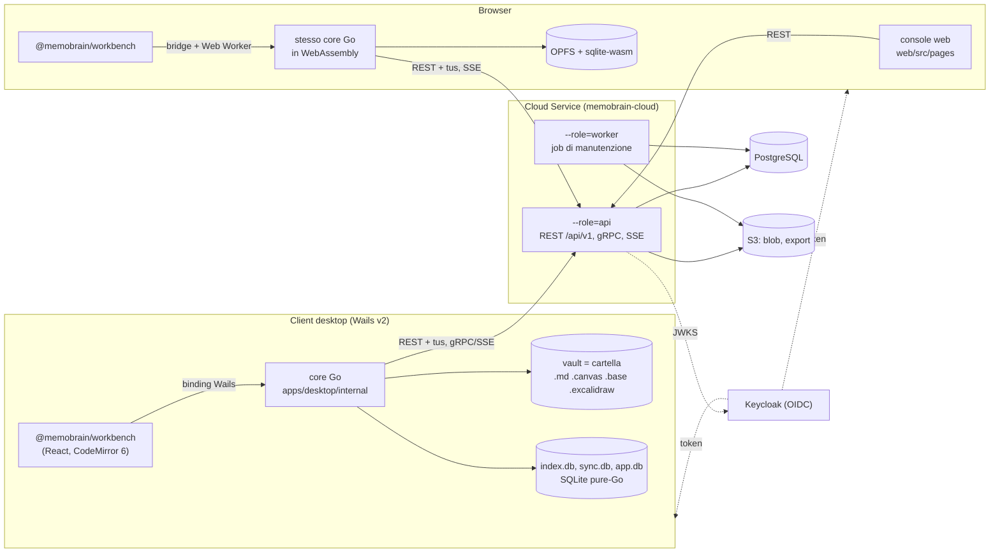

# Architettura di MemoBrain Notes

Panoramica per chi inizia a lavorare sul codice. La fonte di verità resta [`Specifications.md`](../Specifications.md) (architettura, vincoli V-xx, decisioni D-xx); le deviazioni sono negli [ADR](adr/README.md). Per la parità tra desktop e browser c'è una guida dedicata: [desktop-web-sync.md](desktop-web-sync.md).

## Componenti

- **Client desktop** (`apps/desktop`): app Wails v2, una finestra per processo. La UI è il pacchetto condiviso `@memobrain/workbench` (React, CodeMirror 6); la logica è il core Go in `apps/desktop/internal` (vault, indice, link, sync, crittografia), esposto alla UI come binding (`App.Services()`). Funziona offline su un vault che è una cartella di file ordinari, compatibile con Obsidian.
- **Workbench web**: la stessa UI e lo stesso core Go, compilato in WebAssembly (`apps/desktop/cmd/memobrain-core`) e avviato in un Web Worker dalla pagina `/vaults/:id/open` della Web UI. I file stanno in OPFS e gli indici in sqlite-wasm. Il browser è un dispositivo come gli altri (ADR-0029, ADR-0030).
- **Console web** (`web/`): area utente e amministrazione, in React. Parla con la REST attraverso il client TypeScript generato (`@memobrain/api-client`). La console e il workbench sono compilati e incorporati nel binario del cloud (`services/cloud/web-embed`, `go:embed`).
- **Cloud Service** (`services/cloud`): un unico binario Go, _modular monolith_, con `--role=api|worker|all`. Il ruolo `api` serve la REST (`/api/v1`), il gRPC `NotifyService` e il fallback SSE (`GET /api/v1/events`); il ruolo `worker` esegue i job (GC dei blob, upload scaduti, retention, compattazione, purge, riconciliazione delle quote, snapshot, export ZIP). Usa PostgreSQL, uno storage S3-compatibile e Keycloak, rispetto al quale è solo _resource server_: valida i JWT (JWKS, `iss`, `aud=memobrain-api`) e controlla lo stato dell'utente nel proprio database. I gruppi esistono solo nel database del cloud (D-05).
- **Notifiche**: un commit fa `pg_notify`; ogni processo ha una sola connessione `LISTEN` e inoltra gli eventi (`vault_changed`, `config_changed`, `share_changed`, `account_changed`) agli stream gRPC e SSE dei client. Il client reagisce con un pull.

## Sincronizzazione

Il **merge è sempre sul client**: il server ordina e conserva, non interpreta mai il contenuto. Per questo il protocollo è identico per vault privati e condivisi (Specifications.md §3.4, ADR-0009).

1. **Pull:** `GET /vaults/{id}/changes?since=<cursore>` restituisce il changelog del vault, ordinato da un `seq` monotono. Un cursore troppo vecchio (prima di `compaction_seq`) riceve `410 CURSOR_EXPIRED` e il client riparte dall'albero del vault (bootstrap).
2. **Risoluzione sul client:** il core applica le modifiche remote; se un file ha anche modifiche locali fa il merge a tre vie per `.md` e per id per i JSON di canvas ed Excalidraw (`shared/go/merge`). Gli altri tipi producono una copia di conflitto (D-04). I candidati al merge e i path non decifrabili sono persistiti in `sync.db` (`pending_remote`, `quarantine`, ADR-0039), così un crash o un blocco del vault non perdono nulla.
3. **Push:** `POST /vaults/{id}/blobs:check` dice quali blob (content-addressed, SHA-256) mancano; si caricano con `PUT /vaults/{id}/blobs/{sha256}` fino a 32 MB, oltre con tus (`POST /vaults/{id}/uploads`, `PATCH /uploads/{id}`).
4. **Commit:** `POST /vaults/{id}/commit` con `ops[]`; ogni operazione porta la `base_rev` (concorrenza ottimistica) e ha un esito proprio: `accepted`, `conflict` (con la revisione corrente, da fondere) o `rejected` con un codice (`BLOB_MISSING`, `QUOTA_EXCEEDED`, ...). Le revisioni sono immutabili (`rev_no`); nessuna versione viene persa in silenzio, le scartate restano nello storico.

**Rename di cartelle** (§3.4.7, ADR-0040): su un vault condiviso il motore riconosce una cartella rinominata (dalla UI con `Renamed`, o dalla scansione: tutti i file che il server ha sotto la cartella spostati allo stesso posto sotto il nuovo nome, e la vecchia cartella sparita dal disco) e la invia come una sola `move_prefix`, che sposta i file in una transazione e porta con sé le condivisioni; sui vault privati restano le `move` per file, ciascuna col path cifrato di nuovo. Un `SHARE_ROOT_MOVE` (l'ultimo file di una cartella condivisa spostato da solo) diventa la `move_prefix` della radice della condivisione quando il file ha mantenuto il suo posto sotto il nuovo nome; altrimenti lo spostamento resta locale, fermo, e lo stato della sync lo spiega. In arrivo, una serie di `move` che rinomina un'intera cartella locale si applica con un solo rename della directory e una transazione su `sync.db` (`apps/desktop/internal/sync/folders.go`).

La **retention** dello storico e la **compattazione** del changelog sono legate (ADR-0038): quando la retention cancella un'operazione strutturale (create, move, delete, restore), `compaction_seq` avanza, e un client rimasto indietro fa il bootstrap invece di ricevere un changelog con dei buchi. La quota conta solo i file correnti (D-03).

## Vault privati e condivisi (D-02, D-06)

- **Privato:** cifrato end-to-end sul client (`shared/go/vaultcrypto`, con vettori di test condivisi con `packages/vaultcrypto-web`). La VMK da 256 bit è avvolta dalla passphrase (Argon2id) e dalla recovery key; il server vede solo blob e path opachi. Non è condivisibile (`VAULT_ENCRYPTED`); persi passphrase e recovery key, i dati non si recuperano. Dettagli: [security/crypto-design.md](security/crypto-design.md).
- **Condiviso:** non cifrato lato client, condivisibile con utenti e gruppi; una condivisione ricevuta appare come un _mount_, cioè un vault separato.
- La scelta è immutabile (`VAULT_KIND_IMMUTABLE`). Ogni funzione è **per vault** (D-06): nessun link, backlink, grafo, ricerca, segnalibro o template attraversa due vault.

## Dati locali

| File          | Contenuto                                                                                                              | Sincronizzato |
| ------------- | ---------------------------------------------------------------------------------------------------------------------- | ------------- |
| il vault      | i file dell'utente; scritture atomiche (tmp, fsync, rename), niente path traversal, `WriteNote` con `expectedHash`     | sì            |
| `.memobrain/` | configurazione del vault (editor, aspetto, hotkey, workspace), con scope di sync differenziato                         | in parte      |
| `index.db`    | indice SQLite FTS5 (tokenizer `trigram`, driver pure-Go `modernc.org/sqlite`, ADR-0002): link, tag, proprietà, ricerca | no, si rifà   |
| `sync.db`     | stato della sync: cursore, file noti, outbox, conflitti, candidati al merge (`pending_remote`) e quarantena (ADR-0039) | no            |
| `app.db`      | stato dell'app (vault recenti, impostazioni globali); token e chiavi stanno nel keychain del sistema operativo         | no            |

Nel browser gli stessi file stanno in OPFS e i database nel pool `opfs-sahpool` di sqlite-wasm; la copia in chiaro di un vault privato non sopravvive al blocco (ADR-0029 §6, [desktop-web-sync.md](desktop-web-sync.md#host-del-browser)).

## Contratti

- **REST:** [`api/openapi.yaml`](../api/openapi.yaml) è la fonte unica. `task gen-openapi` genera gli stub del server (oapi-codegen, strict server e validatore delle richieste, `services/cloud/internal/api/api.gen.go`), il client Go (`shared/go/apiclient`, usato da `apps/desktop/internal/sync/transport`) e il client TypeScript (`packages/api-client`). Gli errori sono `application/problem+json` con un `code` allineato a `shared/go/syncproto`. tus e SSE sono fuori dal generatore e documentati nell'estensione `x-memobrain-external-routes` (ADR-0037 §3).
- **Notifiche gRPC:** [`api/proto/memobrain/v1/notify.proto`](../api/proto/memobrain/v1/notify.proto) → `shared/go/notifyv1` (buf).
- **Database del cloud:** query per modulo in `services/cloud/internal/db/queries/<modulo>.sql` → `internal/<modulo>/<modulo>db` (sqlc); migrazioni SQL versionate in `internal/db/migrations`.
- **Binding Wails:** i metodi dei servizi Go → `packages/workbench/wailsjs` (generati, non versionati) e, da questi, il client tipizzato dell'host del browser `web/src/workbench/core.gen.ts` (versionato).
- **Eventi Go → TypeScript:** il registro `apps/desktop/internal/app/events_registry.go` → `packages/workbench/src/app/events.gen.ts` (nomi e payload, `task gen-events`). Regole e controlli: [desktop-web-sync.md](desktop-web-sync.md#contratto-degli-eventi) (ADR-0045 §5).
- **Verifiche:** contract test del client contro il server reale (`apps/desktop/internal/sync/transport/contract_test.go`), fixture di conformance Go/TS per Markdown, merge e crittografia (`shared/conformance`), registro di parità (`shared/parity/features.yaml`, con le prove per superficie di ADR-0045). Conformance e registro girano in `task ci` (ADR-0036); il contract test ha il tag `integration` e gira con le altre suite lente in `task test-desktop-e2e`, da eseguire quando si toccano il client della sync o le API.

## Il cloud come modular monolith

Ogni modulo è un pacchetto `services/cloud/internal/<modulo>` con interfacce esplicite. Un modulo dipende solo da `db`, `storage`, `audit`, `notify` e dalle interfacce degli altri moduli, mai dalle loro tabelle: le sue query generate stanno in `<modulo>db`, che solo lui importa (depguard), e gli altri passano dalle funzioni esportate (`exported.go`, con un `db.DBTX`). La mappa delle tabelle e le eccezioni ammesse sono verificate da `internal/db/ownership_test.go` (ADR-0033).

## Osservabilità

- **Metriche Prometheus:** il ruolo `api` espone `/metrics` sullo stesso listener, servito solo a chiamate dirette: una richiesta inoltrata da un proxy o dall'ingress riceve 404. Il ruolo `worker` non ha un listener API: le metriche dei job, `/healthz` e `/readyz` stanno su un listener interno dedicato (`METRICS_LISTEN_ADDR`, default `127.0.0.1:18083`); il `readyz` del worker richiede che lo scheduler batta.
- **Probe:** `/api/v1/healthz` (vivo) e `/api/v1/readyz` (PostgreSQL, S3, Keycloak); i controlli delle dipendenze sono in cache per 2 s e il dettaglio dei controlli va solo ai chiamanti diretti interni (agli altri «ok» o «non disponibile», il resto nel log).
- **Log** JSON con request id (`X-Request-Id`, ripreso nei problem), allarmi e dashboard in `deploy/observability`. Guida: [admin-guide/monitoraggio.md](admin-guide/monitoraggio.md).

## Dove sta cosa

| Area                          | Percorso                                                                       |
| ----------------------------- | ------------------------------------------------------------------------------ |
| Entry del desktop (Wails)     | `apps/desktop/main.go`, `apps/desktop/frontend` (solo entry e e2e)             |
| Core Go (desktop e WASM)      | `apps/desktop/internal/{app,vault,indexer,links,search,sync,crypto,…}`         |
| Core in WebAssembly           | `apps/desktop/cmd/memobrain-core`                                              |
| UI condivisa                  | `packages/workbench`                                                           |
| Gestione dei vault cloud (UI) | `packages/cloud-features` (ADR-0037)                                           |
| Console e host del browser    | `web/src/pages`, `web/src/workbench`                                           |
| Cloud                         | `services/cloud/cmd/memobrain-cloud`, `services/cloud/internal/<modulo>`       |
| Codice Go condiviso           | `shared/go` (`merge`, `vaultcrypto`, `syncproto`, `pathrules`, `apiclient`, …) |
| Fixture condivise             | `shared/conformance`, registro di parità `shared/parity`                       |
| Contratti                     | `api/openapi.yaml`, `api/proto`, `api/config-profile.schema.json`              |
| Distribuzione                 | `deploy/{helm,compose,docker,keycloak,observability}`, `.github/workflows`     |

ADR principali: [0002](adr/0002-sqlite-fts5-trigram.md) (FTS5), [0009](adr/0009-sync-protocol-details.md) (sync), [0029](adr/0029-web-workbench.md) e [0030](adr/0030-desktop-core-wasm.md) (workbench web), [0033](adr/0033-sqlc-per-module.md) (moduli e tabelle), [0036](adr/0036-verifiche-locali-senza-ci.md) (verifiche locali), [0037](adr/0037-registro-funzioni-e-cloud-features.md) (parità e contratti), [0038](adr/0038-retention-e-finestra-changelog.md) (retention), [0039](adr/0039-sync-db-candidati-e-quarantena.md) (sync.db).
